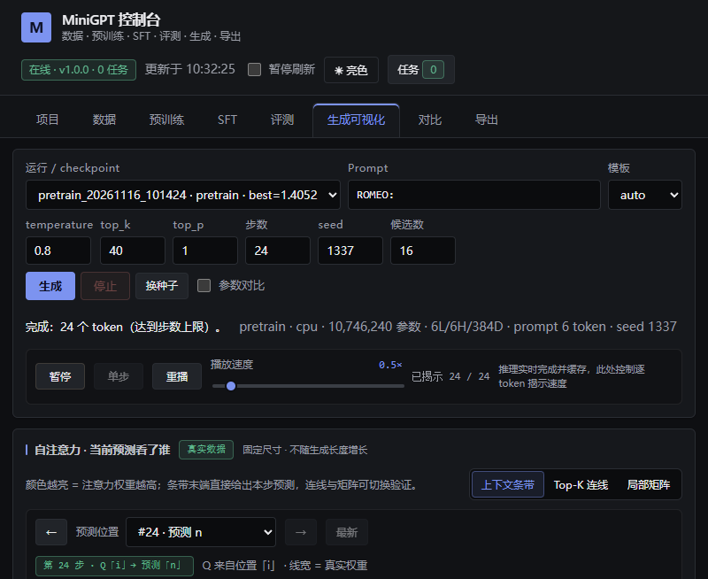

# MiniGPT 完全手册（MANUAL）

> - 适用版本：当前 MiniGPT 实现。
> - 文档定位：**本仓库唯一的长文档**。零基础概念、操作命令、代码导读、实验方法、故障排查、术语与附录全部集中在这里；`README.md` 只是短入口，`CONSTRUCTION.md` 是施工合同（范围/验收/数据许可的唯一依据）。
> - 读者假设：**没有机器学习背景**也能从第 3 章开始读；有经验者可直接跳到第 10 章之后的实操章节。
> - 命令约定：默认给 Windows PowerShell 写法（本机开发环境）；Linux/macOS 只需把 `python` 换成 `python3`、把 `.\.venv\Scripts\python.exe` 换成 `.venv/bin/python`。所有命令都在**项目根目录**执行。
> - 结果说明：本手册第 5–6 章与第 27 章的指标/耗时/截图来自当前参考运行（run_id 见第 27 章），可用相同命令与 seed 复核；**SFT demo 能力很弱、10M 未在本机全量训练**，不要把这些数字外推成“可用助手/大模型效果”。
> - 重要声明：本仓库是**方法/实验室项目**，不是训练好的聊天助手。默认 demo 只训练 0.81M 参数的字符级小模型，合成 SFT 数据只用于验证训练管道；10M 模型**本机没有全量训练**，只提供配置、命令与估算。

## 目录

1. 项目是什么、不是什么
2. 当前能力与使用路径
3. 零基础概念（先读这一章）
4. 安装与环境（Windows / Linux、CPU / GPU）
5. 快速开始：英文 demo（从数据到对话）
6. 快速开始：中文 demo 与公开 SFT 数据
7. 数据准备：语料、字符级 tokenizer、三分与泄漏检查
8. 目录结构、数据流、一次训练到底发生了什么
9. 模型：结构、公式、形状与参数量
10. 预训练：优化器、学习率、AMP、mini-run 门禁、早停与训练产物
11. SFT：对话模板、loss mask、预训练混合与早停
12. 评估：指标、测试纪律与能力边界
13. 对话：`chat.py` 的使用与局限
14. 观察模型：`observe.py`
15. Web 控制面板：面板、任务、配置、API 与安全
16. Checkpoint：字段、resume vs init_from、RNG 与迁移
17. 配置系统：优先级、字段、任意目录运行与移植
18. 部署：局域网、反向代理、Docker 与无 PyTorch 看板
19. 可扩展性：registry、plugin、自定义 callback 与 `ModelBackend` 接口
20. 实验手册：单变量实验、曲线解读与常见误判
21. 故障排查
22. 术语表
23. 附录 A：CLI 速查
24. 附录 B：配置字段总表
25. 附录 C：Checkpoint / events / status / metrics / 数据文件 schema
26. 附录 D：测试与验收对照
27. 附录 E：本机参考结果
28. 代码导读：关键模块与函数
29. 模型打包、交换与部署（MiniGPT Bundle v1）
30. 生成过程可视化：`chat.py --stream` 与 `visualize.py`
31. 纯 Python 后端（Stage 2）：自研张量、自动微分与对拍

---

## 1. 项目是什么、不是什么

### 1.1 一句话定位

MiniGPT 是一个**从零手写的字符级（character-level）小型 GPT 实验室**：它把“数据准备 → 字符 tokenizer → 预训练 → SFT（指令微调）→ 评估 → 对话 → 可视化监控”整条链路用很少的代码完整实现出来，并且每一步都**可复现、可观察、可恢复、可扩展、可移植**。

“字符级”意味着 tokenizer 非常朴素：一个字符就是一个 token（中文一个字、英文一个字母/标点都是一个 token）。为什么先做字符级？因为它没有 BPE 合并规则、没有词表训练算法，**所有复杂度都留给模型本身**，最适合零基础看清“一次训练到底发生了什么”。代价是：要比 BPE 多算很多 token，模型能学到的上下文也更短。

### 1.2 这个项目有什么

| 能力 | 对应实现 | 入口 |
|---|---|---|
| 语料下载/清洗、字符 tokenizer、90/5/5 三分 | `prepare.py`、`minigpt/data/`、`minigpt/tokenization/` | `python prepare.py --dataset shakespeare_en` |
| 预训练（AdamW、warmup+cosine、AMP、梯度累积、早停、best/last） | `pretrain.py`、`minigpt/training/` | `python pretrain.py --preset debug_en` |
| SFT（Q/A 模板、-100 loss mask、15% 预训练混合） | `sft.py`、`prepare_sft.py` | `python sft.py --preset sft_debug_en --init_from <ckpt>` |
| 评估（PPL/BPC/EM/char F1/重复率/空回答率，test 只碰一次） | `evaluate.py`、`minigpt/eval/metrics.py` | `python evaluate.py --checkpoint <ckpt> --split test` |
| 对话（温度/top-k/top-p/EOS/交互模式） | `chat.py` | `python chat.py --checkpoint <ckpt> --interactive` |
| 生成过程可视化（逐 token 概率、采样过程、注意力、hidden） | `chat.py --stream`、`visualize.py`、Web `#/generate` | `python visualize.py --checkpoint <ckpt>` |
| 模型观察（参数量、初始 loss、next-token 概率、attention） | `observe.py` | `python observe.py --checkpoint <ckpt> --attention` |
| 可交换推理包（config/权重/tokenizer/模型卡/CLI/HTTP） | `export.py`、`minigpt/bundle.py`、`bundle_templates/` | `python export.py --checkpoint <ckpt>` |
| 实验监控 Web 面板（启停任务、在线编辑/校验配置、实时曲线） | `dashboard.py`、`minigpt/web/`、`web/` | `python dashboard.py` |
| 可恢复训练（checkpoint 内嵌 optimizer/RNG/tokenizer） | `minigpt/training/checkpoint.py` | `--resume --run_name <run>` |
| 可扩展（registry、plugin、`ModelBackend` 协议） | `minigpt/registry.py`、`minigpt/backends/` | `--plugins my_plugin.py` |
| 测试与移植验证 | `tests/`（`unittest`） | `python -m unittest discover -s tests -v` |

### 1.3 这个项目**不是**什么（请在开始前接受这几点）

- **不是训练好的聊天助手。** 0.81M 参数的字符级模型只能学到“像训练语料的文本”，不能可靠回答事实问题；合成 SFT 数据（`data/demo_sft_*.jsonl`）**只用于验证训练管道**（证明“数据 → loss 下降 → 能生成”这条路走通），不代表真实能力。
- **不是 10M 模型的训练交付。** 10M 配置（`en_10m`/`zh_10m`/`sft_10m`）可以实例化、校验参数、跑 2–3 步冒烟，但**本机没有全量训练**；全量训练需要更强机器。
- **不是 BPE/多模态/RLHF/分布式训练框架。** 这些是明确的非目标。
- **不是性能工程。** 数据只有 1–10MB 量级，故意不用 numpy（数据二进制读写用标准库 `array`/`struct`），CPU 上跑几分钟到几十分钟；目标是“看得懂”，不是“训得快”。
- **不保证可复现到“跨机器逐位一致”**：同一机器、同一环境、同一 seed 下可以复现；换 GPU/驱动/算子实现时，浮点结果可能有微小差异，这属于正常现象（第 16 章会解释哪些东西被固定、哪些没有）。

### 1.4 文档与目录规则（为什么只有一份手册）

施工合同（`CONSTRUCTION.md` §0）规定：`README.md` 是短入口（≤120 行），`MANUAL.md` 是唯一长手册，**不创建 `docs/*.md` 或其他长篇说明**。这样做是为了防止“文档漂移”：同一件事只在一处解释，代码改动时只改一处。代码内部只保留模块/函数 docstring 和必要注释。

---

## 2. 当前能力与使用路径

### 2.1 建议学习路径（零基础按顺序来）

| 顺序 | 章节 | 你会得到什么 |
|---|---|---|
| 1 | 第 3 章 零基础概念 | 看懂 token/loss/attention/SFT 等名词，知道它们为什么存在 |
| 2 | 第 4 章 安装 | 一个能跑 PyTorch 的 Python 环境，并验证通过 |
| 3 | 第 5 章 英文快速开始 | 亲手跑通“准备数据 → mini-run 门禁 → 生成文本 → 看板” |
| 4 | 第 7、8 章 数据/数据流 | 明白 `data/` 里每个文件的来历与去向 |
| 5 | 第 9 章 模型 | 能算参数量、能解释 causal mask / Pre-LN / weight tying |
| 6 | 第 10、11 章 预训练与 SFT | 能读 `metrics.csv`、能判断训练是否正常、能解释 loss mask |
| 7 | 第 12、13、14 章 评估/对话/观察 | 能正确评估测试集、能解释生成参数、能查模型内部 |
| 8 | 第 15、16、17 章 看板/checkpoint/配置 | 能远程监控、能恢复训练、能把项目搬到别处 |
| 9 | 第 18、19、20 章 部署/扩展/实验 | 能部署、能写插件、能设计单变量实验 |
| 10 | 第 21–28 章 排错/术语/附录/代码导读 | 遇到问题能自查，能顺着代码读下去 |

### 2.2 当前实现范围

- **当前实现**：PyTorch 全流程（数据准备 → 字符级 tokenizer → 预训练 → SFT → 评估 → 对话）、中英文双主 demo、Web 控制面板、checkpoint 恢复、测试与移植、模型包导出。
- **当前规模**：debug 配置 0.81M 参数可训练/导出；10M 配置（6 层/6 头/384 维/block 256）已在本机 CPU 完整跑过一次 5000 步预训练（`runs/pretrain_20261116_101424`，约 14 小时，best val 1.4052），但**没有做 10M 的 SFT 与 test 评估**。
- **当前不包含**：纯后端的大模型训练（0.81M/10M 在纯 Python 下不实用）、严格 `transformers` 兼容、BPE/子词 tokenizer、HF Hub 上传。（纯 Python Tensor/autograd 后端已实现，见第 31 章。）
- **当前扩展点**：`ModelBackend` 协议、registry、`--plugins` 和自定义 callback（第 19 章）；当前有 `TorchBackend` 与 `PureBackend`（第 31 章）。

### 2.3 两个主 demo 的定位

| demo | 语料 | 模型 | 步骤 | 目的 |
|---|---|---|---|---|
| 英文 | Tiny Shakespeare（1,115,394 字节，公版） | debug 4 层/4 头/128 维/block 128，约 0.81M 参数 | 预训练 3000 步 + 合成 SFT 300 步 | 主验证：初始 loss ≈ 4.22（`ln 68`），最终 val loss 目标 < 2.2（参考结果 best val 1.9539） |
| 中文 | Project Gutenberg 公版中文书（默认 6 本；当前 demo 用单本 23950） | 同上 debug 配置（当前 V=5,375） | 预训练 500–1000 步 + 合成 SFT 300 步 | 证明中英文共用一套代码/配置/指标框架；初始 loss ≈ `ln(词表)`（参考结果 8.6087），**只看相对下降**，不套用英文阈值 |
| 公开 SFT | `shibing624/alpaca-zh` 采样 500–1000 条 | 接在中文预训练权重后 | 150–300 步 smoke | 证明真实公开指令数据的导入路径可用；**CC BY-NC 4.0，仅研究，只缓存不提交** |

> 当前参考结果：英文 debug 预训练 best val **1.9539**（test PPL 7.3347）、中文 debug 预训练 best val **5.0775**（test PPL 175.16）；合成 SFT 的 test 指标很弱（exact_match=0，英文空回答率 0.32、中文 0.64），只证明管道跑通。完整结果、run_id 与耗时见第 27 章。


---

## 3. 零基础概念（先读这一章）

这一章不要求任何数学/机器学习基础。每个词都回答三个问题：**它是什么、为什么需要、在代码里长什么样**。读完后再看第 5 章的实操会顺畅很多。

### 3.1 文本是怎么变成数字的：token、tokenizer、词表

模型只会做数字运算，所以文本必须先变成整数序列。

- **token**：模型处理的最小单位。本项目是**字符级**：一个 token = 一个字符。英文 `hello` 是 5 个 token；中文 `你好` 是 2 个 token。
- **tokenizer（分词器）**：把字符串 ↔ token 整数序列互相转换的程序。本项目唯一实现是 `CharTokenizer`（`minigpt/tokenization/char.py`）。
- **词表 / vocab**：所有合法 token 的集合。本项目的词表 = **训练集文本里出现过的不同字符** + 3 个特殊 token。
- **特殊 token**：`<unk>`（id 0，未知字符）、`<eos>`（id 1，序列结束/回答结束）、`<pad>`（id 2，填充）。它们的 id **固定写在 tokenizer 状态里**，从 checkpoint 恢复后也不会变。
- 为什么只用**训练集**构建词表？如果用全量文本构建，验证集/测试集的字符信息就“泄漏”进了词表，评估会偏乐观；只用训练集构建，val/test 里没见过的字符统一变 `<unk>`，这个比例叫 **unk rate**，数据准备时会被统计出来。
- 为什么特殊 token 用固定 id？checkpoint 里保存了 tokenizer 状态（字符列表 + specials 映射），换机器/换目录后仍能把 id 还原成同一个字符；否则 checkpoint 就和 tokenizer 绑死了。

Tiny Shakespeare 的词表是 **68 = 65 个不同字符 + 3 个特殊 token**，所以模型“认识”的只有 65 种字符。

### 3.2 embedding：把 token 变成向量

- **embedding（嵌入）**：一张可学习的查找表，矩阵形状 `(词表大小 V, 向量维度 C)`。输入 token id，查表得到一行 C 维向量。
- 为什么需要？1 个整数没有“语义距离”，变成 128 维向量后，模型可以通过训练让相近的字符/用法获得相近的向量。
- **位置 embedding**：注意力本身不知道顺序，因此额外加一张 `(最大长度 block_size, C)` 的可学习位置表，第 0 个位置用第 0 行，以此类推。本项目用**可学习的绝对位置**（不是正弦位置编码）。
- 代码里：`wte`（token embedding）+ `wpe`（position embedding），两者相加得到输入表示。英文 debug 模型里 `wte` 有 `68×128=8,704` 个参数，`wpe` 有 `128×128=16,384` 个参数。

### 3.3 attention：让每个 token 看其他 token

一句话：对每个位置，模型想知道“为了预测下一个字符，应该关注前面哪些位置、关注多少”。

- **Q/K/V**：输入向量分别乘三个矩阵，得到 Query（我在找什么）、Key（我能提供什么）、Value（我实际携带的信息）。
- **注意力分数**：`Q·Kᵀ / √D`（D 是每个头的维度），分数越高表示“这个位置越相关”。
- **softmax**：把一组分数变成概率（非负、和为 1），也就是“关注权重”。
- **加权求和**：用权重对 V 加权求和，得到该位置的输出。
- **multi-head（多头）**：把 C 维切成 H 个头并行做注意力，再拼回去。多个头可以分别关注不同模式（上一个字符、单词开头、标点等）。本项目 debug 模型 H=4、每头 32 维（128/4）。
- 代码里：`c_attn` 一次性算出 QKV（合并投影，数学上等价于 3 个独立线性层），`c_proj` 把多头结果投影回 C 维。

### 3.4 causal mask：不许偷看右侧位置

语言模型的训练目标是“根据前文预测下一个 token”。如果注意力能看到后面的 token，它就等于直接看答案，loss 会假性变低，训练完却不会生成。

- **causal mask（因果掩码）**：一个下三角矩阵；注意力分数矩阵中，位置 `t` 只能看 `≤ t` 的位置，右上角（右侧位置）置为 `-∞`，softmax 后权重为 0。
- 为什么叫“因果”？因为每个位置只依赖它之前的输入，符合“生成时只能看到已生成内容”的因果顺序。
- 代码里：`CausalSelfAttention` 注册一个 `persistent=False` 的下三角 buffer（不写入 checkpoint，因为它是推导出来的、不需要学习）。
- 形状：`(B, H, T, T)`，`B`=batch，`H`=头数，`T`=序列长度；`T` 不能超过 `block_size`。

### 3.5 一次前向：从 token 到 logits

```
token id (B,T)
  → token embedding + 位置 embedding      (B,T,C)
  → N 个 Transformer block（Pre-LN 注意力 + 残差；Pre-LN MLP + 残差）
  → 最终 LayerNorm                        (B,T,C)
  → LM head（与 token embedding 共享权重） (B,T,V)
  → logits：每个位置对词表里每个 token 的“打分”
```

- **logits**：未归一化的分数。`softmax(logits)` 后才是“下一个 token 是某个字符的概率”。
- **残差（residual）**：`x = x + f(x)`，让梯度能直接流过深层网络，是深层网络可训练的关键。
- **LayerNorm**：把每个位置的 C 维向量归一化（均值 0、方差 1 再缩放），稳定训练。
- **Pre-LN**：先归一化再进注意力/MLP（本项目采用），比原始 Transformer 的 Post-LN 更容易训练。
- **GELU**：MLP 里的激活函数（本项目用 tanh 近似版本）。
- **weight tying（权重共享）**：输入 embedding 矩阵和输出 LM head 矩阵共享同一份参数。为什么？输入和输出都是“字符 ↔ 向量”的映射，共享可以减少参数、也让小模型更稳定。本项目默认 `tie_weights=true`，所以 LM head 不额外占参数。
- **无 bias**：Linear/LayerNorm 默认不带 bias，进一步减少参数（GPT-2 之后常见做法）。

### 3.6 loss、交叉熵、PPL、BPC

- **loss（损失）**：一个数字，衡量模型预测得有多差；训练就是让 loss 变小。
- **交叉熵（cross-entropy）**：语言模型的标准 loss。对每个位置，模型给出词表上的概率分布，正确答案是“下一个 token”；交叉熵 = `-log(模型给正确答案的概率)`。答得越对，loss 越小。
- **初始 loss 的期望**：随机初始化时模型近似均匀猜测，所以初始 loss ≈ `ln(词表大小 V)`。英文 V=68 → `ln 68 ≈ 4.22`；中文词表几千 → `ln(V) ≈ 8.x`。**mini-run 门禁就用这个常识判断“模型/数据/损失是否接错了”。**
- **perplexity（PPL，困惑度）**：`exp(loss)`，可以理解为“模型平均在多少个候选里犹豫”。PPL 越小越好；但**不同 tokenizer 的 PPL 不可直接比较**（字符级和 BPE 的 token 粒度不同）。
- **BPC（bits per character，每字符比特数）**：`loss / ln 2`。字符级模型里它表示“平均每个字符需要多少 bit 才能编码”，与 tokenizer 无关，比 PPL 更适合跨配置比较。
- 代码里：`F.cross_entropy(logits.reshape(-1, V), targets.reshape(-1), ignore_index=-100)`。**`ignore_index=-100` 表示这些位置的标签不参与 loss**（SFT 里用来屏蔽问题部分和 padding）。

### 3.7 训练：梯度、优化器、学习率、batch

- **反向传播（backprop）**：自动算出“每个参数往哪个方向改、改多少”（梯度）。
- **优化器**：根据梯度更新参数。本项目用 **AdamW**（带权重衰减的 Adam 变体），是 GPT 类模型的标准选择。
- **学习率（lr）**：每次参数更新的步长。太大会发散（loss 变 NaN），太小会学不动。
- **warmup + cosine**：先用较小 lr 线性升到目标值（warmup，避免一开始就把随机初始化的模型带偏），再按余弦曲线慢慢降到 `min_lr`（收敛更稳）。本项目每步在更新前设置 lr。
- **batch（批）**：一次并行处理多少条序列。**micro-batch** 是显存放不下的折中：先算几个小批的梯度、累加后再更新一次，叫**梯度累积**；有效 batch = `batch_size × grad_accum_steps`。
- **step（步）**：一次参数更新。一个 step 通常处理 `batch_size × block_size` 个 token（再乘累积次数）。
- **梯度裁剪（grad clip）**：梯度的范数超过阈值就等比缩小，防止偶发的大梯度把模型带崩（本项目 clip=1.0）。
- **AMP（自动混合精度）**：用 bfloat16/float16 做部分计算省显存/加速；CPU 默认 float32，CUDA 自动选 bf16（支持时）或 fp16 + 梯度缩放。**CPU 上不要指定 float16**，PyTorch 不支持 CPU 的 float16 autocast，会直接报错。
- **非有限梯度/损失**：出现 NaN/Inf 时跳过这次优化器更新，避免污染权重。

### 3.8 train / val / test 三份数据

- **train（训练集）**：模型参数从这里学。
- **val（验证集）**：训练过程中用来评估“泛化能力”，并据此保存 best checkpoint、触发早停。**调超参只用 val。**
- **test（测试集）**：最终成绩，**只碰一次**。如果你反复用 test 调参，test 就变相成了验证集，最终数字会虚高（这叫 test 污染）。
- 为什么必须分开？模型可能在 train 上“背下来”（过拟合）。只有没参与训练的数据才能反映真实泛化。
- 本项目预训练按**连续字符区间**切 90/5/5（不随机打乱，见第 7 章）；SFT 按**group（归一化问题）**切，保证同一问题的不同表述不跨集合。

### 3.9 checkpoint：训练的“存档”

- **checkpoint**：把模型权重、优化器状态、当前步数、最佳分数、RNG 状态、tokenizer 状态等打包存盘（本项目是单个 `.pt` 文件）。
- **为什么需要？** 训练可能中断（关机/崩溃/主动停止），恢复时要能“从断点继续”，而不是从头再来。
- 本项目每个 run 目录有：
  - `best.pt`：验证集 loss 最好的那次权重（用于评估/对话）；
  - `last.pt`：最近一次保存（用于 `--resume` 继续训练）；
  - 纯后端（`--backend_type pure`）对应 **`best.mgckpt` / `last.mgckpt`**：字段相同，格式是 JSON 头 + float64 张量 + sha256（v2；v1 的 float32 文件仍可读，见第 31.8 节）。
- **RNG（随机数生成器）状态**：数据采样顺序、dropout、生成采样都依赖随机数。恢复训练时必须连 RNG 一起恢复，才能“接着原来的随机流”继续跑。

### 3.10 SFT、loss mask 与对话模板

- **预训练**：用海量纯文本训练“根据前文预测下一个 token”的能力。模型学会语法/风格/知识片段，但**不会听指令**。
- **SFT（Supervised Fine-Tuning，监督微调）**：用“问题 → 回答”的样本继续训练，让模型学会“看到问题后按格式回答”。
- **对话模板**：本项目固定为

  ```text
  Q: {question}
  A: {answer}<eos>
  ```

  训练和推理必须用**完全一样**的模板（`chat.py` 里就是 `f"Q: {question}\nA: "`），否则模型见到的格式和训练时不一致，效果会明显变差。
- **loss mask（损失掩码）**：SFT 时问题部分只是“上下文”，我们只想让模型学会“生成回答”，不想让它学着复述问题。因此把问题 token 和 padding 的标签设为 `-100`（PyTorch 的 ignore 约定），**只有回答 + `<eos>` 参与 loss**。
- `<eos>` 为什么参与 loss？让模型学会“回答完就停”，生成时遇到 EOS 就结束。

### 3.11 生成：temperature、top-k、top-p、EOS

- **贪心（greedy）**：每步取概率最大的 token；`temperature <= 0` 时本项目走贪心。
- **temperature（温度）**：把 logits 除以 T。T < 1 更确定/保守，T > 1 更随机/发散。
- **top-k**：只保留概率最高的 k 个候选，其余概率置 0，防止抽到极不可能的字。
- **top-p（nucleus）**：保留累计概率达到 p 的最小候选集合（本项目先做 top-k 再做 top-p）。
- **EOS 停止**：生成到 `<eos>` 就结束；否则到 `max_new_tokens` 强制停。
- 为什么需要这些参数？贪心容易重复、太随机容易跑题；temperature/top-k/top-p 是在“稳定”和“多样”之间调平衡。

### 3.12 观察指标与实验术语

- **指标（metric）**：衡量模型表现的数字，如 val_loss、PPL、BPC、EM、char F1、重复率。
- **早停（early stopping）**：验证集 loss 连续 N 次评估都不再变好就停止训练，节省时间并防止过拟合；`patience` 就是 N。
- **超参数**：不由训练学出来、由人设定的参数（lr、batch_size、block_size、dropout 等）。
- **seed（随机种子）**：固定随机数序列，使实验可复现。本项目训练 seed 默认 1337，评估 seed 默认 1234。
- **run / run_id**：一次训练实验。每个 run 在 `runs/<run_id>/` 下留下完整档案。
- **telemetry（遥测）/ 事件**：训练过程写出的结构化记录（`events.jsonl`、`status.json`、`metrics.csv`），看板据此实时显示。

---

## 4. 安装与环境（Windows / Linux、CPU / GPU）

### 4.1 环境要求

| 项目 | 要求 | 说明 |
|---|---|---|
| Python | 3.10+（本机 3.14.5 实测可用） | 只用标准库 + PyTorch |
| 运行时依赖 | `torch>=2.1,<3`（`requirements.txt` 唯一依赖） | 不需要 numpy/pytest/transformers 等 |
| 操作系统 | Windows / Linux / macOS | 路径用 `pathlib`，无平台专用 API |
| 磁盘 | 数据 1–10MB + checkpoint 每份约 10–40MB | 中文语料与 10M 权重另算 |
| 内存 | CPU 训练 debug 模型 1–2GB 足够 | 数据集全部加载也只有几 MB |
| GPU | **可选**。本机 Quadro K2200 4GB + 驱动 446.14 太旧，现代 PyTorch 不可用，使用 CPU | 有现代 NVIDIA GPU 时按第 4.3 节装 CUDA 版 |

### 4.2 Windows 安装（本机路径）

```powershell
# 1) 在项目根目录创建虚拟环境（本仓库已带 .venv，可跳过这步）
python -m venv .venv

# 2) 升级 pip（可选）
.\.venv\Scripts\python.exe -m pip install --upgrade pip

# 3) 安装 CPU 版 PyTorch（唯一第三方依赖；CPU 版小很多）
.\.venv\Scripts\python.exe -m pip install torch --index-url https://download.pytorch.org/whl/cpu

# 4) 验证：应打印 torch 版本（本机为 2.15.0+cpu）与 CPU 信息
.\.venv\Scripts\python.exe -c "import torch; print(torch.__version__, torch.cuda.is_available())"
```

安装完成后，本手册其余命令里的 `python` 都指 **`.\.venv\Scripts\python.exe`**。之所以强调“用对解释器”：系统 Python 可能没装 PyTorch，而看板（`dashboard.py`）恰好**不需要** PyTorch，所以两者可以分开（第 18 章）。

### 4.3 有现代 NVIDIA GPU 时（Linux 示例）

```bash
python -m venv .venv
source .venv/bin/activate
# 按 CUDA 版本选择 PyTorch 官方安装命令，例如：
pip install torch --index-url https://download.pytorch.org/whl/cu124
python -c "import torch; print(torch.__version__, torch.cuda.is_available())"
```

- GPU 上训练时 `--device auto` 会自动选 `cuda`；`--dtype auto` 在 CUDA 上优先 bfloat16（不支持则 float16 + GradScaler），CPU 上固定 float32。
- 想强制指定：`--device cuda --dtype bfloat16`；CPU 上 `--dtype float16` 会报错（不支持），`--dtype bfloat16` 在部分 CPU 上也可用。
- 旧 GPU（如本机 Quadro K2200、驱动 446.14）不要强行装旧 PyTorch：既不安全也不划算，CPU 跑 debug demo 完全够用。

### 4.4 Linux / macOS 安装

```bash
python3 -m venv .venv
source .venv/bin/activate
pip install torch --index-url https://download.pytorch.org/whl/cpu   # CPU
# 或按 https://pytorch.org 选择对应 CUDA 版本
python -c "import torch; print(torch.__version__)"
```

### 4.5 验证安装（三个检查）

```powershell
# 1) PyTorch 可用
.\.venv\Scripts\python.exe -c "import torch; print('torch', torch.__version__)"
# 期望：torch 2.15.0+cpu（版本号随安装变化）

# 2) CLI 能启动（任意 cwd 都应能跑，见第 17.5 节）
.\.venv\Scripts\python.exe prepare.py --help

# 3) 单元测试（需要已准备英文数据；没准备会 skip 部分测试）
.\.venv\Scripts\python.exe -m unittest discover -s tests -v
```

参考结果：`.\.venv\Scripts\python.exe -m unittest discover -s tests -v` → **Ran 501 tests in ~60s, OK**（以实际运行为准；模块清单见 D.1）。


### 4.6 为什么有 `_bootstrap.py`

每个命令行脚本第一行都 `import _bootstrap`。它做三件事：

1. 把**项目根目录**加入 `sys.path`，这样即使你在 `C:\Users\...` 或 `/tmp` 下用绝对路径运行 `python C:\path\to\MiniGPT\prepare.py`，也能 `import minigpt`；
2. 把 stdout/stderr 重配为 UTF-8（`errors="replace"`），避免 Windows 控制台默认 GBK 把中文样本/日志变成乱码；
3. 屏蔽 PyTorch 因缺少 numpy 而打印的 `Failed to initialize NumPy` 噪声警告（numpy 是被故意禁止的依赖）。

项目根默认由 `_bootstrap.py` 的文件位置自动推断；需要把代码和数据分开放时，用环境变量 `MINIGPT_ROOT` 指定（第 17 章）。

---

## 5. 快速开始：英文 demo（从数据到对话）

> 本章是**动手章节**：按顺序敲命令即可，每条命令都给出“你应该看到什么”和“为什么”。本机 CPU 的实测结果与耗时见第 27 章（英文 3000 步约 287 秒、中文 1000 步约 111 秒），你可以用实际输出对照。

### 5.1 第 0 步：确认解释器与目录

所有命令都在**项目根目录**执行（本机 `C:\Users\Administrator\Desktop\MiniGPT`）。先确认 PyTorch 可用：

```powershell
.\.venv\Scripts\python.exe -c "import torch; print(torch.__version__)"
# 期望类似：2.15.0+cpu
```

如果报 `ModuleNotFoundError: No module named 'torch'`，回到第 4 章装依赖；如果你用的系统 Python 没装 torch，就统一换成 `.\.venv\Scripts\python.exe`。

### 5.2 第 1 步：准备英文数据 `prepare.py`

```powershell
.\.venv\Scripts\python.exe prepare.py --dataset shakespeare_en
```

这条命令会：下载 Tiny Shakespeare（约 1.1MB，主源 jsDelivr，失败回退 raw.githubusercontent.com）→ 校验固定 sha256（`86c4e6aa9db7c042ec79f339dcb96d42b0075e16b8fc2e86bf0ca57e2dc565ed`）→ 统一换行清洗 → **只用 train 部分**构建字符级 tokenizer → 连续切分 90/5/5 → 写出二进制 token 文件与元数据。产物在 `data/shakespeare_en/`。

**你应该看到（参考结果）：**

```text
[prepare] 获取 Tiny Shakespeare（sha256=86c4e6aa9db7...）
[prepare] dataset=shakespeare_en  来源=download
[prepare] 语料：1,115,394 字符 -> 1,115,394 tokens
[prepare] 词表：68（65 字符 + 3 特殊 token）
[prepare] 切分：train=1,003,854  val=55,769  test=55,771
[prepare] unk rate：train=0.0000%  val=0.0000%  test=0.0000%
[prepare] 输出目录：C:\Users\Administrator\Desktop\MiniGPT\data\shakespeare_en
[prepare] 已写出：train.bin val.bin test.bin tokenizer.json meta.json split_report.json
```

产物清单：

| 文件 | 内容 | 用途 |
|---|---|---|
| `train.bin` / `val.bin` / `test.bin` | token id 的 uint16 小端二进制 | `PretrainSource` 读取训练/评估窗口 |
| `tokenizer.json` | 字符列表 + 特殊 token id（state_dict） | 训练、SFT、评估、对话 |
| `meta.json` | 数据来源、sha256、词表大小、三份 token 数、unk rate、创建时间 | 训练器写 checkpoint 的 `data_meta`；看板显示 |
| `split_report.json` | 切分边界（字符偏移）、每份字符/token 数、unk 字符样例 | 泄漏检查、人工复核 |

**为什么数字是这些？** 英文语料 1,115,394 字符，切分规则是 `train=floor(N×(1−val−test))`、`val=floor(N×val)`、`test=剩下全部`；字符级下 token 数 = 字符数（没有合并，且 train 覆盖了全部 65 种字符，所以 val/test 的 unk rate 为 0）。词表 68 = 65 个不同字符 + `<unk>/<eos>/<pad>`。

> 数据只需准备一次；重复执行会复用 `data/raw/` 缓存并覆盖重写输出，因此**不要在训练进行时重跑 prepare**（会改动数据文件）。

### 5.3 第 2 步：mini-run 门禁（先证明管线是通的）

不要一上来就跑 3000 步；先用缩小版训练（**block/batch 减半、200 步、固定评估、早停关闭**）验证整条管线：

```powershell
.\.venv\Scripts\python.exe pretrain.py --preset debug_en --mini_run --run_name demo
```

**你应该看到（参考运行 `demo-en-pretrain-mini`）：**

```text
[sanity] vocab=68 initial_loss=4.2586 expected~4.2195
[run] demo-en-pretrain-mini stage=pretrain params=812672 device=cpu max_steps=200
[10/200] loss=... lr=... grad=... tok/s=...
[eval] step=20 val_loss=... best=...
...
[mini-run] PASS
{
  "passed": true, "vocab_size": 68, "expected_initial_loss": 4.219507705176107,
  "initial_loss": 4.258608818054199, "initial_loss_abs_diff": 0.03910111287809226,
  "initial_loss_ok": true,
  "grad_norms_count": 200, "grad_norm_min": 1.0249956846237183, "grad_norm_max": 22.086153030395508,
  "gradient_ok": true, "final_train_loss": 2.578062057495117, "loss_drop": 1.680546760559082,
  "loss_drop_ok": true, "loss_tolerance": 0.5, "min_drop": 0.2
}
```

产物在 `runs/demo-mini/`：`last.pt`、`metrics.csv`、`events.jsonl`、`status.json`、`training_report.json`、`minirun_report.json` 等。**PASS 的三个判据**（第 10.7 节详细解释）：

1. 初始 loss 与 `ln(词表大小)` 的偏差 ≤ 0.5（英文 68 → 4.2195）；
2. 梯度范数全部有限、非负，且至少有一个 > 0；
3. 前 200 步训练 loss 下降 ≥ 0.2。

**参考结果：** 英文 `demo-en-pretrain-mini` → initial 4.2586（差 0.0391）、grad 1.025～22.086、loss drop 1.6805、200 步、9.1 秒，PASS；中文 `demo-zh-pretrain-mini` → initial 8.5927（期望 8.5895，差 0.0031）、grad 0.822～4.121、loss drop 2.8010、200 步、9.5 秒，PASS。两条管线都通过门禁。

如果 FAIL，先别继续：通常是数据没准备、tokenizer 与数据不匹配、或训练/损失接错。看 `runs/demo-mini/minirun_report.json` 里哪一项为 false，再查第 21 章。

`--run_name` 是**目录名**（也是看板里的运行名），不写会自动生成 `时间戳-stage-seed-随机串`。mini-run 目录名会在其后加 `-mini`，所以 `--run_name demo` 对应 `runs/demo-mini/`。

### 5.4 第 3 步：观察模型（不用等训练完）

```powershell
.\.venv\Scripts\python.exe observe.py --checkpoint runs/demo-mini/last.pt --prompt "ROMEO:" --top_k 5
```

这是**只观察、不训练**的工具。它打印参数量、下一步各 token 的概率；加 `--attention` 还能打印每个头的注意力熵与 ASCII 注意力图。

**你应该看到（随机/半成品权重下，具体数字每次不同但格式固定）：**

```text
stage=pretrain params=812,672 embedding_params=25,088 non_embedding=787,584
config={'block_size': 128, 'vocab_size': 68, ...} device={'backend': 'torch', 'device': 'cpu', ...}
vocab=68 initial_loss_expected~4.2195
next-token top-k:
  ':': 0.0xxx
  'f': 0.0xxx
  ...
```

> 注意：mini-run 只跑了 200 步缩小配置，生成的文本大概率是“看起来像英文、实际没意义”的字符流，**这是正常的**。想看像样的 Shakespeare 续写，需要跑完 5.5 的完整 demo。

### 5.5 第 4 步：完整英文 demo（3000 步预训练）

```powershell
.\.venv\Scripts\python.exe pretrain.py --preset debug_en --run_name en-pretrain
```

`debug_en` 的固定配方（第 10 章解释每个字段）：4 层/4 头/128 维、block 128、batch 8、3000 步、lr 1e-3、warmup 100、每 200 步评估 50 个 batch、每 500 步存 last、早停 patience=10。

**你应该看到（参考结果，run_id `demo-en-pretrain`）：**

```text
[sanity] vocab=68 initial_loss=4.2707 expected~4.2195
[run] demo-en-pretrain stage=pretrain params=812672 device=cpu max_steps=3000
[1/3000] loss=4.2707 lr=1.00e-05 grad=... tok/s=...
[20/3000] ...
[eval] step=200 val_loss=... ppl=... best=...
...
[eval] step=3000 val_loss=1.95388 ppl=7.0560 best=1.95388
[done] best_val=1.9539 best_step=3000 elapsed=4m47s
```

| 指标 | 参考结果（demo-en-pretrain） |
|---|---|
| 初始 loss | 4.2707（期望 ln 68=4.2195，偏差 0.051，正常） |
| best val loss / step | **1.95388 @ step 3000**（未早停，val 仍在改善） |
| 最终 train loss | 1.9910 |
| test 评估 | loss 1.99261 / PPL 7.3347 / BPC 2.8747（20,480 tokens） |
| 总耗时 / 吞吐 | **286.9 秒（约 4m47s）/ 约 10.7k tokens/s**（CPU） |
| 3000 步样本（`samples.jsonl` 最后一条） | 见下 |

```text
ROMEO:
God bre of the andser
If he is ancem the to think and.'

LOUCESS:
I call, un, h
```

- 训练过程中每 20 步打印一行（`log_interval=20`），每 200 步评估一次并写 `metrics.csv` 一行（3000/200 = 15 行数据），best 变好时覆盖保存 `best.pt`。
- **CPU 上 3000 步需要多久？** 参考结果 **286.9 秒**；这是“代码/数据正确 + CPU 可接受”的量级，不是性能基准。想快速看趋势可临时 `--max_steps 300 --eval_interval 50`（不作为正式 demo 结果）。

训练结束后关键文件：

| 文件 | 说明 |
|---|---|
| `runs/en-pretrain/best.pt` | 验证 loss 最好的一次权重；**评估/SFT 使用它** |
| `runs/en-pretrain/last.pt` | 最近一次保存；用于 `--resume` |
| `runs/en-pretrain/metrics.csv` | 一个 step 一行：loss/PPL/BPC/lr/grad/tokens/s/best |
| `runs/en-pretrain/events.jsonl` | 结构化事件流（看板用） |
| `runs/en-pretrain/training_report.json` | 最终报告：状态、步数、best、是否早停 |
| `runs/en-pretrain/run_config.json` | 当前运行的**冻结配置** + 原始 argv |
| `runs/en-pretrain/environment.json` | 机器/设备/Python/torch 信息 |
| `runs/en-pretrain/samples.jsonl` | 每次评估时用 `sample_prompt` 生成的样例（预训练用 `ROMEO:`） |

### 5.6 第 5 步：合成 SFT（让模型学会“问答格式”）

**先准备 SFT 数据**（仓库已提交 500 条英文合成问答；这一步把它整理成 train/val/test 三份）：

```powershell
.\.venv\Scripts\python.exe prepare_sft.py --source synthetic_en
```

**你应该看到（本机示例；数据是确定性生成的，正常稳定）：**

```text
[prepare_sft] 来源=synthetic_en 输入=500 条，无效=0，重复=0，保留=500
[prepare_sft] 切分：train=450  val=25  test=25  (groups: train=450 val=25 test=25)
[prepare_sft] tokenizer 覆盖率：96.43%（unk 3.57%，词表 68）
[prepare_sft] 输出目录：...\data\sft_demo_en
[prepare_sft] 已写出：train.jsonl val.jsonl test.jsonl sft_meta.json split_report.json
```

- **为什么 train/val/test 是 450/25/25？** SFT 按 group（归一化后的问题）切 90/5/5：500 组 → val=25、test=25、train=450；同一问题的不同问法绝不跨集合（本数据每条问题唯一，所以 group 数=条数）。
- **为什么覆盖率只有 96.43%？** 英文合成问答里含有莎士比亚语料中没出现过的字符（数字等），它们编码为 `<unk>`；覆盖率 = 1 − unk rate。这是提示“SFT 文本与预训练词表是否匹配”的预警：>5% 会在 stderr 打警告。
- 预训练 word 表是 68，SFT 数据**不重新建词表**，而是用 `data/shakespeare_en/tokenizer.json` 编码（覆盖率检查会自动找 `--pretrain_data_dir`/`--tokenizer_dir` 下的 tokenizer）。

**再训练 SFT**（把 `<en-pretrain>` 换成你实际的预训练 run 名）：

```powershell
.\.venv\Scripts\python.exe sft.py --preset sft_debug_en --init_from runs/en-pretrain/best.pt --run_name sft-en
```

- `--init_from` 只加载**模型权重**（不加载优化器/步数/RNG），并自动从 checkpoint 里取出 tokenizer 和模型结构；新 run 的优化器、步数从头开始。
- `sft_debug_en`：300 步、lr 1e-4、warmup 20、每 50 步评估 20 个 batch、patience 5、每 10 步打印、混合 **15% 预训练 batch**（防止灾难性遗忘）。
- 产物：`runs/sft-en/best.pt`、`last.pt`、`metrics.csv`（答案部分 loss 的 val）、`training_report.json` 等；SFT 预设 `sample_prompt=""`，所以默认不生成 samples。

**参考结果（run_id `demo-en-sft`，300 步）：** 初始 answer-loss 10.2312（注意：SFT 初始 loss **不是** `ln(V)`——模型从“续写”切到“问答”时一开始非常困惑，所以可能远高于 `ln 68`）→ 最终 train 2.1713、best val **2.08684 @ step 300**、耗时 21.6 秒、未早停。test（25 条）：answer_loss 2.2103 / PPL 9.118、empty_rate **0.32**、exact_match **0**、char_f1 **0.120**、repetition_rate 0.0018。

**这组数字说明 SFT 管道跑通了（loss 明显下降、格式能生成），但不代表模型会问答**：exact_match=0、32% 回答为空，正是“0.8M 字符级模型 + 500 条模板数据”的能力上限（第 12.5 节）。


### 5.7 第 6 步：评估与对话

```powershell
# 评估：默认在 test 上跑（测试集只应碰一次；开发阶段先用 --split val）
.\.venv\Scripts\python.exe evaluate.py --checkpoint runs/sft-en/best.pt --split test

# 对话：单轮
.\.venv\Scripts\python.exe chat.py --checkpoint runs/sft-en/best.pt --prompt "What is the capital of France?"

# 对话：交互模式（空行 / exit / quit 退出）
.\.venv\Scripts\python.exe chat.py --checkpoint runs/sft-en/best.pt --interactive
```

`evaluate.py` 默认输出目录是 `<checkpoint 所在目录>/eval_<split>/`，其中：

- `evaluation.json`：指标汇总（预训练：loss/PPL/BPC/样本；SFT：answer_loss + `empty_rate`/`exact_match`/`char_f1`/`repetition_rate`/按 category 细分）；
- `predictions.jsonl`（仅 SFT）：逐条 `{q, reference, prediction, category, stopped_early}`；
- `capability_boundary.md`：自动生成的能力边界说明（**需人工复核修改**，见第 12 章）。

`chat.py` 会先打印 `[chat] stage=sft device=cpu`，然后按 `Q: ...\nA: ` 模板生成并打印 `A: <生成结果>`。

> **这里的结果不能当成“助手能力”**：合成 SFT 数据只是 500 条模板化问答，模型会倾向于模仿训练数据的句式。真实能力边界见第 12.5 节。
> 交换顺序无所谓：你也可以先用 `evaluate.py --split val` 看趋势，最终结论才用 `test`。

### 5.8 英文 demo 全流程速查

```powershell
$py = ".\.venv\Scripts\python.exe"
& $py prepare.py --dataset shakespeare_en
& $py pretrain.py --preset debug_en --run_name en-pretrain
& $py prepare_sft.py --source synthetic_en
& $py sft.py --preset sft_debug_en --init_from runs/en-pretrain/best.pt --run_name sft-en
& $py evaluate.py --checkpoint runs/sft-en/best.pt --split test
& $py chat.py --checkpoint runs/sft-en/best.pt --interactive
```

---

## 6. 快速开始：中文 demo 与公开 SFT 数据

> 中文 demo 与英文共用**同一套代码、配置框架和指标**，差异只在：语料下载来源、书单、词表大小、初始 loss 量级、以及“不套用英文阈值”的解释方式。**为什么不能套用英文阈值？** 交叉熵的绝对值和词表大小/语言熵有关；中文词表几千、英文 68，初始 loss 本身就差一倍多（`ln(V)`），只能看**相对下降**和最终任务指标。

### 6.1 准备中文语料（首次会联网下载）

```powershell
# 当前 demo：单本《三國志演義》（书号 23950）+ 用 SFT 的 train 文本补词表
# 注意：--vocab_extra 依赖先跑过 prepare_sft.py；推荐顺序见本节末尾
.\.venv\Scripts\python.exe prepare.py --dataset zh_gutenberg --books 23950 `
    --vocab_extra data/sft_demo_zh/train.jsonl,data/sft_alpaca_zh/train.jsonl

# 默认书单（6 本）也可以；书单/镜像全部可配置
.\.venv\Scripts\python.exe prepare.py --dataset zh_gutenberg
```

会从 Project Gutenberg 下载中文公版书（默认书单 6 本：`23950,23962,24264,23863,23839,7337`；当前 demo 用单本 `--books 23950`），去掉页眉/页脚（`*** START/END OF ... ***`），校验 START/END 完整性与 CJK 比例，缓存到 `data/raw/`，最后合并清洗、切分、构建词表并写到 `data/zh_gutenberg/`。

**你应该看到（参考结果，单本 23950 + vocab_extra）：**

```text
[prepare] 下载 Project Gutenberg 中文书单：23950
[prepare] 书 23950 ...（复用缓存/下载、字符数、CJK 比例、START/END 完整）
[prepare] dataset=zh_gutenberg  来源=download
[prepare] 语料：622,116 字符 -> 622,116 tokens
[prepare] 词表：5375（5372 字符 + 3 特殊 token）
[prepare] vocab_extra：2 个文件，187,138 字符（新增 1283 个词表字符） —— 仅用于建词表，不进入预训练 token 流
[prepare] 切分：train=559,904  val=31,105  test=31,107
[prepare] unk rate：train=0.0000%  val=0.3311%  test=0.4468%
```

**参考数据：** 语料 622,116 字符（CJK 比例约 81.7%），词表 V=5,375（`tokenizer_built_on="train+vocab_extra"`），train/val/test = 559,904 / 31,105 / 31,107 tokens，val/test unk rate 0.3311% / 0.4468%。

**关于 `--vocab_extra`（中文 demo 必看）：** 中文预训练语料是**繁体**（Gutenberg 公版书），而合成/公开 SFT 数据是**简体**。实测只用繁体 train 文本建词表时，SFT 文本覆盖率只有约 **59.8%（synthetic_zh）/ 68.25%（alpaca_zh）**，大量常用简体字会变成 `<unk>`。`--vocab_extra` 允许把 **SFT 的 train 文本**（`.jsonl` 只读 `q/a`，或 `.txt`）用于**扩展词表**：

```powershell
# 只补词表，不改变预训练 token 流；额外文件与 sha256 会写进 meta.json
.\.venv\Scripts\python.exe prepare.py --dataset zh_gutenberg `
    --vocab_extra data/sft_demo_zh/train.jsonl,data/sft_alpaca_zh/train.jsonl
```

- 补字后 `meta.json` 的 `tokenizer_built_on` 变为 `"train+vocab_extra"`，`vocab_extra.files` 记录每个文件的路径/sha256/字符数/新增字符数；
- **只允许传 SFT 的 train**：传 val/test 会让词表提前见到评估字符，属于评估泄漏（合同 §5 明确禁止）；
- 补字后要**重新跑一次 `prepare_sft.py`** 才会更新覆盖率报告（它读 `pretrain_data_dir` 下的 `tokenizer.json`）；
- **参考效果**：词表从 **V=4,092 增到 5,375（+1,283 个字符）**；`synthetic_zh` 覆盖率 **59.80% → 99.95%**、`alpaca_zh` 覆盖率 **68.25% → 99.99%**；中文 val/test 的 unk rate 降到 0.3311% / 0.4468%。

**推荐执行顺序（中文 + vocab_extra）：**

```powershell
$py = ".\.venv\Scripts\python.exe"
# 当前 demo 用单本《三國志演義》--books 23950；用默认 6 本也可以（语料更大、训练更慢）
& $py prepare.py --dataset zh_gutenberg --books 23950      # 1. 基础数据/词表（供 SFT 覆盖率检查）
& $py prepare_sft.py --source synthetic_zh                   # 2. 合成 SFT 数据
& $py prepare_sft.py --source alpaca_zh --max_samples 800    # 3.（可选）公开 SFT 数据（CC BY-NC，仅缓存）
& $py prepare.py --dataset zh_gutenberg --books 23950 `
    --vocab_extra data/sft_demo_zh/train.jsonl,data/sft_alpaca_zh/train.jsonl   # 4. 补词表
& $py prepare_sft.py --source synthetic_zh                   # 5. 重新检查覆盖率（99.95%）
& $py pretrain.py --preset debug_zh --run_name zh-pretrain    # 6. 训练
```


**自定义/离线：**

```powershell
# 换书单
.\.venv\Scripts\python.exe prepare.py --dataset zh_gutenberg --books 23950,23962

# 自定义 Gutenberg 镜像模板（必须含 {id} 占位符）
.\.venv\Scripts\python.exe prepare.py --dataset zh_gutenberg --url "https://www.gutenberg.org/cache/epub/{id}/pg{id}.txt"

# 完全离线：用自己的 UTF-8 文本（自动推导数据目录 data/input_<文件名>）
.\.venv\Scripts\python.exe prepare.py --dataset input --input my_corpus.txt

# 已有文本但想指定输出目录
.\.venv\Scripts\python.exe prepare.py --dataset input --input my_corpus.txt --data_dir data/custom
```

### 6.2 中文预训练（500–1000 步；预设 `debug_zh` 是 1000 步）

```powershell
.\.venv\Scripts\python.exe pretrain.py --preset debug_zh --run_name zh-pretrain
```

`debug_zh`：1000 步、每 100 步评估、warmup 100、`sample_prompt="三国演义："`，其他与 debug_en 相同（4/4/128、block 128、batch 8）。

**判断标准：**
- `[sanity]` 行：`initial_loss` 应接近 `ln(V)`（V 是 prepare 打印的词表大小；本机当前中文数据 V=5375，`ln 5375 ≈ 8.59`；换 `--vocab_extra` 或换语料后以实际 V 为准）；
- 训练 loss 应持续下降（中间有波动正常）；
- 最终 val loss 比初始下降多少（相对比例），记录到第 27 章；
- **不要**用“val loss < 2.2”这种英文 demo 目标要求中文。

**参考结果（run_id `demo-zh-pretrain`）：**

| 指标 | 实测值 |
|---|---|
| 词表 V / 初始 loss | 5,375 / **8.6087**（期望 `ln 5375 = 8.5895`，偏差 0.019，正常） |
| best val loss / step | **5.0775 @ step 1000**（未早停） |
| 最终 train loss | 4.5924（相对初始下降约 46.7%） |
| test 评估 | loss 5.16572 / **PPL 175.16** / BPC 7.4526（20,480 tokens） |
| 耗时 / 吞吐 | **110.7 秒 / 约 9.37k tokens/s**（CPU） |
| 1000 步样本（`samples.jsonl` 最后一条） | 见下 |

```text
三国演义：『吾如此，
必勝之！」
　　操曰：「汝敢從之。」操曰：「此何不知？吾有
吾若何？」孔明急來取小日，不如何不可。」關公曰：「吾不
」權曰：「子子何，吾，可回，不能
```

**怎么判断中文训练“正常”？** 初始 loss ≈ `ln(V)`（8.59）；val loss 从 5.08 起持续下降且 test PPL 与 val 量级一致；**不套用英文的 “< 2.2” 阈值**（中文词表/语言熵不同）；只看相对下降和本语言内部的曲线。

### 6.3 中文 SFT（合成中文问答 500 条）

```powershell
.\.venv\Scripts\python.exe prepare_sft.py --source synthetic_zh
# 输出目录 data/sft_demo_zh；产物同英文（train/val/test.jsonl + sft_meta.json + split_report.json）

.\.venv\Scripts\python.exe sft.py --preset sft_debug_zh --init_from runs/zh-pretrain/best.pt --run_name sft-zh
```

`prepare_sft.py --source synthetic_zh` 默认会检查中文预训练 tokenizer 覆盖率：SFT 词表必须与预训练词表一致（否则同一份 checkpoint 里字符 id 的含义会错位）。`sft_debug_zh` 的 `pretrain_data_dir` 默认是 `data/zh_gutenberg`，混合 15% 中文预训练 batch。若覆盖率很低（繁体词表 vs 简体 SFT），按 6.1 的 `--vocab_extra` 流程先用 SFT **train** 文本补词表，再重新 prepare/prepare_sft。

**参考结果（run_id `demo-zh-sft`，300 步）：** 初始 answer-loss 10.8562 → 最终 train 4.3619、best val **5.64713 @ step 300**、耗时 30.0 秒、未早停；test（25 条）：answer_loss 5.4923 / PPL 242.8、char_f1 **0.04**、empty_rate **0.64**、exact_match 0、repetition_rate 0。**对比：中文预训练样本（6.2 节）能写出很像文言的片段，但 300 步合成 SFT 后模型 64% 的回答是空的**——管道跑通 ≠ 会问答，原因见 12.5。

### 6.4 中文评估与对话

```powershell
.\.venv\Scripts\python.exe evaluate.py --checkpoint runs/sft-zh/best.pt --split test
.\.venv\Scripts\python.exe chat.py --checkpoint runs/sft-zh/best.pt --prompt "中国的首都是什么？"
```

中文生成结果常出现“像文言/像小说”的片段，而不是准确答案；这是 0.8M 字符级模型 + 模板化 SFT 的预期表现。**demo 不是可用助手。**

### 6.5 公开 SFT 数据：alpaca-zh（仅研究、只缓存、不提交）

`shibing624/alpaca-zh` 的 `alpaca_gpt4_data_zh.json` 约 35.1MB、48,818 条，字段为 `instruction` / `input` / `output`，许可证 **CC BY-NC 4.0**：**仅限研究用途，不随仓库分发，只缓存到本地 `data/raw/`（已被 `.gitignore` 忽略）**。

```powershell
# 下载并整理（默认按 seed 确定性采样 800 条；首次下载约 35MB）
.\.venv\Scripts\python.exe prepare_sft.py --source alpaca_zh --max_samples 800
# 输出目录 data/sft_alpaca_zh

# 接在中文预训练权重后做 150–300 步 SFT smoke（证明公开数据导入路径可用）
.\.venv\Scripts\python.exe sft.py --preset sft_debug_zh --data_dir data/sft_alpaca_zh `
    --init_from runs/zh-pretrain/best.pt --max_steps 200 --run_name sft-alpaca-smoke
```

- 记录映射：`q = instruction`（若 `input` 非空则拼成 `instruction\ninput`），`a = output`；`group` 缺省为归一化问题，`category="alpaca_zh"`、`source="alpaca_zh"`。
- 由于中文预训练语料是**繁体** Gutenberg 公版书，而 alpaca-zh 多为**简体**，可能出现 `unk rate` 偏高的覆盖率警告；这是“词表与数据不匹配”的提示，不是 bug，也不影响“导入路径已跑通”的验收目标。
- 许可要求：论文/README 引用时注明 CC BY-NC 4.0；**不要把数据文件提交进仓库**；如需分发请自行遵守许可。

**参考结果（run_id `demo-zh-alpaca-sft`，200 步）：** 采样 `800` 条（输入 48,818 条，无效/重复 0）→ 按 group 切 **720/40/40**（train/val/test，`group_integrity=true`）；`tokenizer` 覆盖率 **99.99%**（V=5,375，`unk_rate≈0.0079%`，因为已有 `--vocab_extra` 补字；未补字时只有 68.25%）。SFT 200 步：初始 loss 9.5713 → 最终 train 6.5308、best val **6.76340 @ step 200**、耗时 20.5 秒；test（20 条）：answer_loss 6.8444 / **PPL 938.6**、char_f1 0.065、empty_rate 0、repetition_rate 0。

**结论：** 公开数据导入路径跑通了（能读取 4.8 万条、能切分、能训练、能评估），但 20 条测试上的 PPL 938.6 / F1 0.065 说明**效果不可用**——这符合“0.8M 字符级模型 + 繁体语料预训练 + 200 步 smoke”的预期，不能把该 checkpoint 当助手。许可（CC BY-NC 4.0，仅研究、不提交）仍然有效。


### 6.6 中文 demo 全流程速查

```powershell
$py = ".\.venv\Scripts\python.exe"
& $py prepare.py --dataset zh_gutenberg
& $py pretrain.py --preset debug_zh --run_name zh-pretrain
& $py prepare_sft.py --source synthetic_zh
& $py sft.py --preset sft_debug_zh --init_from runs/zh-pretrain/best.pt --run_name sft-zh
& $py evaluate.py --checkpoint runs/sft-zh/best.pt --split test
& $py chat.py --checkpoint runs/sft-zh/best.pt --interactive
```

---

## 7. 数据准备：语料、字符级 tokenizer、三分与泄漏检查

> 这一章回答“`data/` 里的文件是怎么来的、字段什么意思、怎么检查没有泄漏”。数据是训练质量的**上限**：模型再好也学不到数据里没有的字符/模式。

### 7.1 支持的预训练语料（`prepare.py --dataset`）

| dataset | 来源 | 默认缓存/产物 | 关键校验 |
|---|---|---|---|
| `shakespeare_en` | Tiny Shakespeare（公版） | `data/raw/shakespeare_en.txt` → `data/shakespeare_en/` | 固定 sha256 `86c4e6aa9db7...`、固定字节数 1,115,394；主源 jsDelivr，回退 raw.githubusercontent.com |
| `zh_gutenberg` | Project Gutenberg 公版中文书（默认书单 6 本；当前 demo 用 `--books 23950` 单本，622,116 字符） | `data/raw/gutenberg_<id>.txt`（逐本缓存）→ 合并为 `data/raw/zh_gutenberg.txt` → `data/zh_gutenberg/` | 去掉 `*** START/END OF ... ***` 页眉页脚并校验完整性；每本最少 1,000 字符；合并后 CJK 比例 ≥1%；失败重试（默认 3 次） |
| `input` | 你自己的本地文本（`--input`/`--input_path`） | 相对项目根解析 → 自动推导 `data/input_<文件名>/` | 解码顺序 UTF-8(BOM) → GB18030 → latin-1；统一换行；语料 <20 字符报错 |

- `--input` 是 `--input_path` 的**别名**；`--url` 是 `--source_url` 的别名；`--books` 是 `--zh_books` 的别名。别名只在 prepare 里生效。
- 自定义中文书单/镜像：`--books 23950,23962`；`--url "https://.../epub/{id}/pg{id}.txt"`（模板**必须**含 `{id}`）。
- 所有下载都**优先复用缓存**：文件已存在且 sha256 正确就不再联网；网络不通时可先用 `--input` 本地兜底。
- **为什么固定 sha256？** 语料是实验的“输入常量”。如果同一 URL 内容悄悄变了，实验就不可复现；固定哈希让“换了数据”这件事必须显式发生。

### 7.2 清洗、切分与“词表只用 train（+ 可选 vocab_extra）”

`prepare.py` 的处理顺序：

1. 取原始文本（下载或本地）→ `clean_corpus_text`：去 BOM/NUL、`\r\n`/`\r` 统一为 `\n`；
2. **连续切分** 90/5/5（按字符偏移，不打乱）：

   ```text
   N = 清洗后总字符数
   train = floor(N × (1 − val − test))
   val   = floor(N × val_fraction)
   test  = N − train − val        # test 吸收取整余数
   ```

   例如 Tiny Shakespeare（参考结果）：`train=1,003,854 / val=55,769 / test=55,771`。**为什么连续切分而不是随机抽？** 预训练本身每个 step 都随机截取窗口，已经足够随机；连续切分简单、可复核（`split_report.json` 里有精确字符偏移边界），也避免“相邻字符同时出现在 train 和 val”造成的近似泄漏。
3. **词表只用 train 文本（可选再加 `--vocab_extra` 的 SFT train 文本）构建**，字符按 Unicode 码点升序排列，保证同一份输入文本每次构建结果完全一致；
4. 用该 tokenizer 编码 train/val/test：**val/test 里没在词表出现过的字符 → `<unk>`（id 0）**，并统计三份的 `unk_rate`；
5. 写出 `train.bin`/`val.bin`/`test.bin`、`tokenizer.json`、`meta.json`、`split_report.json`。

**为什么词表默认只能用 train 构建？** 如果让 val/test 的字符进入词表，评估时模型“见过”测试字符的 id 分布，指标会偏乐观——这是最常见、最隐蔽的数据泄漏之一。检查方法见 7.5。**`--vocab_extra` 是唯一例外**：只允许显式传入 **SFT 的 train** 文本补字（解决繁体语料/简体 SFT 的字符不匹配），且它**只用于建词表、绝不加入预训练 token 流**；传 SFT val/test 属于泄漏，禁止。

### 7.3 二进制文件格式（为什么不用 numpy）

- `*.bin` 是**纯 token id 序列**：`uint16`（2 字节/个）、**小端**、无头部/无分隔；用 Python 标准库 `array('H')` 读写。
- 为什么是 uint16？字符级词表上限 65,536（`CharTokenizer.MAX_VOCAB_SIZE`），实际英文 68、中文几千，2 字节足够，并且比 int64 省 4 倍空间/带宽。`block_size` 内数据集只有 1–10MB，`array` + 批量转 tensor 完全够快。
- 为什么不用 numpy？施工合同明确禁止（`CONSTRUCTION.md` §4.1）：依赖越少越容易移植/教学；二进制读写用 `struct`/`array` 显式小端，跨平台一致。
- 大小估算：英文 train 约 `1,003,854 × 2 ≈ 2.0MB`，val/test 各约 0.11MB；中文取决于语料字符数。

### 7.4 `meta.json` / `split_report.json` 字段

**`meta.json`**（训练器会把它原样写入 checkpoint 的 `data_meta`，便于追溯数据版本）：

| 字段 | 含义 |
|---|---|
| `dataset` / `source` / `source_sha256` | 数据集名、来源详情（URL/文件/逐本统计）、整体 sha256 |
| `vocab_size` / `specials` | 词表大小、三个特殊 token 的 id |
| `splits.train/val/test` | 每份的 `tokens`、`bytes`、`sha256`、`chars` |
| `unk_rate` / `unk_counts` | 每份的未知字符比例/个数 |
| `val_fraction` / `test_fraction` / `seed` | 切分参数 |
| `tokenizer_built_on` | `"train"` 或 `"train+vocab_extra"`（可复核词表来源） |
| `vocab_extra` | `{enabled, files[{path,sha256,bytes,chars,novel_chars,records/lines}], chars, novel_chars, note}`；额外文件与哈希，便于追溯 |
| `created_at` | UTC 创建时间 |

**`split_report.json`**：`bounds`（三份的字符偏移 `[start, end)`）、`char_counts`/`token_counts`、`unknown_chars`（val/test 里不在词表的字符样例）、`sha256`（每份 bin）、`tokenizer`（路径/词表/特殊 token/**`built_on`**）、`vocab_extra`（同 meta 的摘要）、`split_rule`。它是**泄漏检查与人工复核的主要证据**。

### 7.5 泄漏检查（每次换数据后建议做一次）

```powershell
# 1) 三份边界必须首尾相接、互不重叠
.\.venv\Scripts\python.exe -c "import json; r=json.load(open('data/shakespeare_en/split_report.json',encoding='utf-8')); print(r['bounds']); b=r['bounds']; print('adjacent=', b['train'][1]==b['val'][0] and b['val'][1]==b['test'][0])"

# 2) 词表只由 train（+ 可选 SFT train 的 vocab_extra）构建；val/test 的 unk rate 应合理
.\.venv\Scripts\python.exe -c "import json; m=json.load(open('data/shakespeare_en/meta.json',encoding='utf-8')); print(m['tokenizer_built_on'], m.get('vocab_extra',{}).get('enabled'), m['unk_rate'])"

# 3) 看一眼两份 JSON 的完整结构（PowerShell 的 Get-Content 也行）
.\.venv\Scripts\python.exe -m json.tool data/shakespeare_en/split_report.json
```

SFT 数据的泄漏检查看 `data/sft_demo_en/split_report.json`：

- `group_integrity` 必须为 `true`、`group_overlap` 为空 → **同一个 group（归一化问题）不会同时出现在 train/val/test**；
- `splits.*.sha256`/`examples` 与你的预期条数一致；
- `sft_meta.json` 里的 `counts.invalid/duplicates` 是校验/去重统计；
- 训练器/评估器都不读 `test` 参与任何“选模型”决策（best/早停只用 val），这是**协议层面的防泄漏**，详见第 12 章。

### 7.6 SFT 数据规范（JSONL 字段、校验、去重、分组切分）

一条 SFT 记录是**一行 JSON 对象**（UTF-8）：

```json
{"q": "What is the capital of France?", "a": "Paris", "group": "what is the capital of france?", "category": "capitals", "source": "demo_sft_en"}
```

| 字段 | 必填 | 说明 |
|---|---|---|
| `q`（或 `question`） | ✅ | 问题；会做规范化：统一换行、去行尾空白、去空行、`strip` |
| `a`（或 `answer`） | ✅ | 回答；保留内部换行，去行尾/首尾空白 |
| `group` | 可选 | 分组键，缺省 = `normalize_group(q)`（NFKC + casefold + 空白折叠）。**切分按 group 做** |
| `category` | 可选 | 类别标签，用于评估的分类汇总 |
| `source` | 可选 | 来源标记，缺省等于数据源名 |

校验与处理规则（`minigpt/data/formatters.py` + `prepare_sft.py`）：

- 空问题/空回答、超过长度上限（问题 4,000 字符 / 回答 16,000 字符）的记录被**丢弃并计数**；
- 按 `(归一化问题, 归一化回答)` 去重；保留第一次出现；
- 若有效记录数 > `--max_samples`（默认 800），按 `seed` **确定性采样**（排序后的随机下标，保持原相对顺序），保证同 seed 同结果；
- 用 `--val_fraction/--test_fraction`（默认 0.05/0.05）按 **group 切 90/5/5**：先把 group 排序、用 seed 打乱，再按数量取 val/test，最后把记录分派到所属 group 的集合——**同一个 group 绝不跨集合**。为什么按 group 而不是按条？防止“同一问题的不同问法”分别落进 train 和 test，造成近似泄漏；
- 若找到预训练 tokenizer（顺序：`--tokenizer_dir` → `--pretrain_data_dir` → 数据目录），会统计 SFT 文本的 tokenizer 覆盖率，`unk_rate > 5%` 时在 stderr 警告（词表与 SFT 数据可能不匹配，例如简繁差异）；
- 中文场景的推荐修复流程见 6.1：先用 SFT **train** 文本给预训练词表补字（`prepare.py --vocab_extra`），再重跑 `prepare_sft.py` 检查覆盖率；**绝不能**把 SFT val/test 传给 `--vocab_extra`。

四种来源（`--source`，也可写 `--sft_source`）：

| source | 数据 | 说明 |
|---|---|---|
| `synthetic_en` / `synthetic_zh` | 仓库内 `data/demo_sft_{en,zh}.jsonl`（各 500 条） | 由 `scripts/build_demo_data.py` 确定性生成，**仅管道验证** |
| `alpaca_zh` | `shibing624/alpaca-zh` 的 `alpaca_gpt4_data_zh.json` | 约 35.1MB、48,818 条；**CC BY-NC 4.0 仅研究、只缓存不提交**；按 seed 采样 `--max_samples` 条 |
| `jsonl` | `--input`/`--sft_input` 指定的本地 JSONL 或 JSON 数组 | 适合自定义数据 |

默认 source 由 preset 决定：`sft_debug_en`→`synthetic_en`、`sft_debug_zh`→`synthetic_zh`、`sft_10m`→`alpaca_zh`。未显式指定 `--data_dir` 时会推导：`data/sft_demo_en`、`data/sft_demo_zh`、`data/sft_alpaca_zh`、`data/sft_<输入文件名>`。

### 7.7 合成 demo 数据（为什么它只用于验证管道）

`scripts/build_demo_data.py` 用固定 seed、固定模板、纯标准库确定性生成：

- `data/demo_sft_en.jsonl`：500 条英文问答（首都、算术、拼写、反义词、动物、时间、颜色……20 类）；
- `data/demo_sft_zh.jsonl`：500 条中文问答；
- `data/demo_eval_{en,zh}.jsonl`：各 30 条评估问题（10 条同分布 + 10 条边界 + 10 条无关，带 `category`），供人工/定性评估使用（当前 CLI 不自动读取；`evaluate.py` 评估的是 SFT 数据目录里的 `val.jsonl`/`test.jsonl`）。

**定位声明（必须理解）：** 这些数据是“**管道验证数据（pipeline-validation data）**”，用来证明“准备 → 编码 → 训练 → 生成 → 评估 → 对话”这条链路是通的，**不代表模型有真实问答能力**。合成问答模式化、覆盖面窄，训练出的 SFT 模型基本只会模仿模板；真正的公开数据路径用 7.8 的 alpaca-zh 验证。

重新生成（幂等，可用于校验仓库内文件未被手改）：

```powershell
.\.venv\Scripts\python.exe scripts/build_demo_data.py            # 写回 data/
.\.venv\Scripts\python.exe scripts/build_demo_data.py --out-dir "$env:TEMP\demo"   # 写别处，避免覆盖
```

### 7.8 公开 SFT 数据 alpaca-zh：许可与形态

- 来源：`shibing624/alpaca-zh` 的 `alpaca_gpt4_data_zh.json`；默认镜像 `https://hf-mirror.com/datasets/shibing624/alpaca-zh/resolve/main/alpaca_gpt4_data_zh.json`（可用 `--source_url` 换源）。
- 规模/字段：约 35.1MB、48,818 条；字段 `instruction` / `input` / `output`。
- 记录映射：`q = instruction`（`input` 非空时拼成 `instruction\ninput`），`a = output`；`category/source="alpaca_zh"`；其余走统一校验/去重/分组切分。
- **许可：CC BY-NC 4.0（Attribution-NonCommercial，仅限非商业研究）**。项目规则：**只下载缓存到 `data/raw/`，不提交进仓库、不随仓库分发**；`.gitignore` 已忽略 `data/raw/`。引用/复现时请保留来源与许可说明。
- 采样：默认 `--max_samples 800`，可用 `--max_samples 500`/`1000`；采样按 `seed` 确定性进行。

---

## 8. 目录结构、数据流、一次训练到底发生了什么

### 8.1 目录结构（实际仓库）

```text
MiniGPT/
├─ CONSTRUCTION.md          # 施工合同：范围/验收/数据许可的唯一依据
├─ MANUAL.md                # 唯一长手册（本文件）
├─ README.md                # 短入口（≤120 行）
├─ config.example.json      # 完整默认配置示例（复制后改）
├─ requirements.txt         # 只有 torch>=2.1,<3
├─ LICENSE                  # 代码 MIT
├─ .gitignore
├─ _bootstrap.py            # 任意 cwd 可运行、UTF-8 输出、屏蔽 numpy 警告
├─ export.py                # 训练 checkpoint → MiniGPT Bundle v1（可交换包）
├─ bundle_templates/        # 包内自包含 run.py / serve.py 模板
├─ prepare.py               # 预训练数据准备 CLI
├─ prepare_sft.py           # SFT 数据准备 CLI
├─ pretrain.py              # 预训练 CLI（含 --mini_run/--gate）
├─ sft.py                   # SFT CLI（--init_from / --resume / --mini_run）
├─ chat.py                  # 单轮/交互对话（--stream 逐 token）
├─ visualize.py             # 生成过程 HTML 可视化（概率/注意力/隐状态）
├─ evaluate.py              # val/test 评估 + capability_boundary.md
├─ observe.py               # 模型观察
├─ dashboard.py             # Web 控制面板入口（纯标准库）
├─ minigpt/
│  ├─ __init__.py           # 版本号；模块级不导入 torch
│  ├─ config.py             # Config/PRESETS/优先级/路径解析/校验
│  ├─ registry.py           # TOKENIZERS / MODELS / DATA_SOURCES / CALLBACKS / BACKENDS
│  ├─ utils.py              # 原子写 JSON、run_id、seed、时间格式化
│  ├─ inference.py          # load_bundle：只凭 checkpoint 重建模型+tokenizer
│  ├─ tokenization/{base,char}.py     # 字符级 tokenizer 契约与实现
│  ├─ data/{binary,download,formatters,sources}.py  # 二进制 I/O、下载、SFT 编码、批量数据源
│  ├─ models/gpt.py         # GPT/Block/Attention/MLP + generate
│  ├─ pure/{tensor,gpt,weights}.py  # Stage 2：自研张量/自动微分 + 纯 GPT + torch-free 权重
│  ├─ backends/{base,torch_backend}.py  # ModelBackend 协议 + PyTorch 实现
│  ├─ training/{trainer,checkpoint,callbacks,early_stop,job_manager}.py
│  ├─ eval/metrics.py       # EM / char F1 / repetition / empty rate
│  ├─ bundle.py             # MiniGPT Bundle v1 导出/校验
│  └─ web/{server,inference_worker}.py  # 标准库 HTTP + NDJSON 流式转发（server 不导入 torch）
├─ web/                     # index.html / app.js / js/{dashboard,generation,router}.js / style.css / vendor/chart.umd.min.js
├─ scripts/build_demo_data.py
├─ data/                    # 提交的 demo_*.jsonl + 运行时生成的数据目录（见 .gitignore）
├─ configs/                 # 看板保存的配置（首次使用看板时自动创建）
├─ dist/                    # 导出的可交换模型包（config/权重/tokenizer/模型卡/zip）
├─ runs/<run_id>/           # 每次训练的完整档案（.gitignore 忽略）
├─ screenshots/             # 看板真实截图：dashboard / stage-data / spa-generate
└─ tests/                   # unittest（数据/模型/训练/checkpoint/看板/移植/依赖/打包/可视化）
```

### 8.2 数据流（一张图看懂）

```text
 公版语料 / 本地文本 / 公开 SFT 数据
        │  prepare.py（下载/清洗/切分/建词表）
        ▼
 data/<dataset>/ {train,val,test}.bin + tokenizer.json + meta.json + split_report.json
        │  prepare_sft.py（校验/去重/按 group 切分）
        ▼
 data/sft_*/ {train,val,test}.jsonl + sft_meta.json + split_report.json
        │
        │  PretrainSource.train_batch()        SFTJsonlSource.train_batch()
        │  （随机窗口，y=下一个 token）        （Q/A 模板、-100 mask）
        ▼
 Trainer（框架无关）：LR 调度 → backend.train_step → 梯度累积 → optimizer_step
        │                          │
        │                          └─ TorchBackend：张量/设备/AMP/AdamW
        ▼
 runs/<run_id>/ {best.pt,last.pt,metrics.csv,events.jsonl,status.json,
                 samples.jsonl,training_report.json,run_config.json,environment.json}
        │
        ├─ dashboard.py / minigpt/web/server.py（只读文件 → JSON API → 浏览器曲线）
        ├─ evaluate.py（checkpoint + val/test → evaluation.json + capability_boundary.md）
        └─ chat.py / observe.py（checkpoint 内嵌 tokenizer → 重建模型 → 生成/观察）
```

**关键设计：训练进程只写文件，看板只读文件。** 两者不共享内存/不互相 import（看板不依赖 torch），所以训练可以在有 GPU 的机器上跑、看板可以在没有 PyTorch 的机器上看（第 18 章）。

### 8.3 一次预训练 step 到底发生了什么（按 `Trainer.train` 顺序）

1. `while step < max_steps`：先用 `cosine_lr(step, ...)` 算出本步学习率并写进优化器参数组；
2. 对 `grad_accum_steps` 个 micro-batch：`data_source.train_batch(batch_size, block_size)` 从 `train.bin` **随机取** `batch_size` 个窗口（每个窗口 `block_size` 个 token，标签 `y` 是输入右移一位）；
3. `backend.train_step(..., do_step=False, loss_scale=1/grad_accum_steps)`：转张量 → 前向 → 交叉熵（所有标签位置）→ 按累积次数归一化后反向传播（梯度**累加**）；
4. 累积完调用 `backend.optimizer_step`：先解缩放（fp16 时）→ `clip_grad_norm_(1.0)` 得到梯度范数 → 若有限则 AdamW 更新并清零梯度；若 NaN/Inf 则跳过本步；
5. 记录本步 loss（按有效 token 加权）、梯度范数（**裁剪前**测的）、tokens/s；`callbacks.on_step_end`（每 `log_interval` 步写 `events.jsonl` 的 `step` 事件并刷新 `status.json`）；
6. 每 `eval_interval` 步：用**固定 seed 的评估窗口**在 val 上算 loss → 更新早停/最佳 → 变好则保存 `best.pt` → 写 `metrics.csv` 一行 → `callbacks.on_eval_end`（`sample` 回调生成样例写 `samples.jsonl`/`events.jsonl`）→ 检查是否需要早停；
7. 每 `save_interval` 步：保存 `last.pt`；
8. 训练结束/早停/中断：保存 `last.pt`、写 `training_report.json`、写 `run_end` 事件与最终 `status.json`。

**为什么 tokens/s 按“有效标签 token”统计？** SFT 里只有回答部分计 loss，问题/padding 是 `-100`；如果按全部位置统计吞吐，SFT 与预训练的数字就不可比了。看到 SFT 的 tokens/s 比预训练低，通常是因为回答 token 占比小，不代表硬件变慢。

### 8.4 一次 SFT step 与预训练的不同

- 数据来自 `SFTJsonlSource`：随机**有放回**采样一个样本 → 编码成固定长度 `block_size` 的 `(x, y)`（问题/padding 的 `y=-100`，只有回答+EOS 的 `y` 是 token id）；
- 训练数据源外面再包一层 `MixedSource`：按行以 `pretrain_mix_ratio`（默认 0.15）概率替换为**预训练 batch**（`y` 为下一个 token、全部有效），用来缓解“只学问答模板导致的灾难性遗忘”；
- 评估始终只走 SFT 的 val/test（与混合比例无关）；
- 其他（LR/早停/best/last/telemetry）与预训练完全一致，因为训练器只认 `ModelBackend` + 数据源的统一接口。

---

## 9. 模型：结构、公式、形状与参数量

### 9.1 结构总览（`minigpt/models/gpt.py`，不调用 `torch.nn.Transformer`）

```text
token ids (B,T)
  → token embedding + 可学习位置 embedding        (B,T,C)
  → L × [ Pre-LN → 因果多头自注意力 → 残差
          Pre-LN → MLP(4C, GELU)   → 残差 ]
  → 最终 LayerNorm                                (B,T,C)
  → LM head（与 token embedding 共享权重）         (B,T,V)
  → logits
```

### 9.2 形状表（先把这些对上，代码就不难读）

| 符号 | 含义 | debug 值 | 10M 值 |
|---|---|---|---|
| `B` | batch size（并行序列数） | 8 | 32（SFT 16） |
| `T` | 序列长度（≤ block_size） | ≤128 | ≤256 |
| `C` | 向量维度 `n_embd` | 128 | 384 |
| `L` | 层数 `n_layer` | 4 | 6 |
| `H` | 注意力头数 `n_head` | 4 | 6 |
| `D` | 每头维度 `C/H` | 32 | 64 |
| `V` | 词表大小（英文 68） | 68 | 68（英文）/ 中文更大 |
| `idx` / `targets` | 输入/标签 | `(B,T)` int64 | 同 |
| `logits` | 每位置对词表的打分 | `(B,T,V)` | 同 |
| 注意力分数 | 每头 T×T 相关性 | `(B,H,T,T)` | 同 |

### 9.3 公式（写出实现里实际在算的东西）

```text
# 1) 输入表示
x = wte[idx] + wpe[0..T-1]                         # (B,T,C)

# 2) 多头因果自注意力（每个 block）
q,k,v = split(c_attn(ln_1(x)), 3)                  # (B,T,3C)
每个头 h：q_h,k_h,v_h = view(q,k,v)                # (B,H,T,D)
scores = q_h · k_hᵀ / sqrt(D)                      # (B,H,T,T)
scores[mask 为右侧位置] = -∞                        # causal mask（下三角）
attn = softmax(scores)                              # 每行和为 1
y = attn · v_h → 拼接所有头 → c_proj               # (B,T,C)
x = x + y

# 3) MLP（每个 block）
x = x + c_proj_mlp( GELU( c_fc(ln_2(x)) ) )        # 4C 扩张再压回 C

# 4) 输出
x = ln_f(x)
logits = lm_head(x)                                 # (B,T,V)，tie_weights 时与 wte 共享

# 5) loss（预训练）
loss = mean_{所有有效位置} cross_entropy(logits[t], targets[t])
# SFT 时 targets 的 -100 位置不参与 mean（ignore_index=-100）
```

### 9.4 参数量：公式、拆分与实测

通用公式（`bias=False`、`tie_weights=True` 时）：

```text
参数量 ≈ V·C            # token embedding（LM head 共享，不再计一次）
       + block_size·C   # 位置 embedding
       + L · 12C²       # 每层：注意力 4C² + MLP 8C²
       + (2L+1)·C       # 每层 2 个 LayerNorm 权重 + 最终 1 个（无 bias）
```

| 配置 | 计算 | 参数量（实测 `observe.py` 输出） |
|---|---|---|
| debug：L=4,H=4,C=128,block=128,V=68 | 8,704 + 16,384 + 4×196,608 + 9×128 | **812,672（约 0.81M）** |
| 10M（英文）：L=6,H=6,C=384,block=256,V=68 | 26,112 + 98,304 + 6×1,769,472 + 13×384 | **10,746,240（约 10.75M）** |

- 计算 `python observe.py --preset debug_en`（随机初始化，不需要 checkpoint）会打印 `params=812,672 embedding_params=25,088 non_embedding=787,584`；`--preset en_10m` 打印 `params=10,746,240`。这两个数**只由结构决定**，可用来核对配置。
- 中文模型的参数量会更大：token embedding 是 `V·C`，中文词表通常几千，比英文 68 多出 `(V_zh−68)×C` 个参数。所以“10M”是**大约 10.75M 的英文配置**；本机中文 demo 的 V=5,375，代入同一公式得 `5,375×384 + 256×384 + 6×12×384² + 13×384 = 12,784,128`（约 **12.78M**）——中文 10M 配置比英文的参数量更大，这是词表变大的结果，不是结构不同。
- **为什么 `embedding_params` 在 observe 里是 25,088？** 它等于 `wte + wpe = 68×128 + 128×128 = 25,088`，不含 LM head——因为 weight tying 让 head 与 wte 是同一份参数，`model.parameters()` 会去重。

### 9.5 关键设计选择（为什么这么写）

| 选择 | 为什么 |
|---|---|
| Pre-LN（先归一化再进子层） | 深层网络更稳定，不需要复杂学习率技巧；残差路径保持干净 |
| QKV 合并成一个线性层 `c_attn` | 少一次矩阵乘启动开销，参数账更清晰；数学上等价于 3 个线性层 |
| 无 bias（Linear/LayerNorm） | 参数更少；GPT-2 起被广泛采用，训练稳定性影响很小 |
| weight tying（输入 embedding 与输出 head 共享） | 小而词表小的模型更不容易过拟合，参数更少 |
| GELU(tanh 近似) | GPT-2 同款激活，平滑、训练稳定 |
| 可学习绝对位置（不用旋转位置编码） | 实现最简单、最容易讲清楚；代价是超过 block_size 无法外推 |
| 残差 `c_proj` 缩小初始化 `0.02/√(2L)` | GPT-2 技巧：随深度增加缩小残差投影初始值，防止方差累积 |
| causal mask 用 `persistent=False` buffer | 掩码可由结构推导，不需要写进 checkpoint；换到任何设备都会重建 |
| 固定 `block_size` + 固定长度张量 | 数据层把样本裁剪/填充到固定长度，backend 可以直接堆 tensor，不需要动态 padding |

### 9.6 生成算法（`GPT.generate` 实际做了什么）

```text
输入：prompt_ids；参数：max_new_tokens / temperature / top_k / top_p / eos_id
循环最多 max_new_tokens 次：
  1. 取上下文最后 block_size 个 token（超长自动裁掉最前面）
  2. 前向得到最后位置的 logits
  3. 若 temperature <= 0：argmax（贪心）
     否则：logits/temperature → top-k 过滤（保留前 k）→ softmax
           → top-p（nucleus）过滤 → 按概率采样
  4. 抽到 eos_id 就停；否则 append 并继续
返回：prompt + 新生成的 token 列表
```

- **上下文裁剪**：模型最多看 `block_size` 个 token；生成较长文本时只保留最近窗口（不是滑动注意力的近似，而是硬截断）。
- **为什么先 top-k 后 top-p？** 先把明显不可能的候选砍掉，再在剩余候选里做 nucleus 采样，两者组合比单独用更稳。
- 生成只是“采样”，**没有重排/校验/搜索**；质量取决于模型本身（见第 12.5 节能力边界）。

### 9.7 这个模型的真实能力上限（提前管理预期）

- 字符级、0.81M 参数、英文 1MB 语料 ≈ 40 小时 CPU 训练能学会“像莎士比亚的拼写和句式”，**不能回答问题**；
- 中文 0.8M 参数 + 几本公版书，能学会“像古白话/小说”的字词搭配，输出常出现古文腔、错别字、重复；
- SFT 只是把“问答格式”教给它：在 500 条合成数据上，模型会背下模板和常见答案；换未见过的问法就容易答偏；
- 10M 配置是“方法可行性”的参考：本机用 CPU 完整跑过一次 5000 步预训练（best val 1.4052，见 10.10），但**没有 10M 的 SFT/评估结果**，不要外推为通用能力。

---

## 10. 预训练：优化器、学习率、AMP、mini-run 门禁、早停与训练产物

### 10.1 预训练命令与预设

```powershell
.\.venv\Scripts\python.exe pretrain.py --preset debug_en --run_name en-pretrain
.\.venv\Scripts\python.exe pretrain.py --preset debug_zh --run_name zh-pretrain
.\.venv\Scripts\python.exe pretrain.py --preset debug_en --mini_run          # 只跑门禁
.\.venv\Scripts\python.exe pretrain.py --preset debug_en --gate             # 先门禁，通过再正式训练
.\.venv\Scripts\python.exe pretrain.py --list_presets                       # 列出所有预设
```

| preset | 模型 | block | batch | steps | lr | min_lr | warmup | eval 间隔/批数 | 用途 |
|---|---|---|---|---|---|---|---|---|---|
| `debug_en` | 4/4/128 | 128 | 8 | 3000 | 1e-3 | 6e-5 | 100 | 200 / 50 | 英文 CPU demo |
| `debug_zh` | 4/4/128 | 128 | 8 | 1000 | 1e-3 | 6e-5 | 100 | 100 / 50 | 中文 CPU demo |
| `en_10m` | 6/6/384 | 256 | 32 | 5000 | 6e-4 | 6e-5 | 200 | 250 / 100 | 10M 参考（本机已跑完 5000 步预训练） |
| `zh_10m` | 6/6/384 | 256 | 32 | 5000 | 6e-4 | 6e-5 | 200 | 250 / 100 | 10M 中文参考（本机不训练） |

（`--preset` 的默认值：`pretrain.py` 是 `debug_en`；`sft.py` 是 `sft_debug_en`。每个字段都能用同名 CLI 参数覆盖，最多的是 `--max_steps`、`--batch_size`、`--lr`、`--run_name`、`--device`。）

### 10.2 优化器：AdamW 与本项目的参数分组

- **AdamW**：Adam + 解耦权重衰减，GPT 类模型的标准优化器；本项目 `betas=(0.9,0.95)`、`weight_decay=0.1`；
- **权重衰减只作用在“矩阵类”参数上**：`parameter.dim() >= 2`（Linear/Embedding 权重）进 decay 组；LayerNorm 等 1 维参数 `weight_decay=0`。为什么？小参数（归一化缩放）衰减会伤害训练稳定性；
- 学习率由**调度器每步设置**（不是优化器固定 lr）：训练器在每步更新前把当前 `lr` 写进所有参数组；
- **梯度裁剪**：`clip_grad_norm_(parameters, 1.0)`，返回裁剪前的总范数写进日志/指标；
- **非有限保护**：loss 非有限 → 跳过这一步；梯度范数非有限 → 清梯度、跳过优化器更新。这样偶发数值问题不会污染权重（`metrics.csv` 的 `grad_norm` 会记录 `nan`）。

### 10.3 学习率调度：线性 warmup + 余弦衰减

`minigpt/training/trainer.py::cosine_lr` 的精确规则（`step` 是从 0 开始、**即将执行**的那一步）：

```text
if step < warmup:        lr_t = lr_max × (step + 1) / warmup          # 线性升到峰值
else:
    ratio = (step − warmup) / (max_steps − warmup)                    # 0 → 1
    ratio = clamp(ratio, 0, 1)
    lr_t = min_lr + 0.5 × (1 + cos(π × ratio)) × (lr_max − min_lr)    # 余弦降到 min_lr
```

- **为什么要 warmup？** 训练刚开始参数是随机的，大 lr 容易把模型带入坏区域；先小步升温更稳。
- **为什么要 cosine？** 前期保持较大步子快速下降，后期逐渐变小做精细收敛；比固定 lr 更稳、更常用。
- 以 `debug_en` 为例：第 0 步 lr=`1e-3/100=1e-5`，第 99 步到峰值 `1e-3`，之后余弦下降到 3000 步附近的 `6e-5`。日志里的 `lr=` 就是当前实际值。

### 10.4 设备与混合精度（AMP）

| 场景 | `--device auto` 解析 | `--dtype auto` 解析 | 说明 |
|---|---|---|---|
| 本机/普通 CPU | `cpu` | `float32` | 稳定、无需 GradScaler；慢但可复现性好 |
| 现代 NVIDIA GPU 支持 bf16 | `cuda` | `bfloat16` | 不需要 GradScaler，数值范围大 |
| 旧 NVIDIA GPU 不支持 bf16 | `cuda` | `float16` + GradScaler | 需要梯度缩放防下溢 |
| 显式 `--dtype float16` + CPU | — | **报错** | PyTorch 不支持 CPU fp16 autocast；用 float32/bfloat16 |
| 显式 `--device cuda` 但无 CUDA | — | — | 直接报错，不会静默回退 |

- AMP 只影响计算精度，参数本身仍是 float32（autocast 会在算子边界自动转换）；
- fp16 训练时 GradScaler 负责放大 loss 再反缩放，避免梯度下溢；
- CPU 训练慢是硬件限制，不是 bug：debug 模型 3000 步在参考结果 286.9 秒（约 4m47s，见第 27 章）。

### 10.5 梯度累积与有效 batch

```powershell
# 每步只放 4 条进显存，累积 2 次 = 有效 batch 8（与 --batch_size 8 等价，但更省显存）
.\.venv\Scripts\python.exe pretrain.py --preset debug_en --batch_size 4 --grad_accum_steps 2
```

- 训练器对每个 micro-batch 调用一次 `train_step(do_step=False, loss_scale=1/grad_accum_steps)`（只反传、不更新；损失按累积次数归一化，等效梯度不被放大），累积完再调用一次 `optimizer_step`；
- 每步处理的 token 数 = `batch_size × block_size × grad_accum_steps`（SFT 的有效 token 还要按 mask 打折）；
- **注意**：日志里的 tokens/s 与 loss 都是这一步内 micro-batch 的加权结果；改动累积次数时，有效 batch 变了，lr 也可能需要重新调（实验手册第 20 章）。

### 10.6 mini-run 门禁（为什么先跑 200 步）

`--mini_run` 会基于当前配置派生一个**缩小版**训练并退出，用来在几分钟内回答一个问题：“数据、模型、损失、梯度这几条管线是否接对了？”派生规则（`pretrain.py::_mini_config`）：

| 字段 | 变化 |
|---|---|
| `block_size` | 减半（8 为下限） |
| `batch_size` | 减半（1 为下限） |
| `grad_accum_steps` | 固定 1 |
| `max_steps` | `min(200, max(50, 原值))` |
| `eval_interval` / `eval_iters` | 20 / `min(10, 原值)` |
| `log_interval` | 10 |
| `save_interval` | 10,000（即不按间隔存，只在结束时存 last） |
| `warmup_steps` | `min(20, 原值)` |
| `patience` | 0（关闭早停，保证跑满） |
| `run_name` | 原 run 名（或自动生成）后加 `-mini` |

**三个判据（`Trainer.check_mini_run`，全部满足才 PASS）：**

1. **初始 loss 偏差 ≤ 0.5**：初始 loss 与 `ln(词表大小)` 的绝对差 ≤ 0.5；
2. **梯度健康**：所有记录的梯度范数有限、非负，且至少一个 > 0；
3. **loss 下降 ≥ 0.2**：前 200 步内 `初始 loss − 最后一步 train loss ≥ 0.2`。

**怎么读结果：** 终端打印 `[mini-run] PASS` 或 `FAIL`，并向 `runs/<run>-mini/minirun_report.json` 写完整 JSON（`passed`、`initial_loss`、`expected_initial_loss`、`initial_loss_ok`、`gradient_ok`、`loss_drop`、`loss_drop_ok` 等）。退出码：PASS=0、FAIL=1。

**FAIL 常见原因**：数据未 prepare；tokenizer/count 与数据不匹配；lr 太大导致 NaN；数据被换成了别的东西（初始 loss 远离 lnV）；SFT 场景用错脚本（SFT 也有自己的 mini-run，见 11.8，判据不同）。

**`--gate` 的含义：** 先跑 mini-run；PASS 后**自动用完整配置再开一个新 run**（mini 目录 `<run>-mini` 保留，主 run 正常命名）。`--mini_run` 与 `--gate` 互斥；二者都不能和 `--resume` 组合（`pretrain.py` 会报错退出码 2）。

### 10.7 早停、best 与 last

- 每次评估（`eval_interval` 步）在 val 上算 loss，交给 `EarlyStopping.update`：
  - `val_loss < best − min_delta` → 新 best：保存 `best.pt`、`best_step=step`、`num_bad_evals=0`；
  - 否则 `num_bad_evals += 1`；当 `num_bad_evals >= patience` 时触发早停（`patience=0` 表示关闭早停）。
- 预训练默认 `patience=10`（连续 10 次评估没变好就停）；SFT 预设 `patience=5`（见 11.5）。
- `best.pt` 是**验证集 best**，不是训练 loss 最低；`last.pt` 在 `save_interval`、训练结束、早停、Ctrl+C 中断时保存。
- 早停后会：保存 `last.pt`、`result.status="stopped"`、`training_report.stopped_early=true`、写 `run_end` 事件、进程退出码 0（正常停止）。**为什么早停也算成功？** 它是有意的训练结束方式，不是异常。

### 10.8 训练产物（远程看板就是读这些文件）

| 文件 | 写入者 | 内容 |
|---|---|---|
| `run_config.json` | Trainer 启动时 | `run_id`、`created_at`、原始 `argv`、**冻结配置**（portable：项目内路径存相对路径） |
| `environment.json` | Trainer 启动时 | backend/device/dtype/torch 版本、CUDA 可用性、线程数、Python、平台、cwd、`project_root`、参数量 |
| `status.json` | Trainer + telemetry 回调 | 当前状态（running/completed/failed/stopped）、step、max_steps、best_val、最新 checkpoint、pid、时间戳、error |
| `events.jsonl` | telemetry/sample 回调 | 逐行事件：`run_start` / `step` / `eval` / `checkpoint` / `sample` / `run_end` / `error`（schema 见附录 C） |
| `metrics.csv` | Trainer | 每个评估点一行：step, train_loss, val_loss, val_ppl, val_bpc, lr, grad_norm, tokens_per_sec, elapsed_s, best_val |
| `samples.jsonl` | sample 回调 | 每次评估用 `sample_prompt` 生成的文本（`sample_prompt` 为空则不写） |
| `training_report.json` | Trainer 结束/中断时 | 最终状态、步数、best/best_step、是否早停、初始/最终 loss、耗时、error |
| `best.pt` / `last.pt` | Trainer | checkpoint（schema 见附录 C / 第 16 章） |
| `minirun_report.json` | mini-run | 三个判据的详细结果（仅 `-mini` 目录） |
| `console.log` / `resolved_config.json` | **看板启动任务时** JobManager | 子进程 stdout/stderr；启动时冻结的完整配置 |

**为什么用文件而不是数据库？** 训练进程 crash 时已写出的文件仍可读；看板只需“tail 文件”就能实时显示；`runs/` 目录可以直接打包/迁移；不需要额外服务/依赖（第 20.5 节展开“为什么 SQLite 也不需要”）。

### 10.9 随机性、seed 与“可复现”的边界

- 训练开始调用 `seed_everything(seed)`：Python `random`、`PYTHONHASHSEED`、torch（CPU）、CUDA 全部播种（默认 seed=1337）；
- 评估使用**固定评估 seed**（默认 1234）：`eval_batches` 用 `random.Random(f"eval:{seed}:{split}:...")` 生成固定窗口，所以同一个 checkpoint 每次评估结果完全一致；
- 恢复训练会恢复 RNG（Python/torch/CUDA）状态，因此数据采样顺序、dropout、混合采样都能“接着走”；
- **能保证什么**：同一机器、同一环境、同一 seed、同一数据 → 指标一致（CPU float32 下最稳）；
- **不能保证什么**：跨 GPU/驱动/不同 torch 版本时，浮点累加顺序不同，loss 可能在小数点后若干位有差异；GPU 的非确定性算子（如某些原子加）也可能带来微小差别。这不是 bug，复现性承诺的边界见 `CONSTRUCTION.md` §3/A7。

### 10.10 10M 配置：本机已跑过一次 CPU 预训练

```powershell
# 参数规模核对（随机初始化，秒级；不需要训练）
.\.venv\Scripts\python.exe observe.py --preset en_10m

# 2–3 步冒烟：证明 10M 配置能实例化、能前向/反传、loss 有限
.\.venv\Scripts\python.exe pretrain.py --preset en_10m --max_steps 3 `
    --eval_interval 3 --eval_iters 1 --save_interval 100 --log_interval 1 `
    --run_name smoke-en-10m
```

- 预期：`observe.py` 打印 `params=10,746,240`（英文 V=68；中文 V=5,375 时约 12,784,128，见 9.4）；冒烟训练初始 loss ≈4.22、loss 有限、正常写出 `runs/smoke-en-10m/`；
- **本机实际结果**：`runs/pretrain_20261116_101424` 是 `en_10m`（6L/6H/384D、block 256、batch 32）的完整 5000 步 CPU 预训练，耗时约 14 小时，best val **1.4052 @ step 2750**，最终 train loss 0.9428；**未做 test 评估，也未做 10M 的 SFT**；
- `zh_10m` 尚未训练：10M 的中文词表更大，参数量约 12.78M（本机当前 V=5,375）；5000 步、batch 32、block 256 的训练成本与上面英文 10M 同量级；
- 换到 GPU 机器时：装 CUDA 版 PyTorch → `--device auto`（自动 cuda）→ 建议 `--dtype auto`（bf16）；显存不够就 `--batch_size 8 --grad_accum_steps 4` 保持有效 batch，或者降 `--block_size`；
- 训练时长/显存估算公式：每步 token 数 = `batch_size × block_size × grad_accum_steps`；总 token ≈ `max_steps × 每步 token`；用目标机器实测的 tokens/s 相除即得量级。**具体数字必须实测**——上面的 1.4052 只代表这一次英文 10M 预训练，不能当成通用“10M 效果”。

---

## 11. SFT：对话模板、loss mask、预训练混合与早停

### 11.1 SFT 在解决什么问题

预训练模型只会“续写”。SFT（Supervised Fine-Tuning）用 `问题 → 回答` 样本继续训练，让模型学会：看到 `Q: ...` 后按 `A: ...` 的格式回答，并在回答结束时输出 `<eos>`。它**不会**凭空赋予模型知识——知识仍然来自预训练语料，SFT 主要教“格式”和“偏好”。

### 11.2 固定模板与 loss mask（最重要的一节）

模板（训练、评估、对话三处必须完全一致）：

```text
Q: {question}
A: {answer}<eos>
```

编码过程（`minigpt/data/formatters.py::encode_sft_example`）：

1. `prompt_ids = tokenizer.encode("Q: {q}\nA: ")`（**prompt 末尾带一个空格**）；
2. `answer_ids = tokenizer.encode("{a}")`，末尾补 `<eos>`；
3. 若总长超过 `block_size+1`：截断时保留问题前缀并保住 `\nA: ` 边界，回答至少留 2 个 token，末尾仍然补 EOS（避免模型学到「问题中途直接接答案」）；
4. 输入 `x = sequence[:-1]`，标签 `y[t] = sequence[t+1]`（下一个 token 预测）；
5. **把问题位置和 padding 位置的 `y` 设为 `-100`**，只有“回答 + EOS”参与 loss；
6. `x` 不足 `block_size` 时用 `<pad>` 填充，`y` 对应位置填 `-100`。

**一个小例子**（假设词表里每个字符一个 id；`block_size=16`，`q="1+1?"`、`a="2"`）：

```text
prompt = "Q: 1+1?\nA: "        # 10 个字符（注意 A 后面有一个空格）
sequence = prompt + "2" + <eos>  # 12 个 token
x = sequence 去掉最后一个 token，然后用 <pad> 补到 16
y =  [-100 -100 -100 -100 -100 -100 -100 -100 -100  '2'  <eos> -100 -100 -100 -100 -100]
       └────────────── 问题(prompt)全部屏蔽 ──────────────┘ └─ 回答+EOS 计 loss ─┘ └─ pad 屏蔽 ─┘
```

注意 `y` 在**最后一个 prompt token**（`A: ` 里的空格）位置开始有标签 `'2'`——因为 `y[t]` 预测的是 `t+1` 位置的 token，所以边界正好落在“问题最后一个 token → 回答第一个 token”。这解释了代码里 `first_answer_pos = len(prompt_ids) - 1`。

**为什么必须 mask？** 如果问题也计 loss，模型会花容量去学“复述问题”；回答部分信号被稀释，生成时也更容易把问题抄回来。`-100` 是 PyTorch `cross_entropy(ignore_index=-100)` 的约定，`loss` 只对非 `-100` 位置求平均。

### 11.3 15% 预训练混合（防灾难性遗忘）

`MixedSource` 在**训练 batch 的每一行**上抛硬币：以 `pretrain_ratio`（默认 0.15）概率换成预训练 batch，否则用 SFT batch。

- 为什么？只用几百条 SFT 数据连续微调，模型会“遗忘”预训练学到的语言能力（灾难性遗忘）；混入少量原始预训练任务可以缓解；
- 评估始终用 SFT 的 val/test（与混合无关）；
- **tokenizer 必须一致**：`sft.py` 会校验预训练数据目录的 tokenizer 与 SFT 使用的 tokenizer 状态完全相同，不一致直接 `ValueError`（同一 id 在不同词表里含义不同，混训会毁模型）。这也是为什么 `prepare_sft.py` 要检查覆盖率、`sft_debug_*` 预设里 `pretrain_data_dir` 指向对应语言的预训练数据；
- 把 `--pretrain_mix_ratio 0` 可关闭混合（做消融实验时很有用）。

### 11.4 SFT 如何加载预训练权重（`--init_from`）

```powershell
.\.venv\Scripts\python.exe sft.py --preset sft_debug_en `
    --init_from runs/en-pretrain/best.pt --run_name sft-en
```

- `--init_from` 只加载**模型权重**（`model` + `model_config`），不加载优化器/步数/RNG；新 run 的 step 从 0 开始；
- 模型结构以 **checkpoint** 为准（n_layer/n_head/n_embd/vocab_size 来自 checkpoint），`--dropout` 以当前配置为准；
- `block_size` 取 `min(当前配置, checkpoint 的 block_size)`（SFT 可以用更短上下文，但**不能超过**预训练时模型见过的最长位置）；
- tokenizer 从 checkpoint 的 `tokenizer_state` 恢复（不依赖原数据目录），因此 checkpoint 可以单独拷到别的机器上做 SFT/对话；
- 没有 `--init_from` 又不是 `--resume` 时，`sft.py` 会报错：**SFT 必须从预训练权重开始**（随机初始化直接微调没有意义）。

### 11.5 SFT 训练与早停

`sft_debug_en` / `sft_debug_zh` 预设：300 步、batch 8、block 128、lr 1e-4、min_lr 1e-5、warmup 20、每 50 步评估 20 批、每 10 步打印、每 100 步存 last、**patience 5**（连续 5 次评估不改善就早停）。

- SFT 的 `val_loss` 是**只在回答 token 上**的平均交叉熵，和预训练的 loss 不是同一个统计口径，**不能直接比较大小**；
- 300 步在 450 条训练样本上跑，模型会较快记住模板；val loss 可能先降后升（过拟合），早停/best 就是为此准备的；
- SFT 预设 `sample_prompt=""`，所以 `samples.jsonl` 默认不生成；想看效果用 `chat.py`/`evaluate.py`。

### 11.6 SFT 的 `--resume` 与重建

```powershell
# 恢复一个中断的 SFT 训练（目录必须已存在，且里面有 last.pt）
.\.venv\Scripts\python.exe sft.py --preset sft_debug_en --run_name sft-en --resume
```

- `--resume` 必须配 `--run_name`（否则不知道去哪个目录找 `last.pt`）；不能和 `--mini_run` 同时用；
- 恢复内容：模型权重、优化器状态、步数、best、早停状态、RNG；**checkpoint 的 stage 必须与当前脚本一致**（sft 的 checkpoint 只能被 sft.py 恢复）；
- 恢复时 tokenizer 从当前 SFT 数据目录解析（因此数据目录/词表不能换），并校验与 checkpoint 的 tokenizer 状态一致；
- `--init_from` 与 `--resume` 的区别见第 16.3 节表格。

### 11.7 SFT mini-run（判据与预训练不同）

```powershell
.\.venv\Scripts\python.exe sft.py --preset sft_debug_en `
    --init_from runs/en-pretrain/best.pt --mini_run --run_name sft-demo
```

- 派生配置：`max_steps=min(60, 原值)`、每 20 步评估、`save_interval=10000`、`patience=0`；
- **判据只有一条**：`final_train_loss < initial_loss − 0.05`（PASS/FAIL 打印 `[sft-mini-run] ...`，退出码 0/1）；
- 为什么和预训练不同？SFT 的初始 loss 不是 `ln(V)`（只统计回答 token），没法用“接近 lnV”判断；60 步内能降一点就说明梯度/数据/mask 管线是通的；
- **注意**：`sft.py` 的解析器也接受 `--gate` 参数，但当前实现**没有**在 SFT 上执行门禁（`--gate` 对 sft.py 无效果，会直接进入正式训练）——这是已知实现差异（附录 D），SFT 请用 `--mini_run`。

### 11.8 常见 SFT 现象与解释

| 现象 | 可能原因 | 怎么办 |
|---|---|---|
| loss 不降 | `--init_from` 指错/数据/词表不匹配/mask 写错 | 重跑 `prepare_sft.py`，确认 init_from 对应同语言同词表；看 11.2 的 mask 例子 |
| loss 变 NaN | lr 太大、fp16 在 CPU、预训练权重已坏 | 降 lr、CPU 用 float32、换 best.pt |
| 回答总是抄问题 | 没有 mask 或 mask 位置错 | 检查 `encode_sft_example` 的 `-100` 位置（单测覆盖） |
| 回答很短/立刻 EOS | 数据里答案过短或 EOS 学得太早 | 检查数据分布；调 temperature/top_k |
| val 先降后升 | 数据少、过拟合 | 早停/加混合比例/减步数 |
| 中文回答答非所问 | 0.8M 模型 + 合成数据能力边界 | 预期行为，见第 12.5 节 |

---

## 12. 评估：指标、测试纪律与能力边界

### 12.1 评估命令与默认参数

```powershell
# 预训练 checkpoint
.\.venv\Scripts\python.exe evaluate.py --checkpoint runs/en-pretrain/best.pt --split test

# SFT checkpoint（--stage 不写时自动从 checkpoint 读取）
.\.venv\Scripts\python.exe evaluate.py --checkpoint runs/sft-en/best.pt --split test

# 开发阶段看 val（不要动 test）
.\.venv\Scripts\python.exe evaluate.py --checkpoint runs/sft-en/best.pt --split val
```

| 参数 | 默认 | 说明 |
|---|---|---|
| `--checkpoint` | 必填 | best.pt 或 last.pt |
| `--stage` | 自动 | `pretrain`/`sft`；一般不用手动指定 |
| `--data_dir` | checkpoint 里的配置 | 数据目录（换机器/换数据时用） |
| `--split` | `test` | `val` 或 `test`；**最终报告用 test，开发用 val** |
| `--output_dir` | `<checkpoint 目录>/eval_<split>` | 报告输出目录 |
| `--num_batches` | 50 | loss 评估的固定窗口数 |
| `--max_samples` | 200 | SFT 生成评估的样本条数（影响耗时） |
| `--max_new_tokens` / `--temperature` / `--top_k` / `--top_p` | 120 / 0.8 / 40 / 1.0 | 生成参数 |
| `--device` / `--seed` | auto / 1337 | 设备与生成随机种子 |

### 12.2 预训练评估：loss / PPL / BPC + 样例

预训练评估用**固定窗口**（`eval_batches(split, batch_size, block_size, num_batches, eval_seed)`）算 token 加权的平均 loss，再换算：

```text
perplexity（PPL） = exp(loss)              # 平均“在多少个候选里犹豫”
bits per char（BPC） = loss / ln(2)        # 每字符平均多少 bit；字符级下跨配置可比
```

`evaluation.json` 主要字段：`stage`、`split`、`checkpoint`、`data_dir`、`tokens`、`loss`、`perplexity`、`bpc`、`sample_prompt`、`sample`、`created_at`。同时打印 `sample`（用 `sample_prompt` 生成的一段续写）。

**注意**：`--num_batches` 决定评估窗口数，窗口由 `eval_seed` 固定，所以同一 checkpoint 重复评估结果一致；改 `--num_batches` 会换一批窗口（结果会有小波动，这是“抽样评估”的正常现象）。

### 12.3 SFT 评估：answer-only loss + 生成指标

SFT 评估分两部分：

1. **answer-only loss**：在 SFT `val`/`test` 上按固定 seed 取 batch，只统计回答+EOS 的 loss（与训练 loss 同口径）；
2. **生成指标**：对每条记录用 `Q: ...\nA: ` 模板生成回答（`--max_samples` 条），与参考答案对比：

| 指标 | 定义 | 怎么读 |
|---|---|---|
| `empty_rate` | 生成结果去掉空白后为空的比例 | 越高越差；字符级模型常见“只生成一个 EOS” |
| `exact_match` | 规范化后完全相同（NFKC、小写、去空白、去标点） | 严格；模板数据上会偏高，不代表泛化 |
| `char_f1` | 按字符多重集算的 F1（有部分分） | 比 EM 温和；可看“答对一半”的情况 |
| `repetition_rate` | 生成结果中重复的 4-gram 比例 | 越高越像复读机；0.3+ 通常已很明显 |
| `by_category` | 按 `category` 分组的上述指标 | 看模型在哪些类别上系统性失败 |
| `stopped_early`（逐条） | 生成 token 数 < `max_new_tokens` | 说明模型自己输出了 EOS 并停止（通常更自然） |

> `evaluation.json.metrics.eos_rate` 汇总“模型自己输出 EOS 并停止”的比例；逐条细节看 `predictions.jsonl` 的 `stopped_early` 字段。

输出文件：`evaluation.json`（汇总）、`predictions.jsonl`（逐条 q/reference/prediction/category/stopped_early）、`capability_boundary.md`（自动生成的能力边界草稿）。

### 12.4 测试纪律：test 只碰一次

- 训练/调参/选模型（best、早停）**只使用 val**；`test` 只在“模型已经定稿”后评估一次，结果写进报告；
- 如果你反复用 test 结果去改超参数，test 已经变相参与模型选择，最终数字会虚高（test 污染）；
- 本项目在代码层面做的防护：训练器 `evaluate("val", ...)`、早停只基于 val；`evaluate.py` 默认 `--split test` 但**不参与训练**；`split_report.json` 记录三份边界与 group 完整性，便于人工复核；
- 做实验记录时：每次改配置 → 只看 val → 选定方案 → 最后跑一次 test → 把 test 结果和 run_id 写进实验记录；**不要在 test 上做多轮迭代**。

### 12.5 能力边界：这些指标能说明什么、不能说明什么

`capability_boundary.md` 是 `evaluate.py` 自动生成的草稿（含生成时间、阶段、切分、模型结构、参数量、词表、自动指标 JSON，以及一段“预期边界”），**必须人工复核/补充**。它想提醒的事：

- **能说明**：模型在“与训练/验证同分布”的数据上，字符级 next-token 预测有多准；SFT 后在模板化问答上的格式符合度；有没有明显崩坏（空回答/复读）。
- **不能说明**：事实正确性、推理能力、指令泛化、多轮对话能力、安全性。样本量很小（合成数据 test 仅 25 条），指标波动大，**不要引用小数点后两位当结论**。
- 必须写清楚的边界（建议照抄进你的实验报告并补充实测）：
  - 字符级小模型，不能替代通用助手，也不保证事实正确；
  - 能力严格受限于预训练语料与 SFT 数据覆盖范围；
  - 合成 SFT 数据仅用于验证训练管道（pipeline validation），不代表真实能力；
  - test 只用于最终报告，调参请使用 val。

### 12.6 指标解读的常见坑

| 坑 | 说明 |
|---|---|
| 拿 SFT 的 val_loss 和预训练的 val_loss 比 | 两者统计口径不同（SFT 只算回答 token），不可比 |
| 拿字符级 PPL 和 BPE 模型比 | token 粒度不同，PPL 不可比；跨 tokenizer 用 BPC 更合理 |
| EM 高就以为“会问答” | 合成数据模式固定，EM 高可能只是背模板；看 test 的 by_category 与人工样例 |
| 只看一个 seed | 小数据 + 小模型方差大；结论最好跨 2–3 个 seed 看趋势 |
| 用"生成文本看起来像"下结论 | 字符级模型很容易生成“像样但错误”的文本；先看指标和边界，再看样例 |

### 12.7 换数据目录/换机器评估

```powershell
# checkpoint 内嵌 tokenizer，评估时数据目录仍需能提供 val/test 数据
.\.venv\Scripts\python.exe evaluate.py --checkpoint D:\ckpts\sft-en.pt `
    --data_dir D:\data\sft_demo_en --split val --device cpu
```

- `evaluate.py` 会校验 checkpoint 的 tokenizer 状态与数据目录的 tokenizer 是否一致，不一致直接报错（`checkpoint tokenizer does not match ...`）；
- 只拷 checkpoint 不拷数据也能用 `chat.py`（对话不需要数据），但 `evaluate.py` 需要对应数据；
- 换机器时 `--device auto` 会自动选 CPU/CUDA，`map_location` 保证 CUDA 训练的权重能在 CPU 加载。

### 12.8 `demo_eval_*.jsonl` 是什么

它们是 `scripts/build_demo_data.py` 生成的**定性评估问题集**（各 30 条：同分布/边界/无关各 10 条），用于人工检查或扩展；当前 `evaluate.py` 读的是 SFT 数据目录里的 `val.jsonl`/`test.jsonl`，**不会自动读取** `demo_eval_*`。想用它们做人工评估，可以自己写脚本按 `Q: {q}\nA: ` 模板调 `chat.py`/`backend.generate`，把结果与 `category` 对照分析。

---

## 13. 对话：`chat.py` 的使用与局限

### 13.1 命令与参数

```powershell
# 单轮
.\.venv\Scripts\python.exe chat.py --checkpoint runs/sft-en/best.pt --prompt "What is the capital of France?"

# 交互（空行 / exit / quit 退出；Ctrl+C/Ctrl+D 也退出）
.\.venv\Scripts\python.exe chat.py --checkpoint runs/sft-en/best.pt --interactive

# 调生成行为
.\.venv\Scripts\python.exe chat.py --checkpoint runs/sft-en/best.pt --prompt "Hello" `
    --max_new_tokens 60 --temperature 0.7 --top_k 20 --top_p 0.95 --device cpu --seed 1337
```

| 参数 | 默认 | 说明 |
|---|---|---|
| `--checkpoint` | 必填 | 任意 checkpoint（预训练或 SFT 都可以加载；SFT 效果才符合问答格式） |
| `--prompt` | 无 | 单轮问题；省略且不加 `--interactive` 时默认问 `"Hello"` |
| `--interactive` | 关 | 循环读取问题；输入空行或 `exit`/`quit` 退出 |
| `--max_new_tokens` | 200 | 回答最多生成多少 token |
| `--temperature` | 0.8 | 0 = 贪心；越小越保守 |
| `--top_k` | 40 | 只在前 k 个候选里采样 |
| `--top_p` | 1.0 | nucleus 采样阈值（1.0 = 关闭） |
| `--device` | auto | `auto`/`cpu`/`cuda` |
| `--seed` | 1337 | 采样随机种子（固定后可复现同一回答） |

### 13.2 它内部做了什么

1. 用 `load_bundle(checkpoint)` 重建 model + backend + tokenizer（tokenizer 来自 checkpoint 内嵌状态，**不需要原数据目录**）；
2. 打印 `[chat] stage=sft device=cpu`（stage 来自 checkpoint，用来确认你加载的是预训练还是 SFT 权重）；
3. 把问题套进**与训练完全一致**的模板：`prompt = f"Q: {question}\nA: "`；
4. 调 `backend.generate`（第 9.6 节的算法）：最多 `max_new_tokens` 步，超过 `block_size` 的上下文裁掉最前面，遇到 EOS 或到上限停止；
5. 去掉 prompt 部分，只解码新生成 token（跳过特殊 token），`strip()` 后打印 `A: <答案>`。

### 13.3 输出示例（参考结果）

用 `runs/demo-en-sft/best.pt` / `runs/demo-zh-sft/best.pt`（均为 **best.pt**），统一参数 `--max_new_tokens 40 --temperature 0.8 --top_k 40 --seed 1337`：

```text
# 英文（checkpoint: runs/demo-en-sft/best.pt）
$ python chat.py --checkpoint runs/demo-en-sft/best.pt --prompt "What is the capital of France?"
[chat] stage=sft device=cpu
A: $

$ python chat.py --checkpoint runs/demo-en-sft/best.pt --prompt "Hello"
[chat] stage=sft device=cpu
A: he pinsedan.s'aind aming anoud bit frims

$ python chat.py --checkpoint runs/demo-en-sft/best.pt --prompt "What is 2+2?"
[chat] stage=sft device=cpu
A: $

$ python chat.py --checkpoint runs/demo-en-sft/best.pt --prompt "Tell me a joke"
[chat] stage=sft device=cpu
A: he pinsitan.--a--poomin

# 中文（checkpoint: runs/demo-zh-sft/best.pt）
$ python chat.py --checkpoint runs/demo-zh-sft/best.pt --prompt "中国的首都是什么？"
[chat] stage=sft device=cpu
A:

$ python chat.py --checkpoint runs/demo-zh-sft/best.pt --prompt "你好"
[chat] stage=sft device=cpu
A:
```

**怎么读这些结果（不要美化）：** 这正是 test 指标 `empty_rate=0.32`（英文）/ `0.64`（中文）的来源——模型要么输出 `$`/零星字符，要么直接空回答；英文偶尔吐出“像英文词”的乱码。它说明**管道通了、SFT 训练确实改变了输出分布**，但**完全不是可用助手**。对比：中文**预训练**样本（未 SFT，第 6.2 节）能写出很像文言的片段；而 300 步合成 SFT 后，模型反而更容易输出空回答——这是小模型 + 小数据的典型现象，如实记录，不夸大。

### 13.4 局限与注意事项

- **字符级 + 0.81M 参数**：能模仿语气/句式，不能保证事实；SFT 只教格式，不教知识；
- 回答长度受 `max_new_tokens` 与 `block_size` 双重限制：问题很长时留给回答的上下文更少；
- 同一个问题**重复运行结果可能不同**（采样）；要对比确定性结果用 `--temperature 0`（贪心）或固定 `--seed`；
- 生成出现重复/跑题：先降 temperature（0.5–0.7）、降 top_k（20–40）、限制 `--max_new_tokens`；
- 中文 checkpoint 回答英文（或反过来）说明加载错了 checkpoint/数据；`[chat]` 行和 checkpoint 的 `data_meta`、`tokenizer_state` 可帮助定位；
- **不要把 demo 的回答当事实**，也不要把它当作“可用助手”宣传（第 12.5 节）。

---

## 14. 观察模型：`observe.py`

### 14.1 三种用法

```powershell
# A) 随机初始化模型：核对结构/参数量/初始 loss（不需要 checkpoint / 数据）
.\.venv\Scripts\python.exe observe.py --preset debug_en

# B) 观察已训练 checkpoint：参数量、初始 loss 期望、next-token top-k
.\.venv\Scripts\python.exe observe.py --checkpoint runs/demo-mini/last.pt --prompt "ROMEO:" --top_k 5

# C) 注意力可视化：每层每个头的注意力熵 + 指定层的 ASCII 注意力图
.\.venv\Scripts\python.exe observe.py --checkpoint runs/en-pretrain/best.pt `
    --prompt "ROMEO:" --attention --layer 0 --head 0
```

| 参数 | 说明 |
|---|---|
| `--checkpoint` | 指定 checkpoint；不指定则用 `--preset`（默认 `debug_en`）构建随机模型 |
| `--preset` | 随机模型用哪个配置；默认 `debug_en` |
| `--data_dir` | 可选；给定时会从 train 切分取一个 batch 算 `sample_batch_loss`，验证数据/权重是否匹配 |
| `--prompt` | 观察哪个提示的下一个 token 概率；默认用预设的 `sample_prompt` |
| `--attention` | 打印每层/每头注意力熵，以及 ASCII 注意力矩阵 |
| `--top_k` | next-token 展示多少个候选（默认 5） |
| `--layer` / `--head` | ASCII 注意力图显示哪一层/哪个头（越界自动夹到合法范围） |
| `--device` / `--seed` | 设备/种子（默认 auto/1337） |

### 14.2 输出解读

**随机模型（参考示例）：**

```text
stage=random params=812,672 embedding_params=25,088 non_embedding=787,584
config={'block_size': 128, 'vocab_size': 68, 'n_layer': 4, 'n_head': 4, 'n_embd': 128, ...}
vocab=68 initial_loss_expected~4.2195
next-token top-k:
  ':': 0.02xx
  'f': 0.02xx
  '<eos>': 0.02xx
```

- `stage=random`：没有加载权重，纯随机初始化；
- `params`：总参数（weight tying 去重）；`embedding_params=wte+wpe`；
- `initial_loss_expected~ln(V)`：随机模型的期望初始 loss，用来和训练日志的 `[sanity]` 行对照；
- next-token top-k：随机模型的概率接近均匀（每个 ~1/68），只用于确认输出链路正常。

**加载 checkpoint 后**：`stage` 变成 `pretrain`/`sft`；`params` 与结构来自 checkpoint；`initial_loss_expected` 仍是词表对应的理论值（不是该 checkpoint 的实际 loss）；top-k 反映模型真实偏好。

**注意力（`--attention`）**：

- 每个头打印注意力熵（nats）：熵越低越“聚焦”，越高越“分散”；训练好的模型通常不同头呈现不同模式；
- ASCII 图：行=query 位置、列=key 位置，字符 ` .:-=+*#%@` 从低到高表示权重；因果模型里应该能看到**下三角**结构（每个位置主要关注自己和前面）。

### 14.3 和“训练/评估”的区别

- `observe.py` **不做训练、不写 runs/**，只是加载/构建模型后前向；
- 它需要 PyTorch（与 `dashboard.py` 不同）；
- 适合回答：“参数对不对？”“初始 loss 期望多少？”“模型下一步最可能输出什么？”；不适合评估整体质量（那用 `evaluate.py`）。

---

## 15. Web 控制面板：面板、任务、配置、API 与安全

### 15.1 启动

```powershell
# 最简：默认 127.0.0.1:8000，浏览器打开 http://127.0.0.1:8000/
.\.venv\Scripts\python.exe dashboard.py

# 指定端口/目录/训练解释器（看板解释器没装 torch 时特别有用）
.\.venv\Scripts\python.exe dashboard.py --port 8080 --runs-dir runs --configs-dir configs `
    --python .venv\Scripts\python.exe

# 只让本机访问是默认；内网共享才加 --host（无鉴权，见 15.9）
.\.venv\Scripts\python.exe dashboard.py --host 0.0.0.0 --port 8000
```

启动后终端打印：

```text
MiniGPT 控制面板: http://127.0.0.1:8000/
  项目根目录: <...>\MiniGPT
  运行目录:   <...>\MiniGPT\runs
  配置目录:   <...>\MiniGPT\configs
  静态资源:   <...>\MiniGPT\web
  训练解释器: <...>\.venv\Scripts\python.exe
按 Ctrl+C 停止（会同时停止正在运行的训练任务）。
```

| 参数 | 默认 | 说明 |
|---|---|---|
| `--host` | `127.0.0.1`（可用 `MINIGPT_WEB_HOST` 覆盖） | 监听地址；`0.0.0.0` = 所有网卡 |
| `--port` | `8000`（`MINIGPT_WEB_PORT`） | 被占用时换端口或 `--port 0` 让系统分配随机端口 |
| `--runs-dir` | `runs` | 运行产物目录（可以指向挂载的网络目录，只读也能查看已有） |
| `--web-dir` | `web` | 前端静态资源目录 |
| `--configs-dir` | `configs` | 保存的配置目录（首次使用自动创建） |
| `--project-root` | `_bootstrap.py` 自动探测 / `MINIGPT_ROOT` | 项目根目录 |
| `--max-jobs` | 1 | 最多同时运行几个训练任务 |
| `--python` | 当前解释器 | 训练子进程使用的 Python（指向有 PyTorch 的 venv） |
| `--verbose` | 关 | 打印每个 HTTP 请求日志 |

**为什么看板可以没有 PyTorch？** 后端 `minigpt/web/server.py` 与 `minigpt/training/job_manager.py` 只导入标准库；训练由**子进程**完成，子进程才需要 torch。因此你可以用系统 Python 跑看板、用 `.venv` 跑训练（`--python` 指定）。

### 15.2 界面（按流水线阶段分页签）

前端是**原生 ESM + SPA**：不经过 Node 构建。顶层导航按流水线阶段拆成六个页签：
`#/data`（数据）、`#/pretrain`（预训练）、`#/sft`（SFT）、`#/eval`（评测）、`#/generate`（生成可视化）、`#/export`（导出）。
预训练与 SFT 共用一个训练工作区（页面内部按阶段过滤预设和运行）；`#/dashboard` 旧书签会自动重定向到 `#/pretrain`，`?run=` 深链保留。

| 页签 | 内容 | 你会用它做什么 |
|---|---|---|
| 数据 | `data/` 下的语料/SFT 数据集列表（词表、切分、覆盖率、许可、sha256）；右侧详情含切分表、tokenizer、SFT 样例或预训练语料预览 | 确认“模型将要/曾经吃什么数据”，排查覆盖率与切分 |
| 预训练 / SFT | 训练任务、配置编辑器、生成样本、三张曲线、运行状态、门禁/早停、数据与环境、事件流、控制台尾部；预设与运行按当前阶段过滤 | 一键启动预设训练、停止任务、在线改配置、看曲线与产物 |
| 评测 | `runs/<id>/eval_*` 下的评测报告列表（阶段/切分/ppl、char_f1、EM 等）；详情含样本生成、按类别指标、预测样例、能力边界草稿 | 对比不同 checkpoint 的评估结果，定位差在哪类问题 |
| 生成可视化 | 实时逐 token 采样调试器：时间轴、候选过滤流水线（T=1/温度/top-k/top-p）、累积轴与随机数 `u`、注意力条带、分支、输出 | 不训练，直接看某个 checkpoint 每一步是怎么选出 token 的；可改选/重抽开分支 |
| 导出 | `dist/` 下的 Bundle 列表（格式版本、参数量、文件数、大小、zip）；详情含 MANIFEST 文件清单与 sha256、config、模型卡 | 检查打包产物是否完整、能不能拷给别人跑 |

顶栏右侧还有一个**全局“任务”抽屉**：在任何页签都能看到本服务启动过的任务、活动任务数、停止按钮，以及当前任务的训练控制台尾部（每 1 秒刷新）。

| 训练工作区面板 | 内容 | 你会用它做什么 |
|---|---|---|
| 训练任务 | 预设、运行、任务名；**新建任务 / 启动任务 / 停止任务 / 删除任务 / 立即刷新**；活动任务列表 | 新建 = 只冻结配置并建运行目录（不启动）；启动 = 对选中任务拉起训练子进程；删除允许已结束任务，或心跳已过期的卡住任务（强制删除） |
| 配置编辑器 | 已保存配置下拉 + 载入、**表单 / 高级 JSON 双模式**、校验配置、保存为…、删除配置、用此配置新建任务 | 默认用中文表单改常用字段；切到 JSON 改高级字段；校验 → 保存/新建任务 |
| 生成样本 | 最近写入的 `samples.jsonl` 文本 | 训练过程中看模型此刻生成什么 |
| Loss（train/val） | 训练 loss 与验证 loss 曲线 | 判断是否在学习、是否过拟合 |
| 学习率 | lr 曲线 | 确认 warmup+cosine 是否生效 |
| 梯度范数 / 吞吐 | grad_norm 与 tokens/s 曲线 | 发现梯度爆炸、硬件/线程变化 |
| 运行状态 | 状态、step/max_steps、best_val、耗时、pid、checkpoint | 快速了解当前 run 概况 |
| 门禁 / 早停 | mini-run 门禁结果（读 `<run>-mini/minirun_report.json`）与早停事件 | 确认门禁是否 PASS、是否早停 |
| 数据与环境 | data_dir、词表、设备、torch 版本等（来自 run_config/environment） | 排查“这台机器/这份数据”的问题 |
| 事件流 | 最近事件（run_start/step/eval/checkpoint/sample/run_end/error） | 精确定位某个时刻发生了什么 |
| 控制台输出（尾部） | 训练子进程 stdout/stderr 的 `console.log` 尾部 | 看报错/traceback |

交互细节：

- 训练工作区**每 1 秒**自动刷新健康状态、任务列表、运行列表和当前 run 的曲线/事件/样本；勾选“暂停刷新”可冻结画面；
- 任务生命周期是**原子操作**：`新建任务` 只写 `runs/<id>/resolved_config.json` + `status.json(status=created)`，不启动进程；`启动任务` 对选中任务拉起子进程（有 `last.pt` 时自动 `--resume`）；`停止任务` 只停本服务启动的进程；`删除任务` 会删除 `runs/<id>/` 全部文件（不可恢复）；
- 任务卡住（进程已死但 `status.json` 仍写 running、心跳超过 60 秒）时，删除按钮会改用 `DELETE /api/v1/runs/<id>?force=1` 强制删除；心跳仍在更新的运行即使 force 也会被拒绝，避免删掉正在训练的数据；
- 切换“预训练 / SFT”页签时，预设下拉与运行下拉只显示该阶段的条目；`?run=` 指向别的阶段时不会串页；
- 数据/评测/导出三个页签是**只读视图**：只扫描文件，不启动任何任务（重新准备/评估/导出仍用对应 CLI）；
- 生成视图用**流式端点** `POST /api/v1/inference/stream`：独立 PyTorch 子进程逐 token 输出 NDJSON，后端逐行转发，前端边收边画；看板后端本身仍只使用标准库；
- 数据/评测/导出/生成四类视图都是**固定视口 + 面板内部滚动**，内容再多页面也不会变成一长条；
- 连接中断的判定：连续 3 次刷新失败（约 3 秒）或超过 8 秒没有成功刷新，顶栏显示“连接中断”并停止后续请求；run 状态是 running 但 `status.json` 的 `updated_at` 超过 60 秒没更新，显示“训练心跳过期”（说明训练进程可能卡住/被 kill）；
- 所有渲染用 `textContent`，训练产生的文本不会当作 HTML 执行；
- 图表用本地 vendor 的 Chart.js，**页面运行时不请求任何外部网络**。

**真实截图**（都在仓库 `screenshots/` 下，可直接打开核对）：

- **`screenshots/dashboard.png`**（预训练页，**1680×1600**，Edge headless 固定窗口截图，深链 `/?run=pretrain_20261116_101424#/pretrain`）。实测环境 Python 3.14.5 / torch 2.15.0+cpu；顶栏的“16 线程”取自 `os.cpu_count()`（逻辑线程数），**torch 实际使用 10 个线程**（`torch.get_num_threads()`，见附录 E.1）。页面要点：
  - 运行 `pretrain_20261116_101424`（`en_10m` 结构，**10,746,240** 参数；已完成 5000/5000；best val **1.4052** @ step 2750；train loss 0.9428；总耗时 13h59m，CPU）；
  - 三张图正常渲染：Loss(train/val)、学习率 warmup+cosine、梯度范数/吞吐双轴；
  - 事件流末尾为 `run_end best_val=1.4052 status=completed`；该 run 是 CLI 启动，所以“控制台”显示“（暂无输出）”；
  - 顶栏“在线 / 暂停刷新 / 任务抽屉”、阶段页签与页脚（Chart.js 本地 vendor、不请求外部网络）均正常。
- **`screenshots/stage-data.png`**（数据页，**1680×1000**，Edge headless）：左侧 5 个数据集卡片（预训练 2 / SFT 3），右侧是 `sft_alpaca_zh` 的切分表、tokenizer 覆盖率与样例；页面固定视口、面板内部滚动。
- **`screenshots/spa-generate.png`**（生成可视化页，**800×654**，OpenCode 内置浏览器在生成完成后截图；该页必须先点“生成”，headless 一次性截图无法交互）：运行 `pretrain_20261116_101424`，prompt `ROMEO:`，温度 0.8 / top_k 40 / 24 步 / seed 1337，完成 24 个 token；页面展示逐 token 揭示、采样参数、注意力条带/Top-K 连线/矩阵三种视图。

<!-- 截图说明：dashboard 与 stage-data 由 Edge headless 按固定窗口尺寸生成；spa-generate 由内置浏览器截取，尺寸即实际窗口大小。 -->
<!-- 如需重拍：dashboard.py 启动后访问 `/?run=<run_id>#/pretrain`、`/#/data`；生成页选中 run 后点“生成”。 -->


### 15.3 从 UI 启动一次训练（背后发生了什么）

1. **新建任务**：前端 `POST /api/v1/runs`（body 可带 `preset/config/config_name/overrides/run_name/stage`）；
2. 服务端用 `normalize_config` 合并“预设 + 覆盖字段” → 完整 `Config` → 校验（未知字段/越界直接 400）；
3. 分配 `run_id`（不合法/重复的名字会自动加后缀），创建 `runs/<run_id>/`，写 **`resolved_config.json`（冻结配置）**、`console.log` 与 `status.json(status=created)`；**不启动任何进程**；
4. **启动任务**：前端 `POST /api/v1/runs/<id>/start`；服务端检查活动任务数是否达到 `max_jobs`（默认 1，满了返回 409），构造固定命令 `<python> -u pretrain.py|sft.py --config <resolved_config.json>`（有 `last.pt` 时附加 `--resume`），cwd=项目根，`MINIGPT_ROOT` 固定；
5. 子进程按第 8 章流程训练、写 `status.json`/`events.jsonl`/`metrics.csv`/`samples.jsonl`/checkpoint；
6. 看板轮询文件 → API 返回给前端；任务结束（进程退出）后 JobManager 把状态固化为 completed/failed/stopped；
7. **停止任务**：`POST /api/v1/jobs/<id>/stop`，先 `terminate`，5 秒内没退出再 `kill`；**删除任务**：`DELETE /api/v1/runs/<id>`，仅允许非活动任务，删除整个运行目录（不可恢复）；
8. 服务 Ctrl+C 时会先停止所有活动任务再退出（避免孤儿进程）。

**为什么是“冻结配置”？** 启动时把完整配置写进 `runs/<id>/resolved_config.json`，训练进程只读这份文件。之后你在编辑器里改配置/保存，只影响**下一次**启动，不会干扰正在跑的实验（这也是“可复现”的一部分）。

### 15.4 在线编辑/校验配置

- **默认是表单模式**：按“运行与路径 / 模型结构 / 训练超参数 / 评估保存 / 数据准备 / SFT / 生成采样 / 扩展 / Web”分组，字段有中文标签、类型约束和帮助文字；零基础用户不需要手写 JSON。
- 点 **“高级 JSON”** 可切到完整 JSON；再点 **“表单”** 会先解析 JSON，合法才切回。两个模式**互相同步**：表单改动会实时写回 JSON，JSON 改动切回表单会重新渲染。
- 表单覆盖全部 65 个 `Config` 字段；未显式列在分组里的字段会进入“其他”组，不会丢字段。
- 切换“预设”或载入“已保存配置”会重新填充两种编辑器；之后仍可继续手动修改。
- 表单里的值就是一份完整 `Config`（见第 17 章/附录 B）；校验/保存/启动都会使用当前模式的值。JSON 模式下仍可只写想覆盖的字段（服务端以预设为底合并）；
- **校验配置**按钮调用 `POST /api/v1/configs/validate`：返回 `{"valid": true/false, "errors": [...], "config": ..., "resolved": ...}`，不会写盘；
- **保存为…**：校验通过后写到 `configs/<name>.json`（名字只能含字母/数字/点/下划线/连字符）；非法配置拒绝保存；
- **用此配置新建任务**：把编辑器内容作为任务覆盖字段提交，只创建草稿（不启动）；
- **删除配置**：`DELETE /api/v1/configs/<name>`，只删配置文件，不影响任何运行；
- 已保存配置可通过下拉载入/删除（`GET/PUT/DELETE /api/v1/configs/<name>`）。

```powershell
# 例：用 curl 风格验证一份配置（PowerShell 用 Invoke-RestMethod）
$body = @{ preset = "debug_en"; config = @{ max_steps = 100; run_name = "trial" } } | ConvertTo-Json -Depth 5
Invoke-RestMethod -Method Post -Uri http://127.0.0.1:8000/api/v1/configs/validate `
    -ContentType "application/json; charset=utf-8" -Body $body
```

### 15.5 API 清单（与实现一致）

所有 API 前缀 `/api/v1`；响应是 JSON（`Content-Type: application/json; charset=utf-8`）；错误统一 `{"error": "...", "type": "..."}`。

| 方法 | 路径 | 作用 | 备注 |
|---|---|---|---|
| GET | `/api/v1/health` | 服务健康、版本、活动任务数、uptime | 前端每秒轮询 |
| GET | `/api/v1/presets` | 所有预设名 + 完整字段 | 与 `PRESETS` 一致 |
| GET | `/api/v1/system` | Python/平台/CPU/torch 是否可用/目录/任务上限 | 只 `find_spec("torch")`，不导入 torch |
| GET | `/api/v1/configs` | 列出 `configs/` 下配置 | |
| POST | `/api/v1/configs` | 新建配置（body 含 `name` + 配置字段或 `config`） | 201 |
| GET | `/api/v1/configs/<name>` | 读取一份配置 | 404 不存在 |
| PUT | `/api/v1/configs/<name>` | 保存/覆盖配置 | 校验后原子写 |
| DELETE | `/api/v1/configs/<name>` | 删除配置 | |
| POST | `/api/v1/configs/validate` | 只校验不保存 | 返回 valid/errors |
| GET | `/api/v1/jobs` | 当前服务启动过的任务（已有+活动） | 含“已创建（未启动）”的草稿 |
| POST | `/api/v1/jobs` | 创建并**立即启动**任务（兼容旧接口） | 400 配置错；409 超过并发；500 启动失败；201 |
| GET | `/api/v1/jobs/<id>` | 任务详情（内存优先，否则读磁盘） | |
| POST | `/api/v1/jobs/<id>/stop` | 停止任务 | 非本服务启动的运行无法停止（404） |
| POST | `/api/v1/inference` | 对指定 run 的 `best.pt` 生成完整 trace（逐 token 概率/top-k/attention/hidden/采样过程） | body: `run_id/prompt/max_new_tokens/temperature/top_k/top_p/trace_top_k/trace_candidates/max_context/template/seed/prefix_token_ids/device`；固定 checkpoint，不接受任意路径 |
| POST | `/api/v1/inference/stream` | 同上但返回 **NDJSON 流**：`status → meta → step ×N → final → done`（出错 `error`），每行一个事件 | 同上 body + `stream` 由服务端置位；chunked 传输；浏览器断开或超时会杀掉 worker |
| GET | `/api/v1/runs` | 列出 `runs/` 下所有 run（新的在前，带 `has_best`） | |
| POST | `/api/v1/runs` | **新建任务**：冻结配置、创建 `runs/<id>/`，不启动进程 | body 同 jobs；201 |
| POST | `/api/v1/runs/<id>/start` | **启动任务**：拉起已存在的草稿/停止/失败任务 | 有 `last.pt` 自动 `--resume`；409 超过并发 |
| DELETE | `/api/v1/runs/<id>[?force=1]` | **删除任务**：删除整个运行目录 | 非活动任务直接删；卡住（心跳过期）的任务需 `force=1`；心跳仍在更新时 force 也 409；不可恢复 |
| GET | `/api/v1/runs/<id>/summary` | 运行摘要（状态/配置/指标/事件/样本/门禁/console/files） | 前端主要数据源 |
| GET | `/api/v1/runs/<id>/events?after=<n>&limit=<n>` | 事件增量拉取（`after` 事件序号） | limit 默认 500，最大 5000 |
| GET | `/api/v1/runs/<id>/metrics` | 完整 `metrics.csv`（列+行） | |
| GET | `/api/v1/runs/<id>/samples?limit=<n>` | `samples.jsonl` 尾部 | limit 默认 20，最大 500 |
| GET | `/api/v1/runs/<id>/console?limit=<n>` | `console.log` 尾部 | limit 默认 80，最大 2000 |
| GET | `/api/v1/datasets` | 扫描 `data/`：语料/SFT 数据集的词表、切分、覆盖率、许可、sha256、原始缓存 | 只读，不跑数据准备 |
| GET | `/api/v1/datasets/<name>?limit=<n>` | 单个数据集详情：完整 meta、切分表、tokenizer、SFT 样例或预训练语料预览 | limit 默认 10，最大 20；名字白名单 + 越界校验 |
| GET | `/api/v1/evaluations` | 扫描 `runs/<id>/eval_*` 的评测报告（阶段/切分/指标/预测条数） | 只读 |
| GET | `/api/v1/evaluations/<run_id>[?eval=eval_test&limit=<n>]` | 单个评测详情：完整报告、predictions 头部、能力边界草稿 | limit 默认 50，最大 500 |
| GET | `/api/v1/exports` | 扫描 `dist/` 的 Bundle（格式版本、参数量、文件数、大小、zip） | 只读，以 `MANIFEST.json` 为准 |
| GET | `/api/v1/exports/<name>` | 单个导出包详情：MANIFEST 文件清单 + sha256、config、模型卡 | |

> 注意：`/runs/<id>/console` 是**实现额外提供**的便捷接口（`CONSTRUCTION.md` §7.6 的清单里没有它）；其余路径与合同一致。

**启动任务的 POST body 示例：**

```json
{
  "preset": "debug_en",
  "run_name": "web-demo",
  "config": { "max_steps": 100, "eval_interval": 50 },
  "overrides": { "batch_size": 4 }
}
```

字段规则：`preset` 是预设名；`config` 可以是完整配置或覆盖字段（也可以是已保存配置名字符串）；`config_name` 是已保存配置名；`overrides` 最后合并；`run_name`/`stage` 可覆盖。所有未知字段 → 400。

**状态码速查**：200 正常、201 创建成功、400 配置/请求错误、404 不存在、405 方法不允许、409 并发任务超限、411 缺 Content-Length、413 body 超过 1MB、500 内部/启动错误。

### 15.6 事件、状态与看板字段（摘要）

- `events.jsonl`：每行 `{v, ts, run_id, event, step, payload}`，`event` 实际会出现的值：`run_start` / `step` / `eval` / `checkpoint` / `sample` / `run_end` / `error`；详细 payload 见附录 C；
- `status.json`：`status`（starting/running/completed/failed/stopped）、`step`、`max_steps`、`best_val`、`checkpoint`、`pid`、`started_at`/`updated_at`、`error`（以及 `train_loss`/`val_loss`/`lr`/`grad_norm`/`tokens_per_sec`/`elapsed` 等实时字段）；
- mini-run 的门禁结果不在 `events.jsonl` 里，而是在 **`runs/<run_id>-mini/minirun_report.json`**（看板“门禁/早停”面板会读它）；
- 早停没有独立事件：体现在 `training_report.json` 的 `stopped_early`、`run_end.payload.stopped_early`、`status.json` 的 `status="stopped"`。

### 15.7 不用看板也能看运行

```powershell
Get-Content runs\en-pretrain\metrics.csv          # 指标
Get-Content runs\en-pretrain\events.jsonl -Tail 20 # 事件
Get-Content runs\en-pretrain\status.json -Raw      # 当前状态
Get-Content runs\en-pretrain\training_report.json -Raw
```

这些文件就是看板的数据源；看板只是把它们变成曲线和面板。

### 15.8 任务状态机

```text
starting ──(进程启动成功)──▶ running ──(退出码 0)──▶ completed
    │                          │
    │                          ├──(退出码 ≠ 0)──▶ failed
    └──(启动失败)──▶ failed     └──(stop 请求)──▶ stopped
```

- 任务 id 与 run_id 相同：`/api/v1/jobs/<id>` 与 `/api/v1/runs/<id>/...` 用同一个 id；
- 已有 run（不是本服务启动的）只能看，不能停；
- 训练进程异常退出时，`console.log` 里保留 traceback，`status.json`/`events.jsonl` 尽量保留最后状态；看板显示 failed + error。

### 15.9 安全边界（必读）

- **默认无鉴权**：设计上只在 `127.0.0.1` 本机使用；`--host 0.0.0.0` 暴露到内网时**任何能访问该端口的人都能启动/停止训练、读写配置**，务必用防火墙/内网隔离；
- 只允许 `configs/`、`runs/`、`web/` 三类目录，运行 id/配置名先做白名单正则校验，再做解析后路径校验，防路径穿越；
- 只能启动**仓库内固定的** `pretrain.py` / `sft.py`，参数只有冻结配置的 `--config`，**不接受任意 shell 命令**；生成接口只接受 `run_id`，checkpoint 固定解析为 `runs/<id>/best.pt`；
- 请求体大小上限 1MB；配置文件只允许 JSON 对象；静态目录不支持目录列举；
- 请求 Host 限本机回环白名单、校验 Origin/Referer（防 DNS rebinding 与 CSRF）；JSON 请求体强制 `Content-Type: application/json`；Web 提交的配置拒绝 `plugins`；推理并发上限 2、连接有超时；内部错误对外泛化；
- 不要直接暴露到公网；需要公网访问时请在前面加带鉴权的反向代理（第 18 章）。

---

## 16. Checkpoint：字段、resume vs init_from、RNG 与迁移

### 16.1 一个 checkpoint 里有什么（`format_version=1`）

| 字段 | 内容 | 用途 |
|---|---|---|
| `format_version` | 固定 `1`（`CHECKPOINT_VERSION`） | 不兼容时明确报错 |
| `backend` / `backend_version` | `"torch"` / `"1"` | 记录由哪个后端产生；后端字段记录加载方式；当前只有 torch |
| `stage` | `pretrain` / `sft` | resume 时校验阶段一致 |
| `model` | 模型参数 state_dict（CPU 张量） | 重建/继续训练/推理 |
| `optimizer` | AdamW 优化器状态 | resume 时恢复动量等 |
| `iter_num` | 已完成的 step 数 | resume 从下一步继续 |
| `best_val_loss` | 目前为止最佳 val loss | resume 后继续维护 best |
| `config` | 完整配置（**portable**：项目内路径存相对路径） | 还原训练设置 |
| `model_config` | 结构参数（层数/头数/维度/block/vocab 等） | 重建模型结构，`--init_from` 以它为准 |
| `tokenizer_state` | 字符列表 + 特殊 token id | **单文件即可对话/评估**，不依赖原数据目录 |
| `data_meta` | 训练数据目录的 `meta.json`/`sft_meta.json` | 追溯数据版本 |
| `rng` | `{python, torch, cuda}` 随机数状态 | resume 后随机流连续 |
| `early_stopping` | patience/min_delta/best/best_step/num_bad_evals | resume 后早停状态连续 |
| `python_version` / `torch_version` | 环境版本 | 复现排查 |
| `created_at` / `run_id` | 时间与运行名 | 追溯 |

- 默认每个 run 有两个文件：`best.pt`（val 最好）与 `last.pt`（最新，供 resume）；
- 文件大小：debug 模型约 10MB/份（0.81M 参数 + AdamW 两份动量，float32）；10M 模型约 130MB 量级（参数+优化器状态），具体以实际为准；
- checkpoint 用 `torch.save` 写临时文件再 `os.replace` **原子落盘**，不会出现“半个 checkpoint”。

### 16.2 如何查看 checkpoint

```powershell
# 安全加载（weights_only=True + 白名单 TorchVersion：checkpoint 里除张量外只有版本号等少量受信对象）
.\.venv\Scripts\python.exe -c @"
import torch
torch.serialization.add_safe_globals([torch.torch_version.TorchVersion])
p = torch.load('runs/en-pretrain/best.pt', map_location='cpu', weights_only=True)
print('format', p['format_version'], 'backend', p['backend'], 'stage', p['stage'])
print('step', p['iter_num'], 'best_val', p['best_val_loss'])
print('model_config', p['model_config'])
print('tokenizer vocab', len(p['tokenizer_state']['chars']) + 3)
"@
```

### 16.3 resume vs init_from（最容易混淆的一对）

| | `--resume --run_name <run>` | `--init_from <checkpoint>` |
|---|---|---|
| 来自 | 同一个 run 目录的 `last.pt`（列在同一个实验里） | 任意另一个 checkpoint（通常预训练 → SFT） |
| 恢复什么 | 模型 + 优化器 + 步数 + best + 早停 + **RNG** | **只恢复模型权重** + `model_config`/tokenizer |
| 优化器 | 恢复 | 新建 |
| step | 从 `iter_num` 继续 | 从 0 开始 |
| 用途 | 训练中断后继续跑 | 换任务（预训练 → SFT） |
| 命令 | `pretrain.py --resume --run_name en-pretrain` / `sft.py --resume --run_name sft-en` | `sft.py --init_from runs/en-pretrain/best.pt` |
| 约束 | 需要已存在的 run 目录；stage/tokenizer 必须匹配；不能与 `--mini_run`/`--gate`（预训练）同用 | SFT 必须有它（除非 resume）；`block_size` 不能超过 checkpoint |

- **pretrain.py 也有 `--init_from` 参数（所有 Config 字段都会出现在 CLI）但当前没有使用**：预训练从随机初始化开始；`--init_from` 只对 SFT 有意义。这是已知实现细节（附录 D）。
- resume 时 `Trainer` 会校验：checkpoint 的 `stage` 与当前脚本一致、tokenizer 状态与当前数据 tokenizer 一致；不一致直接报错（不会带着错配的 id 继续训练）。

### 16.4 RNG 与可复现

- checkpoint 里保存 Python `random`、torch CPU、CUDA 的 RNG 状态；
- resume 时 `restore_rng_state` 恢复它们 → 数据采样顺序、dropout、SFT/预训练混合的抛硬币都能接着原来的随机流；
- **为什么连 RNG 都要存？** 只恢复权重和优化器，dropout 序列/采样顺序就变了，恢复后的 loss 曲线会和“没中断”不一致，实验对比就失真；
- 但注意：恢复后重新评估的窗口由固定 `eval_seed` 决定，与 RNG 无关，所以 val 指标仍然可复现。

### 16.5 移动 checkpoint（换机器/换目录）

- checkpoint **内嵌 tokenizer**，所以 `chat.py` 只需这一个文件；
- `evaluate.py` 还需要对应的数据目录（`--data_dir` 可覆盖）；pretrain/SFT resume 还需要原 run 目录结构（`last.pt` 在 `runs/<run_name>/` 下）；
- `torch.load(..., map_location=...)`：CUDA 上训练的权重默认在 CPU 加载，`--device auto` 再按当前机器选择运行设备；
- `run_config.json`/checkpoint 里的配置使用**项目相对路径**（portable），所以从 `C:\A\MiniGPT` 移到 `D:\B\MiniGPT` 后路径仍能解析；数据目录缺失时用 `--data_dir` 覆盖。

```powershell
# 把 english SFT checkpoint 拷到别的目录后直接对话（不需要原数据）
Copy-Item runs\sft-en\best.pt "$env:TEMP\sft-en.pt"
.\.venv\Scripts\python.exe chat.py --checkpoint "$env:TEMP\sft-en.pt" --prompt "Hello"
```

### 16.6 不兼容与跨后端

- `format_version` 不一致 → 明确报错（“checkpoint format_version=..., expected 1”）；
- `backend` 记录产生者；**当前不做跨后端权重转换**；
- 模型结构（层数/维度/block）由 `--init_from` 的 checkpoint 决定；如果 resume 时改了结构，加载 state_dict 会报形状不匹配——这是有意的保护。

---

## 17. 配置系统：优先级、字段、任意目录运行与移植

### 17.1 优先级（实际实现）

```text
dataclass 默认值
  < --preset（预设）
  < --config <JSON 文件>
  < MINIGPT_* 环境变量
  < 命令行参数（同名 flag）
```

- 注意：`CONSTRUCTION.md` §6.1 写的是“默认值 < config.json < 环境变量 < 命令行”，**没有提到 preset**；实现里 preset 在 config.json 之前（preset 只是“默认值的一组命名覆盖”）。两者不矛盾，**以本节代码行为为准**；
- 所有字段都会暴露成 `--<字段名>`；布尔字段是 `--xxx/--no-xxx` 成对（如 `--resume/--no-resume`、`--bias/--no-bias`）；
- 未知字段（config JSON 或 API）会被拒绝：`unknown config fields: [...]`。

### 17.2 `--preset` 与 `--config`

```powershell
# 查看所有预设
.\.venv\Scripts\python.exe pretrain.py --list_presets

# 预设 + JSON 覆盖文件
.\.venv\Scripts\python.exe pretrain.py --preset debug_en --config my_config.json

# 预设 + 命令行覆盖（最常用）
.\.venv\Scripts\python.exe pretrain.py --preset debug_en --max_steps 500 --run_name my-run
```

`--config` 的文件路径**相对当前工作目录**解析（这一点与其他路径字段不同）；文件内字段覆盖预设。仓库根目录的 **`config.example.json`** 是完整默认配置（全部字段的默认值），复制一份改成自己的 `my_config.json` 即可。一个最小配置示例：

```json
{
  "max_steps": 500,
  "batch_size": 16,
  "block_size": 256,
  "lr": 0.0006,
  "n_layer": 6,
  "n_head": 6,
  "n_embd": 384,
  "device": "auto",
  "dtype": "auto",
  "run_name": "my-10m-smoke"
}
```

### 17.3 环境变量 `MINIGPT_*`

- 命名规则：`MINIGPT_` + 字段名大写，例如 `MINIGPT_MAX_STEPS=500`、`MINIGPT_DEVICE=cpu`、`MINIGPT_RUNS_DIR=D:\runs`；
- 布尔值接受 `1/true/yes/on` 与 `0/false/no/off`；
- `MINIGPT_ROOT` 是 `project_root` 的友好别名（指定项目根目录，支持代码与数据分开部署）。

```powershell
$env:MINIGPT_DEVICE = "cpu"
$env:MINIGPT_MAX_STEPS = "100"
.\.venv\Scripts\python.exe pretrain.py --preset debug_en   # 生效：cpu + 100 步
Remove-Item Env:MINIGPT_DEVICE, Env:MINIGPT_MAX_STEPS
```

### 17.4 关键字段速览（完整列表见附录 B）

| 分组 | 字段 | 默认 | 说明 |
|---|---|---|---|
| 路径 | `project_root` | 自动探测 | 项目根；`MINIGPT_ROOT` 可覆盖 |
| 路径 | `data_dir` / `runs_dir` / `web_dir` / `download_dir` | `data/shakespeare_en` / `runs` / `web` / `data/raw` | 相对项目根；绝对路径也可 |
| 运行 | `run_name` | 空（自动生成） | run 目录名；也用于 `--resume` 定位 |
| 运行 | `device` / `dtype` / `num_threads` / `seed` / `eval_seed` | auto / auto / 0 / 1337 / 1234 | 设备/精度/线程/随机种子 |
| 模型 | `n_layer` / `n_head` / `n_embd` / `block_size` / `dropout` / `bias` / `tie_weights` | 4/4/128/128/0.1/false/true | 结构 |
| 训练 | `batch_size` / `grad_accum_steps` / `max_steps` / `lr` / `min_lr` / `warmup_steps` | 8/1/3000/1e-3/6e-5/100 | 优化 |
| 训练 | `weight_decay` / `beta1` / `beta2` / `grad_clip` | 0.1/0.9/0.95/1.0 | AdamW/裁剪 |
| 训练 | `eval_interval` / `eval_iters` / `log_interval` / `save_interval` / `patience` / `min_delta` | 200/50/20/500/10/0.0 | 评估/日志/保存/早停 |
| SFT | `init_from` / `pretrain_data_dir` / `pretrain_mix_ratio` | 空 / `data/shakespeare_en` / 0.15 | SFT 专用 |
| 生成 | `sample_prompt` / `temperature` / `top_k` / `top_p` / `max_new_tokens` | `ROMEO:` / 0.8 / 40 / 1.0 / 200 | 采样/样本日志 |
| 扩展 | `backend_type` / `model_type` / `tokenizer_type` / `callbacks` / `plugins` | torch/gpt/char/`telemetry,sample`/空 | 后端/组件选择 |
| Web | `web_host` / `web_port` / `max_jobs` | 127.0.0.1/8000/1 | 看板/并发 |
| 模式 | `resume` / `mini_run` / `gate` | false | 恢复/门禁 |
| 数据 | `dataset` / `input_path` / `val_fraction` / `test_fraction` / `source_url` / `zh_books` / `sft_input` / `sft_source` / `max_samples` / `tokenizer_dir` | 见附录 B | 数据准备/SFT 专用 |
| 数据 | `vocab_extra` | 空 | 逗号分隔的额外建词表文件（只允许 SFT train；见 6.1/7.2） |

### 17.5 任意目录运行与移植

```powershell
# 在别的目录用绝对路径运行（_bootstrap.py 会把项目根加入 sys.path）
cd C:\
& C:\Users\Administrator\Desktop\MiniGPT\.venv\Scripts\python.exe `
    C:\Users\Administrator\Desktop\MiniGPT\prepare.py --dataset shakespeare_en

# 项目根不在默认位置时（代码/数据分离部署）
$env:MINIGPT_ROOT = "D:\deploy\MiniGPT"
python D:\deploy\MiniGPT\pretrain.py --preset debug_en --data_dir D:\data\shakespeare_en --runs_dir D:\runs
```

可移植性规则（施工合同 §6）：

- 不硬编码用户名/`C:\Users\...`/`/home/...`/固定机器名/固定 GPU/固定端口/固定 run 目录；
- 所有路径字段默认相对项目根，绝对路径也可；统一 `pathlib`；
- 写文件显式 UTF-8、原子替换（`os.replace`）；无 Windows 专用 API、无 shell 命令；
- checkpoint 内嵌 tokenizer，`chat.py` 只依赖单个文件；
- 看板后端纯标准库、静态资源相对路径、Chart.js 本地 vendor；
- 已由 `tests/test_dependencies.py`（依赖/路径扫描）与 `tests/test_portability.py`（异目录运行、无 torch 看板、checkpoint 移动）自动验证。

### 17.6 `--stage` 的注意点

每个脚本的解析器都会暴露 `--stage`（因为它是 Config 字段），但 `parse_config(stage, ...)` 最后会**强制把 stage 设成脚本对应的阶段**：`pretrain.py` 永远是 `pretrain`、`sft.py` 永远是 `sft`。也就是说 `--stage sft` 传给 `pretrain.py` 会被忽略/覆盖。**用哪个脚本决定阶段**，不要用 `--stage` 切换。这是已知实现细节（附录 D）。

### 17.7 `config.example.json` 与示例配置

仓库根目录提供 **`config.example.json`**：它是 `Config()` 的完整默认字段（65 个，含 `vocab_extra`），定位是“可复制的模板”——复制成 `my_config.json` 后按需修改，再用 `--config my_config.json` 传给任意 CLI。三个等价来源：

1. `config.example.json`（完整默认值模板）；
2. `runs/<id>/run_config.json` 的 `config` 字段（某次真实运行的冻结配置，**最贴近复现**）；
3. 看板“保存为…”写到 `configs/<name>.json`（Web API 校验后保存）。

> `CONSTRUCTION.md` §7.1 的目录清单把它列为项目文件，现在已提供；之前文档若提到“缺少该文件”，以本节为准。

### 17.8 配置校验规则（写配置前先看）

`Config.validate()` 会检查：`stage ∈ {pretrain,sft}`；`backend_type ∈ {torch,pure}`；`device ∈ {auto,cpu,cuda}`；`dtype ∈ {auto,float32,bfloat16,float16}`；维度为正且 `n_embd % n_head == 0`；`block_size/batch_size/grad_accum_steps/max_steps/eval_interval/eval_iters/save_interval/log_interval > 0`；`warmup_steps/patience >= 0`；`dropout ∈ [0,1)`；切分比例 ∈ [0,1) 且 `val+test < 1`；`pretrain_mix_ratio ∈ [0,1]`；`lr > 0`、`min_lr >= 0`；`top_p ∈ (0,1]`；`temperature/top_k/max_new_tokens >= 0`；`max_jobs/web_port > 0`；`run_name` 只能是纯目录名（不含路径分隔符/`..`）。

---

## 18. 部署：局域网、反向代理、Docker 与无 PyTorch 看板

### 18.1 三种典型部署形态

| 形态 | 训练机 | 看板机 | 适用 |
|---|---|---|---|
| 单机本地 | 同一台 | 同一台（127.0.0.1） | 个人学习/开发（默认） |
| 训练机 + 内网看板 | 有 GPU 的机器写 `runs/` | 另一台只读挂载 `runs/`（可不装 torch） | 实验室多机 |
| 容器化 | 训练容器 | 看板容器（python slim，无 torch） | 部署/隔离环境 |

### 18.2 局域网访问（内网）

```powershell
# 训练机（或看板机）
.\.venv\Scripts\python.exe dashboard.py --host 0.0.0.0 --port 8000
# 其他机器浏览器访问 http://<训练机内网IP>:8000/
```

- Windows 防火墙需要放行 8000 端口（或你用的端口）；
- **无鉴权**：只建议在可信内网使用；暴露前先确认没有公网入站；
- `--runs-dir` 可以指向网络共享（SMB/NFS）的 `runs/`，看板只读，训练机写入即可远程查看。

### 18.3 反向代理（Nginx 示例，带基础鉴权）

```nginx
server {
    listen 80;
    server_name minigpt.internal;

    location / {
        auth_basic "MiniGPT";
        auth_basic_user_file /etc/nginx/.htpasswd;
        proxy_pass http://127.0.0.1:8000;
        proxy_set_header Host $host;
        proxy_set_header X-Real-IP $remote_addr;
    }
}
```

看板 API 是纯 HTTP/JSON、无 CORS/WebSocket 依赖，普通反向代理即可；前端轮询 1 秒一次，注意代理超时不要小于几秒。

### 18.4 Docker 示例（看板容器可以没有 PyTorch）

```dockerfile
# 看板容器：只用标准库，python-slim 即可
FROM python:3.12-slim
WORKDIR /app
COPY . /app
EXPOSE 8000
# 训练子进程需要 torch；没有 torch 时看板仍可用来查看已有/改配置
CMD ["python", "dashboard.py", "--host", "0.0.0.0", "--port", "8000", "--runs-dir", "/app/runs"]
```

```bash
docker build -t minigpt-dashboard .
docker run --rm -p 8000:8000 \
  -v "$PWD/runs:/app/runs" \
  -v "$PWD/configs:/app/configs" \
  minigpt-dashboard
```

- 如果要**在看板里启动训练**：把训练用的 Python（带 torch）也放进镜像，或用 `--python /opt/venv/bin/python` 指定；
- 训练容器单独跑 CLI 时，把项目目录、`data/`、`runs/` 挂载进去即可；GPU 容器需要 `--gpus all` 并装匹配 CUDA 的 PyTorch；
- 静态资源 `web/` 已随项目复制；无需 Node/构建步骤。

### 18.5 换机器（移植检查清单）

1. 复制整个项目目录（不含 `.venv` 也行，重新建环境）；
2. 装 Python + `pip install torch`（CPU 或对应 CUDA 版本）；
3. `python prepare.py --dataset ...` 重新生成数据，或 `--data_dir` 指向已有数据目录；
4. `python -m unittest discover -s tests -v` 跑一遍测试；
5. 拷 checkpoint 后 `chat.py`/`evaluate.py` 验证；
6. `dashboard.py --runs-dir <已有runs>` 查看已有。

### 18.6 GPU 机器上的 10M 参考命令（本机不跑）

```bash
# 英文 10M：6 层/6 头/384 维/block 256，5000 步
python pretrain.py --preset en_10m --device auto --dtype auto --run_name en10m-pretrain

# 中文 10M（先准备中文数据）
python prepare.py --dataset zh_gutenberg
python pretrain.py --preset zh_10m --run_name zh10m-pretrain

# 10M 的 SFT（接预训练 best.pt）
python sft.py --preset sft_10m --init_from runs/en10m-pretrain/best.pt --run_name en10m-sft
```

- 显存不够时用 `--batch_size 16 --grad_accum_steps 2`（有效 batch 不变）或降低 `--block_size`；
- 训练时长/显存**必须实测**：用目标机器跑 10–20 步，测 tokens/s，再按 `总token ≈ max_steps × batch_size × block_size × grad_accum_steps` 估算；
- 本机（i5-13400F / 无可用 GPU）只验证过 2–3 步冒烟（第 10.10 节），**没有 10M 全量训练结果**。

### 18.7 长时间训练的建议

- 用 `dashboard.py` 启动（自动写 console.log、可远程停止），或 `tmux`/`screen`/`nohup` 跑 CLI；
- 定期看 `metrics.csv`/`status.json`，不要只信终端最后几行；
- 中断后 `--resume --run_name <run>` 继续（第 16.3 节），不要直接重跑覆盖；
- 机器休眠/关机前先停任务，避免 checkpoint 写一半（原子写能保护，但进程被杀可能导致最后一步丢失）。

---

## 19. 可扩展性：registry、plugin、自定义 callback 与 `ModelBackend` 接口

### 19.1 五个 registry

`minigpt/registry.py` 提供极简的“名字 → 实现”注册表（无插件市场、无 entry points）：

| Registry | 当前已注册 | 用途 |
|---|---|---|
| `TOKENIZERS` | `char`（`CharTokenizer`） | `config.tokenizer_type` 选择 tokenizer |
| `CALLBACKS` | `telemetry`、`sample` | `config.callbacks` 逗号分隔列表 |
| `BACKENDS` | `torch`（`TorchBackend`） | `config.backend_type` 选择计算后端 |
| `MODELS` | 空 | 当前直接使用 `GPT`，不经过 registry 选择 |
| `DATA_SOURCES` | 空 | 当前直接使用 `PretrainSource`/`SFTJsonlSource`/`MixedSource` |

> 当前只有 `TOKENIZERS`/`CALLBACKS`/`BACKENDS` 被实际消费；`MODELS`/`DATA_SOURCES` 是保留的名字，当前没有消费方。

注册方式：装饰器或函数调用，重复注册同名会报错：

```python
from minigpt import registry

@registry.CALLBACKS.register("my_logger")
class MyLogger:
    def __init__(self, config, run_dir):
        self.path = Path(run_dir) / "my_logger.log"

    def on_eval_end(self, state):
        self.path.write_text(f"step={state.step} val={state.val_loss}\n", encoding="utf-8")
```

### 19.2 `--plugins`：不改主代码就加载本地扩展

`--plugins path/to/module.py` 会在构建模型/训练器之前 **import 该文件**（执行其顶层代码，从而完成注册）。插件写法：

```python
# my_plugin.py
from pathlib import Path
from minigpt import registry

@registry.CALLBACKS.register("marker")
class MarkerCallback:
    def __init__(self, config, run_dir):
        self.path = Path(run_dir) / "marker.txt"

    def on_train_start(self, state):
        self.path.write_text(f"start:{state.step}", encoding="utf-8")

    def on_eval_end(self, state):
        self.path.write_text(f"eval:{state.step}", encoding="utf-8")

    def on_train_end(self, state):
        self.path.write_text(f"end:{state.step}", encoding="utf-8")
```

```powershell
# 只对 pretrain.py / sft.py 生效；多个插件用逗号分隔
.\.venv\Scripts\python.exe pretrain.py --preset debug_en --mini_run `
    --plugins my_plugin.py --callbacks telemetry,marker
```

- 插件失败/回调抛异常**不会杀死训练**：`CallbackList` 会捕获并打印 traceback（telemetry 不能反过来破坏实验）；
- `load_plugin` 只接受本地路径，不做沙箱；**只加载你信任的代码**；
- 插件在 `--config` 解析之后、训练器构建之前加载（所以注册的组件能被当前运行使用）。

### 19.3 自定义 callback 的接口

回调收到 `TrainingState`（run_id/stage/step/max_steps/run_dir/config/lr/train_loss/val_loss/best_val/grad_norm/tokens_per_sec/elapsed/model/optimizer/backend/tokenizer/extra），可覆盖的钩子：

`on_train_start` / `on_step_end` / `on_eval_end` / `on_checkpoint(state, kind, path)` / `on_train_end` / `on_error(state, error)` / `close`。

适合做的事：把指标转发到别的监控、把样本写到自定义文件、按自己的规则触发额外保存。不适合做的事：在回调里改训练状态（训练器不保证回调顺序之外的语义）。

### 19.4 `ModelBackend` 与后端扩展点

`minigpt/backends/base.py` 定义了 `ModelBackend` 协议（`runtime_checkable`）；当前只有 `TorchBackend` 实现它。更换计算后端时，训练器/数据/checkpoint/telemetry/看板只依赖协议，不需要改：

| 方法 | 职责 |
|---|---|
| `name` / `version` | 后端标识（写入 checkpoint） |
| `build_model(model_config, vocab_size)` | 构建模型对象 |
| `build_optimizer(model, train_config)` | 构建优化器 |
| `train_step(model, optimizer, batch, grad_clip, do_step=True)` | 前向+反向（可只累积）；返回 `StepResult(loss, grad_norm, tokens, stepped)` |
| `optimizer_step(model, optimizer, grad_clip)` | 裁剪+更新（梯度累积的第二步） |
| `eval_step(model, batch)` | 前向算 loss；返回 `EvalResult(loss, tokens)` |
| `state_dict(model)` / `load_state_dict(model, state)` | 权重导出/加载 |
| `optimizer_state_dict(optimizer)` / `load_optimizer_state_dict(optimizer, state)` | 优化器状态 |
| `generate(model, prompt_ids, max_new_tokens, temperature, top_k, top_p, eos_id)` | 自回归生成 |
| `device_info()` | 设备信息（写 `environment.json`） |

当前实现边界：

1. `BACKENDS` 只注册了 `torch`；配置校验虽然允许 `backend_type="pure"`，但当前使用会报 unknown backend。
2. Checkpoint 记录 `backend` 与 `format_version`；当前不做跨后端权重转换。
3. 新后端不得引入新依赖（`CONSTRUCTION.md` §4.1）。
4. 训练协议（LR 调度、早停、best/last、指标、事件）由 `Trainer` 统一处理，数据层复用 `train_batch/eval_batches` 契约。

`ModelBackend` 把框架相关代码（张量/设备/AMP/优化器/生成）收进一个后端实现，训练器只看到 Python 数字和 `StepResult`。`tests/test_extensibility.py` 覆盖协议注册、plugin 加载和自定义 callback。

---

## 20. 实验手册：单变量实验、曲线解读与常见误判

### 20.1 实验五条原则

1. **一次只改一个变量**：改了 lr 就别同时改 batch_size，否则无法归因；
2. **固定 seed 做对比**：`--seed`/`--eval_seed` 不变；要估计方差，再另跑 2–3 个 seed；
3. **选择模型只看 val**，test 只在方案定稿后碰一次（第 12.4 节）；
4. **记录 run_id 与冻结配置**：`runs/<id>/run_config.json` 就是天然实验记录，`training_report.json` 是结论摘要；
5. **先小后大**：先用 `--max_steps 100` 看趋势/排错，再跑正式配置；先 `--mini_run` 确认管线。

### 20.2 可比较性检查表（对比两个 run 之前先过一遍）

- [ ] 数据目录/`meta.json` 的 sha256 是否相同？（换了数据就不是同一个实验）
- [ ] 模型结构（层数/头数/维度/block/vocab）是否相同？
- [ ] tokenizer 是否相同？（不同 tokenizer 的 loss/PPL 不可比）
- [ ] `max_steps` / `batch_size` × `grad_accum_steps` 是否可比？
- [ ] seed 是否相同？跑了几次？
- [ ] 指标是否同一口径？（预训练 val_loss vs SFT answer-only loss 不可比）
- [ ] test 是否只用于最终报告？

### 20.3 推荐的实验记录模板

| 项 | 内容 |
|---|---|
| 假设 | 例如“lr=2e-3 会更快收敛但更不稳” |
| 自变量 | `lr`（1e-3 → 2e-3），其他不变 |
| 固定项 | preset、seed、数据目录（记录 sha256）、步数 |
| 指标 | val loss 曲线、best_val、best_step、是否早停、耗时 |
| run_id | `runs/en-lr2e3-...` |
| 结论/决策 | 采纳/放弃；下一步改什么 |

**当前 run 目录中的运行记录（用于观察，不是严格单变量对照；做正式对照请按上面的模板在稳定环境重跑）：**

| run_id | 阶段 / 关键配置 | 目的 | 结果（best val / test 指标） | 耗时 | 结论 |
|---|---|---|---|---|---|
| `demo-en-pretrain-mini` | pretrain mini：block 64、batch 4、200 步 | 英文门禁 | PASS；initial 4.2586、loss drop 1.6805、grad 1.02–22.09 | 9.1s | 管线正确，可开正式训练 |
| `demo-en-pretrain` | pretrain `debug_en`：4/4/128、3000 步 | 英文主 demo | best val **1.95388@3000**；test loss 1.99261 / PPL 7.3347 / BPC 2.8747 | 286.9s | 英文预训练达标（目标 <2.2） |
| `demo-en-sft` | SFT `sft_debug_en`：300 步、合成 450 条、混合 0.15 | 英文 SFT 管线 | best val 2.08684；test answer-loss 2.2103 / PPL 9.118 / F1 0.120 / empty 0.32 / exact 0 | 21.6s | 管道通、**效果很弱** |
| `demo-zh-pretrain-mini` | pretrain mini：block 64、batch 4、200 步 | 中文门禁 | PASS；initial 8.5927、loss drop 2.8010、grad 0.82–4.12 | 9.5s | 中文管线正确 |
| `demo-zh-pretrain` | pretrain `debug_zh`：1000 步、`--books 23950`、V=5375 | 中文主 demo | best val **5.07750@1000**；test loss 5.16572 / PPL 175.16 / BPC 7.4526 | 110.7s | 中文预训练相对下降明显（8.61→5.08） |
| `demo-zh-sft` | SFT `sft_debug_zh`：300 步、合成 450 条 | 中文 SFT 管线 | best val 5.64713；test answer-loss 5.4923 / PPL 242.8 / F1 0.04 / empty 0.64 / exact 0 | 30.0s | 管道通、**效果很弱** |
| `demo-zh-alpaca-sft` | SFT：200 步、alpaca-zh 720/40/40 | 公开数据导入路径 | best val 6.76340；test answer-loss 6.8444 / PPL 938.6 / F1 0.065 / empty 0 | 20.5s | 导入路径通、效果不可用 |

> 注意：这些运行使用的数据/步数不同（如 mini 与完整、合成与公开），**不要把它们当单变量对照去比较大小**；单变量实验请在相同数据、相同 seed、相同结构下只改一个字段（20.2 检查表）。


### 20.4 一组可以真做的实验（从易到难）

| # | 实验 | 改什么 | 观察什么 | 预期/解读 |
|---|---|---|---|---|
| 1 | 学习率扫描 | `--lr 5e-4 / 1e-3 / 2e-3`（300–500 步） | val loss 下降速度、是否 NaN/发散 | 太小学得慢，太大震荡/NaN；找中间值 |
| 2 | 上下文长度 | `--block_size 64 / 128` | 同 step 的 val loss、tokens/s | block 越长每步 token 越多、每 token 信息更多，但更慢 |
| 3 | 正则化 | `--dropout 0 / 0.1 / 0.2` | train vs val 的间隙 | 数据小、模型小；dropout 太大可能欠拟合 |
| 4 | SFT 预训练混合 | `--pretrain_mix_ratio 0 / 0.15 / 0.3` | SFT val loss、生成文本的自然度 | 0 容易“忘语言”，过高又稀释 SFT 信号 |
| 5 | batch/累积 | `--batch_size 4 --grad_accum_steps 2` vs `8/1` | 速度、稳定性 | 有效 batch 相同时曲线应接近；显存不同 |
| 6 | 合成 vs 公开数据 | `synthetic_*` vs `alpaca_zh` | 覆盖率、SFT loss、生成 | 合成数据模式化；公开数据更杂、覆盖率受简繁影响 |

> 注：SFT 实验里 `--pretrain_mix_ratio 0` 时 `sft.py` 不会加载预训练数据源，但 `--init_from` 仍然必需。

### 20.5 曲线怎么读（`metrics.csv` / 看板）

| 现象 | 含义 | 建议 |
|---|---|---|
| train 与 val 同步下降 | 正常学习 | 继续；看 best 点 |
| train 降、val 平/升 | 过拟合（小数据常见） | 早停/加数据/降模型/加 dropout |
| 两者都平 | lr 太小、数据有问题、mask 错 | 检查 lr、初始 loss、tokenizer |
| 突然尖峰后恢复 | 偶发大梯度/数据异常 | 看 grad_norm；clip 已生效，通常可继续 |
| loss 变 NaN | lr 太大/CPU fp16/坏数据 | 降 lr、检查 dtype、换 last.pt |
| val 先降后升 | 过拟合或评估窗口波动 | 用 best.pt，不要用 last.pt 下结论 |
| tokens/s 突然变化 | 线程被抢/设备变了/代码改了 | 确认机器状态；对比时要同环境 |
| lr 曲线不升/不降 | 调度参数不对 | 检查 warmup/max_steps/lr |

**为什么看 `best_val` 而不看最后一步？** 训练后期可能过拟合；best 是按 val 选出的最优点，评估/对话都用它。

### 20.6 常见误判（务必避免）

- “训练 loss 更低 = 模型更好”——过拟合时 train loss 可以很低而 val 变差；
- “合成数据 EM 高 = 会问答”——模板数据上 EM 天然偏高，换问法就崩；
- “PPL 从 60 降到 20 = 变强 3 倍”——PPL 不是线性能力指标，且只反映 next-token 预测；
- “改完 test 上有效，写进结论”——test 被反复使用就污染了，结论无效；
- “换 tokenizer 后 PPL 降低 = 进步”——不同 tokenizer 的 PPL 不可比；
- “10M 一定比 0.81M 好”——本机没训过 10M，任何“10M 效果”的说法都必须是实测；
- “demo 回答看起来对 = 能做助手”——字符级小模型的事实性极不可靠（第 12.5 节）。

### 20.7 为什么不需要 SQLite/数据库

- 训练产物是**追加写**的文本：`metrics.csv`/`events.jsonl` 可以 `tail`，`status.json` 小到可整文件重写；
- 看板只需要“读最新文件 + 增量拉事件”，标准库 `csv`/`json` 足够；
- `runs/` 是自包含目录，可直接复制/打包/归档；
- 加数据库会引入服务、锁、迁移、依赖问题，收益极低；
- 需要查询/画图时，用标准库读 CSV/JSONL 写几行 Python 或 PowerShell 即可（附录 A 有示例思路）。

### 20.8 复现检查清单

- [ ] 用同一份数据（核对 `meta.json` 的 source sha256 / split sha256）；
- [ ] 用同一份代码（记录版本/提交号；无 git 时保存项目快照）；
- [ ] 用同一环境（Python/torch 版本见 `environment.json`）；
- [ ] 同 seed、同配置（`run_config.json` 完整可查）；
- [ ] CPU float32 最稳；GPU 可能因非确定性算子有微小差异；
- [ ] 对比同口径指标；test 只用于最终报告。

### 20.9 多 seed 快速对比示例

```powershell
$py = ".\.venv\Scripts\python.exe"
foreach ($seed in 1337, 1338, 1339) {
  & $py pretrain.py --preset debug_en --seed $seed --evaluate_only 2>$null
}
```

> 上面只是示意循环写法；`--evaluate_only` 并不存在（本项目没有该参数），实际跑多 seed 就直接 `pretrain.py --preset debug_en --seed $seed --run_name "en-s$seed" --max_steps 300`，然后比较 `runs/en-s*/training_report.json` 的 `best_val_loss`。

---

## 21. 故障排查

> 排查顺序建议：**先看报错原文 → 看 console/日志 → 用最小命令复现 → 再改一处**。不要一次改多个变量。

### 21.1 安装/环境

| 现象 | 原因 | 解决 |
|---|---|---|
| `ModuleNotFoundError: No module named 'torch'` | 用了没装 torch 的解释器 | 统一用 `.\.venv\Scripts\python.exe`（或对应 venv 的 python） |
| `Failed to initialize NumPy` 警告 | torch 探测 numpy（本项目故意不装） | `_bootstrap.py` 已屏蔽该警告；可忽略 |
| `pip install torch` 很慢/失败 | 网络/镜像 | 用官方 CPU 索引（第 4.2 节），或换 CUDA 索引 |
| `RuntimeError: CUDA was requested but ...` | `--device cuda` 但无 CUDA | 改 `--device auto`/`cpu` |
| CPU 上 `float16` 报错 | PyTorch 不支持 CPU fp16 autocast | 用默认 float32 或 `--dtype bfloat16` |
| 旧 GPU 装不上 torch | 驱动太旧（本机 Quadro K2200/446.14） | 用 CPU 跑 debug demo；换现代 GPU 机器跑大配置 |

### 21.2 数据准备

| 现象 | 原因 | 解决 |
|---|---|---|
| `下载/校验失败` / sha256 不匹配 | 网络被劫持/镜像内容变了 | 重试；换 `--url`；或 `--input` 用本地文本 |
| 中文某本书下载截断 | 网络中断/END 标记缺失 | 删除 `data/raw/gutenberg_<id>.txt` 后重跑（会重试/校验）；或换书单/镜像 |
| 中文乱码 | 控制台编码/文件编码 | 用 UTF-8 终端（`chcp 65001`）；`$env:PYTHONIOENCODING="utf-8"`；文件应显式 UTF-8 |
| `语料过短/太短` | 输入文本太小 | 换更长的 `--input`；确认文件不是空/二进制 |
| `val/test 比例过大` | 切分比例相对语料太大 | 减小 `--val_fraction/--test_fraction` 或增加数据 |
| unk rate 很高 | 词表与数据不匹配（简繁/领域差异） | 用同源语料建词表；或接受并记录（SFT 覆盖率 >5% 会警告） |
| `dataset=input 需要... --input` | 选了 input 但没给文件 | 加 `--input my.txt` |

### 21.3 训练

| 现象 | 原因 | 解决 |
|---|---|---|
| loss 不降 | lr 太小/数据错/tokenizer 错/mask 错 | 看 `[sanity]` 初始 loss 是否 ≈ ln(V)；mini-run 判据哪条失败；检查数据目录 |
| loss 变 NaN/Inf | lr 太大/CPU fp16/坏数据 | 降 lr；确认 dtype；换 `best.pt`/重新 prepare |
| CUDA OOM | batch/block 太大 | 降 `--batch_size`/`--block_size`，或 `--grad_accum_steps` 保持有效 batch；清 GPU 缓存 |
| CPU 太慢 | 硬件限制 | 用 mini-run/缩短步数；`--num_threads` 调整；CPU 跑 10M 不现实 |
| 早停太早 | patience 太小/val 波动 | 增大 `--patience`；检查数据量 |
| `checkpoint tokenizer does not match...` | resume 时数据/tokenizer 换了 | 用回原数据目录；或不要 resume 这个 checkpoint |
| `checkpoint stage=... expected ...` | 用 sft 去 resume pretrain 的 checkpoint（或反之） | 用对应脚本；pretrain resume 用 pretrain.py |
| `--resume requires --run_name` | 没给 run 名 | 加 `--run_name <已存在的 run>` |
| `--mini_run/--gate are mutually exclusive` | 两个都传 | 二选一 |
| 40/50 步后 loss 突然变差 | lr 太大/数据异常/早停点附近 | 看曲线；恢复用 `best.pt`；调 lr |

### 21.4 SFT

| 现象 | 原因 | 解决 |
|---|---|---|
| `SFT needs --init_from ...` | 没给预训练权重 | 加 `--init_from <pretrain best.pt>`；或 `--resume --run_name` |
| `pretrain mix data uses a different tokenizer...` | `--pretrain_data_dir` 与 SFT/checkpoint 词表不一致 | 用同语言同词表的预训练数据目录；或 `--pretrain_mix_ratio 0` |
| loss 不降 | init_from 错/数据/模板/词表问题 | 重跑 prepare_sft；确认 checkpoint 对应语言；看 11.2 mask |
| 回答抄问题 | mask 位置错（或没 mask） | 直接用项目自带 `encode_sft_example`；跑单测 |
| 回答立刻 EOS/空 | 数据答案过短/EOS 学太早 | 检查数据；调 temperature/top_k；看 empty_rate |
| val 很快变差 | 数据少过拟合 | 减步数/加混合/早停 |
| `--gate` 没效果 | sft.py 未实现 gate | 用 `--mini_run`（附录 D） |

### 21.5 评估/对话

| 现象 | 原因 | 解决 |
|---|---|---|
| `checkpoint tokenizer does not match the evaluation data` | 数据目录与 checkpoint 词表不一致 | `--data_dir` 指向同源数据 |
| 生成空/乱码 | 模型太弱/参数不对/checkpoint 加载错 | 换 best.pt；调 temperature/top_k；确认语言 |
| 一直重复 | temperature/top_k 不合适/模型过拟合 | 降 temperature、降 top_k、限制 max_new_tokens |
| 回答跑题 | 小模型能力边界 | 预期行为（第 12.5 节） |
| 相同问题结果不同 | 采样随机 | 固定 `--seed` 或用 `--temperature 0` |
| evaluate 很慢 | `--max_samples` 大/CPU | 减小 `--max_samples`、`--num_batches` |

### 21.6 Web 控制面板

| 现象 | 原因 | 解决 |
|---|---|---|
| 端口被占用 | 已有服务 | 换 `--port 8080` 或 `--port 0` |
| 打不开页面 | host/防火墙 | 本机用 127.0.0.1；内网用 `--host 0.0.0.0` 并放行端口 |
| 启动任务失败（500） | 训练脚本/解释器路径问题 | 看 `runs/<id>/console.log`；确认 `--python` 可用、项目根正确 |
| 409 任务过多 | `max_jobs` 上限 | 先停当前任务或增大 `--max-jobs` |
| 400 配置错误 | 字段名/取值不合法 | 看返回的 errors；对照附录 B |
| 页面显示“训练心跳过期” | 训练卡住/进程被 kill | 看 console.log 与 status.json；用任务面板停止后排查 |
| 任务状态 failed | 训练进程退出码非 0 | `runs/<id>/console.log` 的 traceback；`status.json.error` |
| 已有 run 无法停止 | 不是本服务启动的 | 正常现象；用任务管理器/命令行结束进程 |
| 截图过时 | 面板数据变了 | 重新截图（附录 E.9） |

### 21.7 测试

| 现象 | 原因 | 解决 |
|---|---|---|
| `ModuleNotFoundError: torch` | 用系统 Python 跑测试 | 用 `.\.venv\Scripts\python.exe -m unittest ...` |
| 部分测试 skip | 数据/checkpoint 不存在 | 先 `prepare.py --dataset shakespeare_en`；`test_portability` 需要一个 demo checkpoint（默认 `runs/demo-en-sft/best.pt`，可选） |
| 测试失败但代码没改 | 队友正在改代码/数据在重生成 | 等一下重跑；看具体失败模块 |
| web 测试端口冲突 | 并行的其他测试实例 | 测试已用随机端口（port 0）；若仍冲突，串行执行 |
| 依赖扫描失败 | 引入了 numpy/pytest 等 | 移除新依赖（施工合同禁止） |

### 21.8 Windows / 编码 / 路径

| 现象 | 原因 | 解决 |
|---|---|---|
| 中文日志乱码 | 控制台代码页（GBK） | `chcp 65001`；`$env:PYTHONIOENCODING="utf-8"`；`_bootstrap.py` 已重配 stdout |
| `python` 找不到/是别的版本 | PATH | 用完整路径 `.\.venv\Scripts\python.exe` |
| 路径含空格 | 引号 | 用双引号包路径：`--data_dir "D:\My Data\shakespeare_en"` |
| 反斜杠被转义 | PowerShell 字符串 | 用单引号或正斜杠 |
| Ctrl+C 后状态异常 | 中断时序 | 看 `last.pt`/`status.json`；用 `--resume` 恢复 |

### 21.9 恢复/checkpoint

| 现象 | 原因 | 解决 |
|---|---|---|
| `checkpoint not found` | 路径错/run 名错 | 检查 `runs/<run>/last.pt` 是否存在 |
| `checkpoint format_version=...` | 版本不兼容 | 用当前版本重新训练/转换；不要混用旧文件 |
| resume 后 loss 不连续 | 数据/代码/环境变了 | 确认 `run_config.json` 冻结配置未变、同机器同 seed |
| checkpoint 移动后加载失败 | 相对路径/版本 | 用 `chat.py` 单文件方式；`evaluate.py` 加 `--data_dir` |

---

## 22. 术语表

| 术语 | 解释 |
|---|---|
| token | 模型处理的最小单位；本项目一个字符 = 一个 token |
| tokenizer / 分词器 | 字符串 ↔ token id 的转换器 |
| vocab / 词表 | 所有合法 token 的集合；本项目 = 训练集字符 + 3 个特殊 token |
| special token | `<unk>`(0) 未知、`<eos>`(1) 结束、`<pad>`(2) 填充 |
| unk rate | 文本中被编码成 `<unk>` 的 token 比例 |
| embedding | 把 token id 映射为 C 维向量的可学习查找表 |
| position embedding | 表示 token 位置的可学习向量表 |
| logits | 模型对词表每个 token 的未归一化打分 |
| softmax | 把打分变成概率分布 |
| attention / 注意力 | 每个位置按相关性对其它位置加权求和 |
| Q/K/V | 注意力中的 Query/Key/Value 投影 |
| multi-head | 把 C 维分成多组并行做注意力 |
| causal mask / 因果掩码 | 禁止位置看到右侧 token 的下三角掩码 |
| residual / 残差 | `x = x + f(x)`，帮助深层网络训练 |
| LayerNorm | 对每个位置向量做归一化 |
| Pre-LN | 先归一化再进子层（本项目采用） |
| GELU | MLP 中的平滑激活函数 |
| MLP | Transformer block 里的两层前馈网络（4C 扩张） |
| weight tying | 输入 embedding 与输出 head 共享参数 |
| logits → loss | 交叉熵：`-log(模型给正确 token 的概率)` |
| cross-entropy / 交叉熵 | 语言模型标准损失函数 |
| PPL / 困惑度 | `exp(loss)`，平均“犹豫候选数” |
| BPC | bits per character = `loss/ln2`；字符级下跨配置较可比 |
| gradient / 梯度 | 参数应该往哪改、改多少 |
| backprop / 反向传播 | 自动求梯度的算法 |
| AdamW | 带解耦权重衰减的 Adam 优化器 |
| learning rate / lr | 参数更新的步长 |
| warmup | 训练初期线性升温 lr |
| cosine decay | lr 按余弦曲线衰减 |
| weight decay | 权重衰减（正则化项） |
| grad clip | 梯度范数超过阈值就缩放 |
| AMP / 混合精度 | 用 bf16/fp16 加速部分计算 |
| GradScaler | fp16 训练中缩放梯度防下溢 |
| batch / micro-batch | 一次并行的样本数 / 显存放不下时的小批 |
| grad accumulation | 多个 micro-batch 梯度累加后更新一次 |
| step | 一次参数更新 |
| epoch | 把训练集完整过一遍（本项目按 step 计，不强调 epoch） |
| train/val/test | 训练/验证/测试三分 |
| overfitting / 过拟合 | 训练集表现好、泛化差 |
| early stopping / 早停 | val 连续 N 次不变好就停止 |
| patience | 早停的容忍次数 N |
| min_delta | 判定“变好”的最小改善量 |
| checkpoint | 训练存档（权重+优化器+步数+RNG+tokenizer…） |
| resume | 从 last.pt 接着训练 |
| init_from | 只加载另一 checkpoint 的模型权重 |
| SFT | 用“问题→回答”数据监督微调 |
| loss mask | 用 `-100` 屏蔽问题/padding 的 loss |
| ignore_index | PyTorch 中 `-100`：该位置不计 loss |
| prompt / 模板 | 输入格式，本项目 `Q: {q}\nA: {a}<eos>` |
| temperature | 采样温度：小=保守，大=随机 |
| top-k | 只在前 k 个候选里采样 |
| top-p / nucleus | 保留累计概率 p 的候选集合 |
| greedy | 每步取概率最大的 token |
| EOS | 序列结束 token；生成时遇到就停 |
| exact match / EM | 规范化后完全一致 |
| char F1 | 按字符多重集算的 F1 |
| repetition rate | 生成文本中重复 4-gram 的比例 |
| empty rate | 生成结果为空的样本比例 |
| RNG / seed | 随机数生成器/随机种子 |
| telemetry | 训练过程写出的结构化监控数据 |
| event | `events.jsonl` 中的一条记录 |
| run / run_id | 一次训练实验及其目录名 |
| registry | 名字 → 实现 的注册表（tokenizer/callback/backend…） |
| backend | 计算后端（PyTorch 与纯 Python PureBackend） |
| ModelBackend | 计算后端协议 |
| plugin | 通过 `--plugins` 加载的本地扩展模块 |
| capability boundary | 能力边界说明（`capability_boundary.md`） |

---

## 23. 附录 A：CLI 速查

> 所有脚本都支持 `--help`；命令默认在项目根目录、用 `.\.venv\Scripts\python.exe`（Linux：`.venv/bin/python`）。**`--preset`/`--config`/所有 Config 字段都可以作为任意脚本的 CLI 参数**，下表只列最常用的。

### A.1 数据准备

**`prepare.py`**（预训练数据；纯标准库，不需要 torch）

| 参数 | 说明 |
|---|---|
| `--dataset shakespeare_en \| zh_gutenberg \| input` | 语料来源（默认 `shakespeare_en`） |
| `--input <文件>` | 别名 `--input_path`；`dataset=input` 时必填 |
| `--data_dir <目录>` | 输出目录（默认按 dataset 推导 `data/<dataset>`） |
| `--download_dir <目录>` | 下载缓存目录（默认 `data/raw`） |
| `--val_fraction` / `--test_fraction` | 切分比例（默认 0.05/0.05） |
| `--seed` | 随机种子（影响 SFT 采样等；预训练切分是确定性的） |
| `--url`（别名 `--source_url`） | 自定义下载 URL；中文模板必须含 `{id}` |
| `--books`（别名 `--zh_books`） | 中文 Gutenberg 书号，逗号分隔 |
| `--vocab_extra <文件,...>` | 额外建词表文件（`.jsonl` 的 q/a 或 `.txt`；**只能传 SFT train**，只补词表、不进 token 流；见 6.1/7.2） |

**`prepare_sft.py`**（SFT 数据；纯标准库）

| 参数 | 说明 |
|---|---|
| `--source synthetic_en \| synthetic_zh \| alpaca_zh \| jsonl` | 数据来源（默认由 preset 决定） |
| `--input <文件>` | 别名 `--sft_input`；`source=jsonl` 时必填 |
| `--max_samples <N>` | 超过 N 条时确定性采样（默认 800） |
| `--data_dir <目录>` | 输出目录（默认 `data/sft_demo_en` 等） |
| `--val_fraction` / `--test_fraction` | 按 group 切分比例（默认 0.05/0.05） |
| `--tokenizer_dir <目录>` | 强制用哪个 tokenizer 做覆盖率检查 |
| `--pretrain_data_dir <目录>` | 默认用它下的 `tokenizer.json` 做覆盖率检查 |

### A.2 训练

**`pretrain.py`**

| 参数 | 说明 |
|---|---|
| `--preset <名字>` | 预设（默认 `debug_en`；`--list_presets` 查看全部） |
| `--config <json>` | JSON 覆盖文件 |
| `--run_name <名字>` | run 目录名（也用于 resume 定位；不写自动生成） |
| `--data_dir` / `--runs_dir` | 数据/运行目录 |
| `--device` / `--dtype` / `--num_threads` | 设备/精度/线程 |
| `--max_steps` / `--batch_size` / `--grad_accum_steps` / `--block_size` | 训练规模 |
| `--n_layer` / `--n_head` / `--n_embd` / `--dropout` | 模型结构 |
| `--lr` / `--min_lr` / `--warmup_steps` / `--weight_decay` / `--grad_clip` | 优化 |
| `--eval_interval` / `--eval_iters` / `--log_interval` / `--save_interval` | 评估/日志/保存节奏 |
| `--patience` / `--min_delta` | 早停 |
| `--callbacks telemetry,sample` / `--plugins <a.py,b.py>` | 回调/插件 |
| `--mini_run` / `--gate` / `--resume` | 门禁/恢复（互斥关系见 10.6） |
| `--seed` / `--eval_seed` | 训练/评估随机种子 |

**`sft.py`**

| 参数 | 说明 |
|---|---|
| `--preset` | 默认 `sft_debug_en` |
| `--init_from <pretrain ckpt>` | 预训练权重（首次 SFT 必填） |
| `--resume --run_name <run>` | 恢复已有 SFT run |
| `--run_name` | 目录名 |
| `--data_dir` / `--pretrain_data_dir` / `--pretrain_mix_ratio` | SFT 数据/预训练混合数据/混合比例 |
| `--batch_size` / `--block_size` / `--max_steps` / `--lr` / … | 同 pretrain |
| `--mini_run` | SFT 冒烟（判据见 11.7） |

### A.3 评估/对话/观察/看板

**`evaluate.py`**：`--checkpoint`（必填）、`--stage pretrain|sft`（默认自动）、`--data_dir`、`--split val|test`（默认 test）、`--output_dir`、`--num_batches 50`、`--max_samples 200`、`--max_new_tokens 120`、`--temperature 0.8`、`--top_k 40`、`--top_p 1.0`、`--device auto`、`--seed 1337`。

**`chat.py`**：`--checkpoint`（必填）、`--prompt`、`--interactive`、`--max_new_tokens 200`、`--temperature 0.8`、`--top_k 40`、`--top_p 1.0`、`--device auto`、`--seed 1337`。

**`observe.py`**：`--checkpoint`（可选）、`--preset debug_en`、`--data_dir`、`--prompt`、`--attention`、`--top_k 5`、`--layer 0`、`--head 0`、`--device auto`、`--seed 1337`。

**`dashboard.py`**：`--host`、`--port`（0=随机）、`--runs-dir`、`--web-dir`、`--configs-dir`、`--project-root`、`--max-jobs`、`--python`、`--verbose`。

**`scripts/build_demo_data.py`**：`--out-dir`（默认项目 `data/`）。

**测试**：`.\.venv\Scripts\python.exe -m unittest discover -s tests -v`。

### A.4 常用命令组合

```powershell
$py = ".\.venv\Scripts\python.exe"

# 最短冒烟（约 1 分钟）
& $py prepare.py --dataset shakespeare_en
& $py pretrain.py --preset debug_en --mini_run --run_name demo

# 英文完整 demo
& $py pretrain.py --preset debug_en --run_name en-pretrain
& $py prepare_sft.py --source synthetic_en
& $py sft.py --preset sft_debug_en --init_from runs/en-pretrain/best.pt --run_name sft-en
& $py evaluate.py --checkpoint runs/sft-en/best.pt --split test
& $py chat.py --checkpoint runs/sft-en/best.pt --interactive

# 中文完整 demo
& $py prepare.py --dataset zh_gutenberg
& $py pretrain.py --preset debug_zh --run_name zh-pretrain
& $py prepare_sft.py --source synthetic_zh
& $py sft.py --preset sft_debug_zh --init_from runs/zh-pretrain/best.pt --run_name sft-zh
& $py evaluate.py --checkpoint runs/sft-zh/best.pt --split test

# 恢复中断的预训练
& $py pretrain.py --preset debug_en --run_name en-pretrain --resume

# 看板
& $py dashboard.py --port 8000
```

---

## 24. 附录 B：配置字段总表

以下为 `minigpt/config.py::Config` 的**全部字段**（`--preset` 会覆盖其中一部分；`--config`/环境变量/CLI 可再覆盖）。默认值就是 `Config()` 的初始值。

```python
# ---- 运行时 / 路径（PATH_FIELDS 的路径默认相对项目根）----
project_root = ""                 # 项目根；空=自动探测；MINIGPT_ROOT 可覆盖
data_dir = "data/shakespeare_en"  # 数据目录
runs_dir = "runs"                 # 运行产物目录
web_dir = "web"                   # 前端静态资源目录
download_dir = "data/raw"         # 下载缓存目录
run_name = ""                     # run 目录名；空=自动生成
device = "auto"                   # auto | cpu | cuda
dtype = "auto"                    # auto | float32 | bfloat16 | float16
num_threads = 0                   # 0=PyTorch 默认线程数
seed = 1337                       # 训练随机种子
eval_seed = 1234                  # 评估窗口固定种子

# ---- 模型 ----
block_size = 128                  # 上下文长度（最大序列长度）
n_layer = 4                       # Transformer 层数
n_head = 4                        # 注意力头数（n_embd 必须能整除）
n_embd = 128                      # 隐藏维度 C
dropout = 0.1                     # dropout 概率 [0,1)
bias = False                      # Linear/LayerNorm 是否带 bias
tie_weights = True                # 输入 embedding 与 LM head 共享权重
backend_type = "torch"            # torch（当前唯一实现）| pure（校验允许，未注册）
model_type = "gpt"                # 当前只用 GPT
tokenizer_type = "char"           # char（当前唯一实现）
callbacks = "telemetry,sample"    # 逗号分隔的回调名
plugins = ""                      # 逗号分隔的插件文件路径

# ---- 数据准备 ----
dataset = "shakespeare_en"        # shakespeare_en | zh_gutenberg | input
input_path = ""                   # 本地文本（dataset=input 时用；别名 --input）
val_fraction = 0.05               # 验证集比例
test_fraction = 0.05              # 测试集比例
source_url = ""                   # 自定义下载 URL（别名 --url）
zh_books = "23950,23962,24264,23863,23839,7337"  # 中文书号（别名 --books）
sft_input = ""                    # 本地 SFT JSONL/JSON（别名 --input）
sft_source = ""                   # synthetic_en|synthetic_zh|alpaca_zh|jsonl（别名 --source）
max_samples = 800                 # SFT 采样上限
tokenizer_dir = ""                # SFT 覆盖率检查用的 tokenizer 目录
vocab_extra = ""                  # 额外建词表文件（逗号分隔；只能传 SFT train；只补字不进 token 流）

# ---- 优化 / 训练 ----
stage = "pretrain"                # 由脚本决定并强制覆盖（勿手改）
batch_size = 8                    # 每 micro-batch 序列数
grad_accum_steps = 1              # 梯度累积次数（有效 batch = batch_size×本值）
max_steps = 3000                  # 总训练步数
lr = 1e-3                         # 峰值学习率
min_lr = 6e-5                     # 余弦衰减下限
warmup_steps = 100                # 线性 warmup 步数
weight_decay = 0.1                # AdamW 权重衰减（仅 dim>=2 参数）
beta1 = 0.9                       # AdamW beta1
beta2 = 0.95                      # AdamW beta2
grad_clip = 1.0                   # 梯度范数裁剪阈值
eval_interval = 200               # 每多少步评估一次
eval_iters = 50                   # 每次评估用多少个 batch
log_interval = 20                 # 每多少步打印/写 step 事件
save_interval = 500               # 每多少步保存 last.pt
patience = 10                     # 早停耐心（0=关闭）
min_delta = 0.0                   # 早停最小改善量

# ---- SFT ----
init_from = ""                    # SFT 的预训练 checkpoint（仅 sft.py 使用）
pretrain_data_dir = "data/shakespeare_en"  # SFT 混合用的预训练数据目录
pretrain_mix_ratio = 0.15         # 训练 batch 中预训练样本比例 [0,1]

# ---- 采样 / 观察 ----
sample_prompt = "ROMEO:"          # 训练中生成样本的提示（SFT 预设为空=不生成）
temperature = 0.8                 # 采样温度（0=贪心）
top_k = 40                        # top-k 采样（0=关闭）
top_p = 1.0                       # nucleus 采样（1.0=关闭）
max_new_tokens = 200              # 最大生成 token 数

# ---- Web / 部署 ----
web_host = "127.0.0.1"            # 看板监听地址
web_port = 8000                   # 看板端口
max_jobs = 1                      # 最多同时活动任务数

# ---- 模式 ----
resume = False                    # 从 run 目录 last.pt 恢复
mini_run = False                  # 只跑缩小版门禁
gate = False                      # 先门禁、通过再正式训练（pretrain.py）
```

> 字段说明补充：
> - `--config` 文件路径相对**当前工作目录**；文件内其他路径字段相对**项目根**解析（`resolve_paths`）；
> - `PATH_FIELDS = {data_dir, runs_dir, web_dir, download_dir, pretrain_data_dir, tokenizer_dir, init_from, sft_input}` 会被解析成绝对路径；写 `run_config.json`/checkpoint 时用 `to_dict(portable=True)` 转回项目相对路径（项目外路径保持绝对）；
> - 环境变量名 = `MINIGPT_` + 字段名大写；`MINIGPT_ROOT` 等价于 `project_root`。

---

## 25. 附录 C：Checkpoint / events / status / metrics / 数据文件 schema

### C.1 `events.jsonl`（每行一个 JSON 对象）

```json
{"v":1,"ts":"2026-01-01T00:17:18+00:00","run_id":"en-pretrain","event":"eval","step":200,"payload":{"val_loss":3.21,"train_loss":3.34,"best_val":3.21,"lr":0.00099,"grad_norm":0.98,"tokens_per_sec":5100.2,"elapsed":123.4}}
```

| 字段 | 说明 |
|---|---|
| `v` | schema 版本（当前 1） |
| `ts` | UTC ISO-8601 时间戳 |
| `run_id` | 运行名 |
| `event` | 实际会写：`run_start` / `step` / `eval` / `checkpoint` / `sample` / `run_end` / `error` |
| `step` | 事件对应步数（`run_start` 为 0） |
| `payload` | 事件负载（见下表） |

| event | payload 主要字段 |
|---|---|
| `run_start` | `stage`、`max_steps`、`seed`、`data_dir` |
| `step` | `lr`、`train_loss`、`grad_norm`、`tokens_per_sec`、`elapsed` |
| `eval` | `val_loss`、`train_loss`、`best_val`、`lr`、`grad_norm`、`tokens_per_sec`、`elapsed` |
| `checkpoint` | `kind`（`best`/`last`）、`path` |
| `sample` | `prompt`、`text`（由 sample 回调写） |
| `minirun` | `passed`、初始/期望 loss、loss drop、梯度范围、vocab_size（mini-run 结束后写） |
| `early_stop` | `best_val`、`patience`（触发早停时写） |
| `run_end` | `status`（completed/stopped/failed）、`best_val`、`stopped_early` |
| `error` | `type`、`message` |

> mini-run 的完整报告仍在独立文件 `runs/<run>-mini/minirun_report.json`；`events.jsonl` 中的 `minirun` 是摘要。早停同时体现在 `early_stop` 事件、`run_end.payload.stopped_early` 和 `training_report.json`。

### C.2 `status.json`

```json
{
  "run_id": "en-pretrain",
  "stage": "pretrain",
  "status": "running",
  "step": 400,
  "max_steps": 3000,
  "best_val": 3.21,
  "checkpoint": ".../runs/en-pretrain/best.pt",
  "pid": 12345,
  "started_at": "2026-01-01T00:00:00+00:00",
  "updated_at": "2026-01-01T00:05:00+00:00",
  "error": "",
  "val_loss": 3.24, "train_loss": 3.30, "lr": 0.00098,
  "grad_norm": 0.95, "tokens_per_sec": 5100.0, "elapsed": 300.0
}
```

`status` 取值：`starting` / `running` / `completed` / `failed` / `stopped`（看板/JobManager 用 `ACTIVE_STATUSES = {starting,running,stopping}` 判断活动任务）。

### C.3 `metrics.csv`

表头（固定顺序）：

```text
step,train_loss,val_loss,val_ppl,val_bpc,lr,grad_norm,tokens_per_sec,elapsed_s,best_val
```

- 只有**评估点**才写行（不是每步）；每个评估点一行；
- `val_ppl = exp(min(val_loss, 50))`；`val_bpc = val_loss / ln(2)`；
- `grad_norm` 是评估时最近一步的梯度范数（裁剪前）；`best_val` 是累计最佳。

### C.4 `samples.jsonl`

```json
{"v":1,"ts":"...","run_id":"en-pretrain","step":200,"prompt":"ROMEO:","text":"ROMEO:\nWhat say you..."}
```

只有 `sample_prompt` 非空时才有；`text` 是包含 prompt 的完整解码文本（`decode(skip_special=True)`）。

### C.5 `training_report.json`

```json
{
  "run_id": "en-pretrain", "stage": "pretrain", "status": "completed",
  "steps": 3000, "best_val_loss": 2.11, "best_step": 2800,
  "stopped_early": false, "patience": 10,
  "initial_loss": 4.27, "final_train_loss": 1.98,
  "elapsed_s": 1234.5, "error": "", "created_at": "..."
}
```

### C.6 `minirun_report.json`（`runs/<run>-mini/`）

预训练 mini-run：`passed`、`vocab_size`、`expected_initial_loss`、`initial_loss`、`initial_loss_abs_diff`、`initial_loss_ok`、`grad_norms_count`、`grad_norm_min`、`grad_norm_max`、`gradient_ok`、`final_train_loss`、`loss_drop`、`loss_drop_ok`、`loss_tolerance`、`min_drop`、`run_id`、`run_dir`、`config`。
SFT mini-run：`run_id`、`run_dir`、`passed`、`initial_loss`、`final_train_loss`、`best_val`、`steps`。

### C.7 `evaluation.json`

**预训练**：

```json
{
  "stage": "pretrain", "split": "test", "checkpoint": "...", "data_dir": "...",
  "tokens": 128000, "loss": 2.01, "perplexity": 7.47, "bpc": 2.90,
  "sample_prompt": "ROMEO:", "sample": "...", "created_at": "..."
}
```

**SFT**：

```json
{
  "stage": "sft", "split": "test", "checkpoint": "...", "data_dir": "...",
  "tokens": 4521, "answer_loss": 1.83, "perplexity": 6.23,
  "metrics": {
    "count": 25, "empty_rate": 0.04, "exact_match": 0.44, "char_f1": 0.66,
    "repetition_rate": 0.08,
    "by_category": {"capitals": {"count": 3, "exact_match": 0.33, "char_f1": 0.5, "repetition_rate": 0.0}}
  },
  "created_at": "..."
}
```

另有 `predictions.jsonl`（逐条）与 `capability_boundary.md`（人工复核）。

### C.8 Checkpoint 字段

见第 16.1 节表格（必填字段由 `validate_checkpoint` 校验：`format_version`、`backend`、`stage`、`model`、`optimizer`、`iter_num`、`best_val_loss`、`config`、`model_config`、`tokenizer_state`；`CHECKPOINT_VERSION = 1`）。

### C.9 数据目录文件

| 目录 | 文件 | schema 摘要 |
|---|---|---|
| 预训练数据 | `train.bin` / `val.bin` / `test.bin` | uint16 小端 token id 序列，无头部 |
| 预训练数据 | `tokenizer.json` | `{type:"char", version:1, specials:{"<unk>":0,"<eos>":1,"<pad>":2}, chars:[...]}` |
| 预训练数据 | `meta.json` / `split_report.json` | 见第 7.4 节 |
| SFT 数据 | `train.jsonl` / `val.jsonl` / `test.jsonl` | 每行 `{q,a,group,category,source}` |
| SFT 数据 | `sft_meta.json` / `split_report.json` | 来源、计数、group 切分、覆盖率等（第 7.6 节） |
| 运行 | 见 10.8 / 附录 C | `run_config.json`、`environment.json`、`status.json`、`events.jsonl`、`metrics.csv`、`samples.jsonl`、`training_report.json`、`best.pt`、`last.pt`；看板启动的 run 另有 `resolved_config.json`、`console.log` |

### C.10 看板 API 错误格式

```json
{"error": "人类可读的原因", "type": "config_error | not_found | job_limit | job_start_error | internal_error"}
```

成功响应直接是业务 JSON（如 `{"valid": true, "errors": [], "config": {...}}`）。

---

## 26. 附录 D：测试与验收对照

### D.1 运行测试

```powershell
# 必须在能 import torch 的解释器里跑（本机是 .venv）
.\.venv\Scripts\python.exe -m unittest discover -s tests -v
```

**参考结果：`Ran 501 tests in ~60s, OK`（以实际运行为准）。** 模块清单见下方表格。

| 测试模块 | 覆盖 |
|---|---|
| `test_config.py` | 预设是副本、CLI/config/env 优先级、布尔解析、非法维度、portable 路径、`--list_presets` |
| `test_tokenizer.py` | 字符级 build/encode/decode、特殊 token 固定 id、state 往返、save/load、unk/越界 |
| `test_data.py` | 二进制 uint16 小端、sha256、下载清洗/书页脚剥离/缓存、格式化与 mask、数据源 batch、混合源 |
| `test_prepare.py` | 英文/中文/input 三种 prepare、切分边界、unk rate、vocab_extra（只补词表、不改变 token 流、拒绝 val/test 混入、缺失/扩展名报错） |
| `test_sft_prepare.py` | JSONL 字段/校验/去重/group 切分/采样、覆盖率检查、合成数据可复现 |
| `test_model.py` | 前向形状、causal mask 生效、weight tying、参数量、generate/EOS |
| `test_metrics.py` | EM / char F1 / repetition / empty rate |
| `test_checkpoint.py` | RNG 捕获/恢复、save/load 原子性、validate 必填字段、format_version |
| `test_early_stop.py` | patience/min_delta/best 状态、resume 状态 |
| `test_trainer.py` | 训练 3 步、resume 续训、事件/状态/报告、mini-run 判据 |
| `test_extensibility.py` | ModelBackend 协议、plugin 注册、自定义 callback 被调用 |
| `test_job_manager.py` | 任务新建/启动/停止/超时、并发上限、配置存储、注入假命令（不启动真训练） |
| `test_web.py` | 静态资源、全部 API、路径穿越、配置校验/保存、任务新建/启动/停止/删除（port 0）、严格 JSON（无 NaN） |
| `test_dependencies.py` | 只允许 stdlib+torch、requirements 只有 torch、看板不 import torch、前端无外部 URL、无机器专用路径 |
| `test_portability.py` | 任意 cwd 跑 CLI、无 torch 导入看板、checkpoint 移动后可加载 |
| `test_bundle.py` | 导出小 checkpoint、`weights.f32`/`pure/` 子集、`--verify`、torch/pure 双引擎贪心一致、屏蔽 torch 后 `auto` 回退 pure |
| `test_visualize.py` | 生成 trace、注意力/隐状态摘要、单文件 HTML 无外部资源 |
| `test_stream.py` | 采样 trace 的过滤阶段/抽签区间/贪心分支、`iter_trace` 增量事件与固定前缀、`prefix_token_ids`/`seed` 校验、流式端点 NDJSON 转发、客户端断开后 worker 回收 |
| `test_spa.py` | ESM/SPA 静态接线、六阶段路由与只读视图、固定视口布局断言、生成接口参数校验与子进程分派 |
| `test_stages.py` | 数据/评测/导出只读扫描：数据集列表与详情、语料预览、评测指标与预测/边界、导出 MANIFEST、路径穿越拒绝、`DashboardApp` 默认目录 |
| `test_pure_tensor.py` | 自研张量：广播/矩阵乘/softmax/layer_norm/GELU/embedding/cross_entropy 的数值与中心差分梯度、形状校验、`no_grad` |
| `test_pure_parity.py` | 纯 GPT 与 torch 对拍：logits/loss/全部参数梯度、贪心生成序列、真实 checkpoint 前向 |
| `test_pure_weights.py` | torch-free 权重文件往返、偏移连续、sha256 篡改/截断/错误格式检测 |
| `test_pure_backend.py` | `PureBackend` 训练/评估/状态往返/生成、`.mgckpt` 往返与篡改、`load_pure_bundle` 与 `chat` 按后缀分派 |
| `test_pure_cli.py` | 子进程闭环：`pretrain.py --preset pure_debug_en` → `.mgckpt` → `chat.py` / `evaluate.py` |
| `test_form_ui.py` | 表单/高级 JSON 双模式接线、65 个配置字段都有表单项 |
| `test_docs.py` | README 行数、MANUAL 必需章节/指标、模块 docstring、无散落长文档 |

注意：部分测试依赖已准备的数据/checkpoint，缺失时会 `skip`（不是失败）；`test_portability` 的 checkpoint 移动用例默认使用 `runs/demo-en-sft/best.pt`。

### D.2 当前验收矩阵对照（A1–A18）

| # | 验收项 | 证据（当前运行） | 状态 |
|---|---|---|---|
| A1 | 测试 | 501 tests OK（D.1，以实际运行为准） | ✅ |
| A2 | 英文数据 | `data/shakespeare_en/`：split 1,003,854/55,769/55,771、V=68、unk 全 0、`split_report.json` | ✅ |
| A3 | 中文数据 | `data/zh_gutenberg/`：单本 23950、622,116 字符、V=5,375、split 559,904/31,105/31,107、unk 0.3311%/0.4468% | ✅ |
| A4 | 英文训练 | `demo-en-pretrain`（best val 1.95388、test PPL 7.3347）+ `demo-en-sft` + `evaluate.py` + `chat.py` | ✅ |
| A5 | 中文训练 | `demo-zh-pretrain`（best val 5.07750、test PPL 175.16）+ `demo-zh-sft` + 评估/对话 | ✅ |
| A6 | SFT 双数据 | en/zh 合成 SFT（450/25/25 各）+ Alpaca-ZH（720/40/40，200 步）均实际跑通 | ✅ |
| A7 | 门禁/恢复 | `demo-en-pretrain-mini`、`demo-zh-pretrain-mini` 均 PASS；resume 由 `test_trainer`/`test_checkpoint` 验证 | ✅ |
| A8 | 仪表盘 | `dashboard.py` 启停真实训练（`dash-job-test`/`dash-stop-test` 运行记录）、配置校验/保存、曲线/样本/门禁面板 | ✅ |
| A9 | 截图 | `screenshots/`：`dashboard.png`（Edge headless，1680×1600）、`stage-data.png`（1680×1000）、`spa-generate.png`（内置浏览器，800×654，生成完成态） | ✅ |
| A10 | 移植 | `test_portability`（异目录 CLI、无 torch 看板、checkpoint 移动）+ `test_dependencies`（路径/依赖扫描） | ✅ |
| A11 | 文档 | 本 MANUAL + README（≤120 行）+ CONSTRUCTION 互链；命令已对照 `--help` 校验 | ✅ |
| A12 | 10M 校验 | 参数核对：`observe --preset en_10m` → 10,746,240；中文 V=5,375 → 12,784,128；**英文 10M 已在本机 CPU 完整预训练 5000 步**（`runs/pretrain_20261116_101424`，best val 1.4052，约 14h）；10M 的 SFT/test 评估未做 | ✅（预训练）/未做 SFT |
| A13 | 可扩展 | `ModelBackend` 协议、`TorchBackend`、registry、`--plugins`、`test_extensibility` | ✅ |
| A14 | 可复现 | 数据确定性（固定 sha256/切分）、`run_config.json` 冻结配置、`seed_everything`/`eval_seed`、RNG 入 checkpoint | ✅ |
| A15 | 可交换包 | `export.py` 生成 Bundle v1（含 torch-free `weights.f32`），从临时 cwd 运行、`--verify` 通过；torch/pure 双引擎贪心输出一致；不声称 transformers 兼容 | ✅ |
| A16 | 生成可视化 | `chat.py --stream` 逐 token 概率/top-k；`visualize.py` 单文件 HTML（概率、注意力、隐状态）；两者都带采样过程 trace（T=1/温度/top-k/top-p/累积轴/u）；无外部资源 | ✅ |
| A17 | SPA / 面板 | ESM 模块 + 六阶段 hash 路由（数据/预训练/SFT/评测/生成/导出，`#/dashboard` 兼容重定向）；生成视图经 `POST /api/v1/inference/stream` NDJSON 流式渲染；数据/评测/导出为只读扫描接口；看板后端不 import torch | ✅ |
| A18 | 纯后端 | `minigpt/pure/`：自研 Tensor/autograd/AdamW + 纯 GPT + `PureBackend` + `.mgckpt`；与 torch 对拍 tiny logits ~1e-17、真实 checkpoint logits 4.1e-6、梯度 ~1e-15、贪心生成一致；`--backend_type pure` 可训练 tiny 模型，`chat.py`/`evaluate.py` 按后缀分派；bundle 含 `weights.f32`，`run.py --engine pure` 无 torch 实测通过；CLI 闭环有测试 | ✅（A1–A4） |

### D.3 当前实现说明

1. **`--stage` 会被脚本强制覆盖**：`parse_config(stage, ...)` 最后把 `config.stage` 设回脚本阶段，`pretrain.py --stage sft` 无效；用脚本决定阶段（17.6）。
2. **配置优先级**：`默认值 < --preset < --config < MINIGPT_* < CLI`（以 17.1 为准）。
3. **`pretrain.py` 接受 `--init_from` 但不使用**：该字段只对 SFT 有意义（预训练从随机初始化开始）。
4. **`sft.py` 接受 `--gate` 但不实现门禁**：SFT 使用 `--mini_run`（判据见 11.7）。
5. **`MODELS` / `DATA_SOURCES` registry 当前为空**：训练流程直接使用 `GPT` 和内置数据源。
6. **`backend_type` 校验允许 `"pure"`，但 `BACKENDS` 只注册 `torch`**：`minigpt/pure/` 已实现张量/autograd/纯 GPT 与对拍（A1/A2），但尚未包装成 `PureBackend` 注册；当前 `--backend_type pure` 仍会报 unknown backend。
7. **`/api/v1/runs/<id>/console` 是合同 §7.6 之外的扩展接口**（前端控制台末尾使用）。
8. **`ModelBackend` 实现比合同 §7.7 更细**：包含 `do_step` / `optimizer_step`（梯度累积需要）。
9. **`status.json` 字段多于合同**：包含 `val_loss`/`train_loss`/`lr`/`grad_norm`/`tokens_per_sec`/`elapsed` 等实时字段。
10. **`--config` 的路径解析与其他路径字段不同**：`--config` 相对**当前工作目录**，其余路径字段相对**项目根**（17.1/17.2）。

---

## 27. 附录 E：本机参考结果

> 所有数字来自当前运行产物（`runs/` 下的 `training_report.json`、`evaluation.json`、`minirun_report.json`、`metrics.csv` 与 `screenshots/` 截图）。可用第 5–6 章命令 + 相同 seed 复核；**SFT 效果很弱；10M 只做过英文预训练，未做 10M 的 SFT/test 评估**，不要外推。
>
> 说明：本机归档的 `runs/` 只有 `pretrain_20261116_101424`（`en_10m` 结构）、`pure-pre`、`pure-sft` 三个 run；下文出现的 `demo-*` 是历史参考案例（run 目录未随仓库归档），其指标与命令仍可用于对照复现。

### E.1 环境

| 项 | 值 |
|---|---|
| CPU | i5-13400F（10 核 16 线程），32GB 内存 |
| GPU | Quadro K2200 4GB，驱动 446.14 → 现代 PyTorch 不可用，**CPU 训练** |
| OS | Windows-10-10.0.18362-SP0 |
| Python / torch | 3.14.5 / 2.15.0+cpu（`torch.get_num_threads()=10`；顶栏“16 线程”是 `os.cpu_count()`） |
| 训练设备 | `device=cpu`、`dtype=float32` |

### E.2 英文数据 + 门禁

| 项 | 实测 |
|---|---|
| Tiny Shakespeare | 1,115,394 字节，sha256 `86c4e6aa9db7c042ec79f339dcb96d42b0075e16b8fc2e86bf0ca57e2dc565ed` |
| split | train **1,003,854** / val **55,769** / test **55,771** tokens；V=**68**；unk 全 0 |
| mini-run `demo-en-pretrain-mini` | **PASS**；initial **4.2586**（期望 4.2195，差 0.0391）、grad 1.025–22.086、loss drop **1.6805**、200 步、9.1 秒；best val 2.6311 |

### E.3 英文预训练 3000 步（`demo-en-pretrain`）

| 指标 | 值 |
|---|---|
| 初始 loss | 4.2707 |
| best val loss / step | **1.95388 @ 3000** |
| 最终 train loss | 1.9910 |
| test（20,480 tokens） | loss **1.99261** / PPL **7.3347** / BPC **2.8747** |
| 耗时 / 吞吐 | **286.9 秒**（约 4m47s）/ 末行 **10,734.56 tokens/s** |
| 早停 | 否（patience 10，best 在最后一步仍在改善） |

训练中 `samples.jsonl` 最后一条（step 3000，`sample_prompt="ROMEO:"`）：

```text
ROMEO:
God bre of the andser
If he is ancem the to think and.'

LOUCESS:
I call, un, h
```

### E.4 英文合成 SFT 300 步（`demo-en-sft`）

| 指标 | 值 |
|---|---|
| 初始 answer-loss | 10.2312（SFT 初始 loss 与 `ln(V)` 无关） |
| 最终 train loss / best val | 2.1713 / **2.08684 @ 300** |
| test（25 条） | answer_loss **2.21028** / PPL **9.118**；empty_rate **0.32**、exact_match **0**、char_f1 **0.120**、repetition_rate **0.0018** |
| 耗时 | 21.6 秒；未早停 |
| 对话样例 | 见 13.3：多为 `$`/空/乱码 → **不可用助手** |

### E.5 中文数据（单本 23950 + vocab_extra）

| 项 | 实测 |
|---|---|
| 语料 | 622,116 字符（CJK 81.7%），Gutenberg 书 23950 |
| 词表 | V 从 4,092 → **5,375**（+1,283 字符）；`tokenizer_built_on="train+vocab_extra"` |
| split | train **559,904** / val **31,105** / test **31,107** tokens |
| unk rate | train 0% / val **0.3311%** / test **0.4468%** |
| SFT 覆盖率 | `synthetic_zh` **59.80% → 99.95%**；`alpaca_zh` **68.25% → 99.99%** |
| vocab_extra 文件 | `data/sft_demo_zh/train.jsonl` + `data/sft_alpaca_zh/train.jsonl`（哈希写入 `meta.json`） |

### E.6 中文预训练 1000 步（`demo-zh-pretrain`）

| 指标 | 值 |
|---|---|
| 初始 loss | **8.6087**（期望 `ln 5375 = 8.5895`） |
| best val / step | **5.07750 @ 1000**（相对初始下降约 41%） |
| 最终 train loss | 4.5924 |
| test（20,480 tokens） | loss **5.16572** / **PPL 175.16** / BPC **7.4526** |
| 耗时 / 吞吐 | **110.7 秒** / 末行 **9,370.19 tokens/s** |
| 门禁 `demo-zh-pretrain-mini` | PASS；initial 8.5927（期望 8.5895，差 0.0031）、grad 0.822–4.121、drop 2.8010、9.5 秒 |

训练中 `samples.jsonl` 最后一条（step 1000，`sample_prompt="三国演义："`，**文言风格明显**）：

```text
三国演义：『吾如此，
必勝之！」
　　操曰：「汝敢從之。」操曰：「此何不知？吾有
吾若何？」孔明急來取小日，不如何不可。」關公曰：「吾不
」權曰：「子子何，吾，可回，不能
```

### E.7 中文合成 SFT 300 步（`demo-zh-sft`）

| 指标 | 值 |
|---|---|
| 初始 answer-loss | 10.8562 |
| 最终 train / best val | 4.3619 / **5.64713 @ 300** |
| test（25 条） | answer_loss **5.4923** / PPL **242.80**；empty_rate **0.64**、char_f1 **0.04**、exact_match **0**、repetition_rate **0** |
| 耗时 | 30.0 秒；未早停 |
| 对比 | 预训练样本“像文言”（E.6），SFT 后 64% 回答为空 → 管道通、**效果很弱** |

### E.8 公开数据 SFT 200 步（`demo-zh-alpaca-sft`）

| 指标 | 值 |
|---|---|
| 数据 | 输入 48,818 条 → 采样 800 条 → split **720/40/40**（group 完整性 true） |
| tokenizer 覆盖率 | **99.99%**（V=5,375，unk_rate≈0.0079%，已用 vocab_extra） |
| 初始 / 最终 train loss | 9.5713 / 6.5308 |
| best val / step | **6.76340 @ 200** |
| test（20 条） | answer_loss **6.8444** / PPL **938.63**；char_f1 **0.065**、empty_rate 0、exact_match 0 |
| 耗时 | 20.5 秒；未早停 |
| 许可 | CC BY-NC 4.0，仅研究；**只缓存 `data/raw/`，不提交仓库** |

### E.9 看板与截图

| 项 | 实测 |
|---|---|
| 启动 | `.\.venv\Scripts\python.exe dashboard.py` → `http://127.0.0.1:8000/`；后端纯标准库、不 import torch |
| 截图 | **`screenshots/dashboard.png`**（Edge headless，1680×1600）、**`stage-data.png`**（1680×1000）、**`spa-generate.png`**（内置浏览器，800×654） |
| 内容 | Loss/LR/grad/throughput 实时曲线、运行状态、事件流、样本、控制台末尾；数据页的切分/tokenizer 覆盖率；生成页的逐 token 揭示、采样分解与注意力三视图 |
| 前端 | Chart.js 4.4.7 本地 vendor；页面不请求外部网络（`test_dependencies` 校验） |
| 启停任务 | JobManager 测试覆盖；当前 run 目录保留 `dash-job-test`（3 步 completed）与 `dash-stop-test` 记录 |

### E.10 测试与 10M

| 项 | 实测 |
|---|---|
| unittest | **Ran 501 tests in ~60s, OK**（以实际运行为准；模块见 D.1） |
| 10M 参数核对 | 英文 `observe --preset en_10m`: **10,746,240**；中文 V=5,375 按公式 **12,784,128** |
| 10M 训练 | 英文 `en_10m` 已在本机 CPU 完整预训练 5000 步：`runs/pretrain_20261116_101424`，best val **1.4052 @2750**、final train loss 0.9428、约 14h；未做 test 评估与 10M 的 SFT |

### E.11 可复现性

- 数据：固定 sha256（英文）、确定性切分/词表；`meta.json`/`split_report.json` 记录哈希与边界；
- 训练：`seed=1337`、`eval_seed=1234`；每个 run 的 `run_config.json` 保存冻结配置与 argv；`environment.json` 保存环境；
- 恢复：checkpoint 内嵌模型/优化器/step/best/早停/RNG/tokenizer；
- 复跑方式：第 5–6 章命令 + 相同 `--run_name`（或新名字）+ 相同 seed；预期指标应与 E.2–E.8 一致（同一机器/环境）。

---

## 28. 代码导读：关键模块与函数

> 目的：知道“想改什么该看哪个文件”。不逐行抄代码；每个模块的 docstring 是第二份说明书，函数名基本能自解释。

### 28.1 顶层脚本（CLI 入口）

| 文件 | 入口/关键函数 | 说明 |
|---|---|---|
| `prepare.py` | `main` / `prepare` / `_split_text` / `_load_vocab_extra` / `_resolve_corpus` | 数据准备：下载→清洗→切分→建词表→写 bin/meta/report；别名 `--input/--url/--books` |
| `prepare_sft.py` | `main` / `prepare_sft` / `_load_source_records` / `_validate_and_dedupe` / `_split_by_group` / `_check_tokenizer_coverage` | SFT 数据：四来源→校验/去重/采样→按 group 切→写 JSONL/meta |
| `pretrain.py` | `main` / `_mini_config` / `_run_mini` / `_build` | 预训练：门禁派生、构建 Trainer、`--gate` 逻辑 |
| `sft.py` | `main` / `_build_trainer` / `_tokenizer_from` | SFT：`--init_from` 加载权重、混合预训练、mini-run |
| `chat.py` | `main` / `_answer` | 模板构造 + `backend.generate` + 解码 |
| `evaluate.py` | `main` / `_loss_for_batches` / `_capability_boundary` | 预训练/SFT 评估、写 `evaluation.json`/`predictions.jsonl`/边界草稿 |
| `observe.py` | `main` / `_attention_text` | 模型/参数量/next-token/attention 观察 |
| `visualize.py` | `main` / `iter_trace` / `collect_trace` / `_sampling_with_tokens` / `build_html` | 生成过程：增量事件（Web 流式复用）与单文件 HTML（top-k、注意力条带/热图、hidden 摘要） |
| `dashboard.py` | `main` / `build_parser` | 看板启动：解析参数 → `create_server` → `serve_forever` |
| `scripts/build_demo_data.py` | 生成函数族 | 确定性生成 demo SFT + eval JSONL（纯标准库） |

### 28.2 `minigpt/` 核心包（建议阅读顺序）

| 模块 | 关键符号 | 读它解决什么问题 |
|---|---|---|
| `__init__.py` | `__version__` | 版本；模块级不导入 torch |
| `config.py` | `Config`（65 字段）、`PRESETS`、`get_preset`、`apply_env`、`build_parser`、`parse_config`、`Config.resolve_paths/validate/to_dict` | 优先级、路径解析、校验、可移植配置 |
| `registry.py` | `Registry`、`load_plugin`、`TOKENIZERS/MODELS/DATA_SOURCES/CALLBACKS/BACKENDS` | 扩展点 |
| `utils.py` | `atomic_write_json`、`safe_name`、`generate_run_id`、`seed_everything`、`fmt_seconds` | 原子写/命名/随机种子 |
| `tokenization/base.py` | `Tokenizer` 协议 | tokenizer 契约 |
| `tokenization/char.py` | `CharTokenizer`（`build/encode/decode/state_dict/from_state/save/load/token_repr`）、`SPECIALS`、`MAX_VOCAB_SIZE` | 字符级 tokenizer 全部逻辑 |
| `data/binary.py` | `write_uint16`、`read_uint16_array`、`sha256_file`、`atomic_write_json`、`write_jsonl`、`read_jsonl` | 标准库二进制/JSON I/O（显式小端） |
| `data/download.py` | `download_shakespeare`、`download_zh_gutenberg`、`download_alpaca_zh`、`clean_corpus_text`、`strip_gutenberg_markers`、`cjk_ratio` 及常量 | 语料获取/清洗/缓存/校验 |
| `data/formatters.py` | `format_sft_prompt`、`format_sft_full_text`、`encode_sft_example`、`validate_record`、`normalize_question/answer/group`、`SFT_FORMAT_TEMPLATE` | Q/A 模板、-100 mask、字段规范化 |
| `data/sources.py` | `PretrainSource`、`SFTJsonlSource`、`MixedSource`、`load_tokenizer`、`IGNORE_INDEX` | `train_batch`/`eval_batches` 统一数据契约 |
| `models/gpt.py` | `GPTConfig`、`CausalSelfAttention`、`MLP`、`Block`、`GPT.forward/forward_trace/generate_stream/generate/num_parameters`、`_sample_with_trace`、`_sample_trace_payload` | 模型全部数学；causal mask、tie weights、显式逆 CDF 采样与采样过程 trace |
| `pure/tensor.py` | `Tensor`、`no_grad`、`add/mul/scale/matmul/transpose_last/permute/reshape/slice_last/softmax/layer_norm/gelu/embedding/cross_entropy/sum_all` | Stage 2 自研张量与反向传播（纯标准库） |
| `pure/gpt.py` | `PureGPT`、`PureGPTConfig`、`state_dict/load_state_dict/forward/generate/generate_stream` | 纯 Python GPT；参数名与 torch `state_dict` 对齐 |
| `pure/backend.py` | `PureBackend`（`build_model/optimizer/train_step/eval_step/generate/…`），注册 `BACKENDS["pure"]` | 让 `--backend_type pure` 走同一套 trainer 协议 |
| `pure/checkpoint.py` | `save_pure_checkpoint`、`load_pure_checkpoint`、`is_pure_checkpoint` | `.mgckpt`：JSON 头 + float64 张量（v2；兼容 v1 float32）+ sha256 |
| `pure/inference.py` | `load_pure_bundle` | 从 `.mgckpt` 重建 Config/模型/tokenizer（chat/evaluate 用） |
| `pure/adamw.py` | `AdamW`、`clip_grad_norm` | 纯 Python 优化器（去耦权重衰减）与全局梯度裁剪 |
| `pure/weights.py` | `save_weights`、`load_weights`、`WeightFileError` | torch-free 权重文件（float32 + JSON 索引 + sha256） |
| `backends/base.py` | `ModelBackend` 协议、`StepResult`、`EvalResult` | 后端替换缝 |
| `backends/torch_backend.py` | `TorchBackend`（设备/dtype/AMP/AdamW 分组/`train_step`/`optimizer_step`/`eval_step`/state_dict/`generate`/`device_info`）、`BACKENDS.register("torch")` | PyTorch 细节都在这一个文件 |
| `training/trainer.py` | `Trainer`（`train`/`evaluate`/`save`/`_load_for_resume`/`_write_run_metadata`）、`cosine_lr`、`check_mini_run`、`METRIC_FIELDS` | 训练协议：LR/评估/早停/best/last/指标/事件 |
| `training/checkpoint.py` | `CHECKPOINT_VERSION`、`capture_rng_state`、`restore_rng_state`、`save_checkpoint`、`load_checkpoint`、`validate_checkpoint` | checkpoint 格式与 RNG |
| `training/callbacks.py` | `TrainingState`、`CallbackBase`、`TelemetryCallback`、`SampleLoggerCallback`、`CallbackList.from_config` | events/status/samples 与回调扩展 |
| `training/early_stop.py` | `EarlyStopping` | patience/min_delta/best |
| `training/job_manager.py` | `JobManager`（`start_job`/`stop_job`/`shutdown`）、`default_command_builder`、`ConfigStore`、`normalize_config`、`validate_run_id/config_name` | 看板启停任务、配置存储、冻结配置 |
| `eval/metrics.py` | `normalize_text`、`exact_match`、`char_f1`、`repetition_rate`、`eos_rate`、`summarize_predictions` | 评估指标（无第三方 NLP 库） |
| `inference.py` | `load_bundle` | checkpoint → Config/backend/model/tokenizer（对话/评估/观察共用） |
| `web/server.py` | `DashboardApp`（health/presets/configs/jobs/runs/summary/events/metrics/samples/datasets/evaluations/exports/`build_inference_request`/inference）、`start_inference_process`/`close_inference_process`、`read_*_tolerant`、`Handler._dispatch/_dispatch_api`/`_serve_inference_stream`、`create_server` | 纯标准库 HTTP + JSON API + 静态资源 + NDJSON 流式转发 |
| `web/stages.py` | `scan_datasets`/`dataset_detail`、`scan_evaluations`/`evaluation_detail`、`scan_exports`/`export_detail` | 数据/评测/导出三个只读视图的文件扫描（容错读取 + 名字白名单） |
| `web/inference_worker.py` | PyTorch 推理子进程：stdin JSON → 逐行 NDJSON（`--stream`）或一次性 JSON trace | 让看板后端保持零 torch，同时边生成边输出 |

### 28.3 前端与测试

| 路径 | 内容 |
|---|---|
| `web/index.html` | SPA 壳：六个阶段页签 + 训练工作区 + 数据/评测/导出只读视图 + 实时生成可视化（固定视口五区）+ 全局任务抽屉 + 完整矩阵浮层 |
| `web/app.js` | ESM 入口：注册各视图的 `spa:view` 监听，再启动路由 |
| `web/js/dashboard.js` | 1s 轮询、Chart.js 图表、配置校验/保存、任务启停、按阶段过滤预设/运行、`?run=` 深链接、暂停与“连接中断/心跳过期”提示、全局任务抽屉 |
| `web/js/router.js` | 六个阶段路由 + `#/dashboard` 旧路由重定向 + `spa:view` 事件 |
| `web/js/ui.js` | 只读视图共用：DOM/数字/字节格式化、`kv`/`table`、JSON 请求 |
| `web/js/data.js` | 数据页：数据集列表 + 详情（切分/tokenizer/SFT 样例/预训练预览） |
| `web/js/eval.js` | 评测页：报告列表 + 详情（指标/按类别/预测样例/能力边界） |
| `web/js/export.js` | 导出页：Bundle 列表 + 详情（MANIFEST 文件清单/配置/模型卡） |
| `web/js/generation.js` | 生成控制条、NDJSON 流式读取（`fetch` + `ReadableStream`）、token 时间轴、采样流水线（候选/温度/top-k/top-p/累积轴与 `u`）、注意力 canvas、分支（改选/重抽）、输出 |
| `web/style.css` | 布局/主题（固定视口骨架、生成页五区、阶段视图、任务抽屉） |
| `web/vendor/chart.umd.min.js` + `CHARTJS_LICENSE.md` | 本地 vendor 的 Chart.js 4.4.7 与许可证 |
| `tests/` | 25 个 `unittest` 模块（见附录 D.1） |

### 28.4 建议的阅读路线

1. **跑一遍最小命令**（第 5 章）：`prepare → mini_run → observe`，先建立“输入/输出长什么样”的直觉；
2. `config.py`：搞清配置优先级与路径解析（其他脚本都用它）；
3. `tokenization/char.py` + `data/{download,formatters,sources}.py`：数据怎么变成 batch；
4. `models/gpt.py`：forward 的形状与 loss，`generate` 的采样；
5. `backends/torch_backend.py` + `training/trainer.py`：一次 step 的生命周期（可对照第 8.3 节）；
6. `training/{callbacks,checkpoint,early_stop}.py`：训练产物与恢复；
7. `prepare.py`/`pretrain.py`/`sft.py`/`evaluate.py`：CLI 如何组装上面的模块；
8. `training/job_manager.py` + `web/server.py` + `web/app.js`：看板如何“读文件/启停任务/画图”。

**代码与文档的一致性**：`CONSTRUCTION.md` 是合同、本手册是唯一长文档；若发现代码与文档不一致，以代码为准，并同步更新合同/手册。附录 D.3 记录当前实现与合同措辞的差异；模块/函数 docstring 与代码同步维护。

---

## 29. 模型打包、交换与部署（MiniGPT Bundle v1）

### 29.1 为什么需要四层，而不是“一个 checkpoint 走天下”

| 层 | 内容 | 谁用 | 是否可交换 |
|---|---|---|---|
| 1. 训练 checkpoint | `runs/<id>/best.pt`：model + optimizer + RNG + config + tokenizer state | 自己继续训练、复现实验 | 可以，但对方需要本项目训练代码 |
| 2. 推理目录 | `config.json` + `pytorch_model.bin` + `weights.f32` + tokenizer + model card + `run.py`/`serve.py` + 最小源码子集（含 `pure/` 引擎） | 别人直接推理/部署 | **本层是主要交付** |
| 3. zip | 把第 2 层打成一个 `.zip` | 拷贝/传输 | 解压即可 |
| 4. 严格 HF adapter | `transformers.AutoModel` 兼容 | 当前不提供 | **当前不做、不冒充** |

关键取舍：**我们不做“假的 HF 兼容”**。当前 `config.json` 的 `model_type` 是 `minigpt`，`architectures` 是 `["MiniGPT"]`；它使用自定义字符级 tokenizer，**不能被 `transformers.AutoModel` 直接加载**。当前不提供 HF adapter；需要 GPT-2 映射、remote code 或改 tokenizer，并且会引入 `transformers` 依赖。

### 29.2 导出命令

```powershell
# 从 SFT best.pt 导出；默认输出 dist/<run目录名>/ 和同名 .zip
.\.venv\Scripts\python.exe export.py --checkpoint runs/demo-en-sft/best.pt

# 指定目录、覆盖已有目录
.\.venv\Scripts\python.exe export.py --checkpoint runs/demo-zh-sft/best.pt --output dist/minigpt-zh-sft --force

# 只要目录，不要 zip
.\.venv\Scripts\python.exe export.py --checkpoint runs/demo-en-sft/best.pt --no-zip

# 校验一个已有包（MANIFEST 的 sha256/字节数 + 模型/tokenizer 能加载）
.\.venv\Scripts\python.exe export.py --verify dist/minigpt-en-sft
```

导出脚本只有 Python 标准库 + 现有 PyTorch；不安装 `transformers`、`safetensors`、`huggingface_hub`。它会拒绝覆盖非空目录，除非显式 `--force`。

### 29.3 包内文件

```text
minigpt-en-sft/
├─ config.json                 # 模型结构、tokenizer 摘要、prompt 模板、生成参数、来源、评估摘要
├─ pytorch_model.bin           # PyTorch 权重 state_dict（CPU；torch.load(weights_only=True)）
├─ weights.f32                 # torch-free 权重（float32 + JSON 索引 + sha256），供 pure 引擎使用
├─ tokenizer.json              # 字符级 tokenizer 状态
├─ special_tokens_map.json     # <unk>/<eos>/<pad>
├─ generation_config.json      # temperature/top-k/top-p/max_new_tokens
├─ run.py                      # 单轮/交互 CLI；--engine auto|torch|pure（pure 只需标准库）
├─ serve.py                    # 标准库 HTTP 服务；POST /api/generate
├─ minigpt/                    # 运行所需的最小源码子集（不依赖本仓库；含 pure/ 引擎）
├─ MODEL_CARD.md               # 数据、指标、限制、许可
├─ README.md                   # 给接收者的最短说明
├─ MANIFEST.json               # 所有文件 sha256 + 字节数
├─ requirements.txt            # 只有 torch
└─ LICENSE                     # MIT（代码）
```

`config.json` 是**本项目的自有格式**，不是 Hugging Face `config.json`。`MODEL_CARD.md` 会记录来源 run、阶段、数据摘要、test 指标和明确的能力边界。

### 29.4 在另一台机器上运行

前提：目标机器有 **Python 3.11+**；PyTorch 可选——有 torch 用默认引擎，没有就用纯 Python 引擎 `--engine pure`（只依赖标准库，读 `weights.f32`）。不需要本仓库、不需要联网、不需要 `transformers`。

```powershell
# 解压 zip（或直接拷贝目录）
Expand-Archive dist/minigpt-en-sft.zip -DestinationPath C:\somewhere

# 单轮（有 torch：默认引擎）
python C:\somewhere\minigpt-en-sft\run.py --prompt "Hello" --max_new_tokens 40

# 没有 torch：纯 Python 引擎
python C:\somewhere\minigpt-en-sft\run.py --engine pure --prompt "Hello" --max_new_tokens 20

# 自动选择：有 torch 用 torch，否则用 pure
python C:\somewhere\minigpt-en-sft\run.py --engine auto --prompt "Hello"

# 交互
python C:\somewhere\minigpt-en-sft\run.py --interactive

# HTTP 服务（标准库；默认只监听 localhost）
python C:\somewhere\minigpt-en-sft\serve.py --port 8000
```

```bash
curl -X POST http://127.0.0.1:8000/api/generate \
  -H "Content-Type: application/json" \
  -d '{"prompt":"Hello","max_new_tokens":40}'
```

`run.py` 会把包目录加入 `sys.path`，只 import 包内的 `minigpt` 子集，因此从任意 cwd 运行都可以。中文输出已显式 UTF-8 重配置。引擎差异：`torch` 快但依赖 PyTorch；`pure` 只依赖标准库但慢（0.81M 模型约 1.4–1.9 s/token）；两者用同一份权重，`--temperature 0`（贪心）输出逐 token 一致。

### 29.5 示例包与验证

当前示例包：

| 包 | 来源 | 阶段 | 大小 | 结果 |
|---|---|---|---|---|
| `dist/minigpt-en-sft` | `runs/demo-en-sft/best.pt` | SFT | 约 5.8MB zip | torch/pure 双引擎均从临时 cwd 运行通过且贪心输出一致；`--verify` 通过；HTTP `/health` + `/api/generate` 通过 |
| `dist/minigpt-zh-sft` | `runs/demo-zh-sft/best.pt` | SFT | 约 10.6MB zip | 从临时 cwd 运行通过；`--verify` 通过；输出可能为空（SFT 弱，如实记录） |
| `dist/minigpt-zh-pretrain` | `runs/demo-zh-pretrain/best.pt` | 预训练 | 约 10.6MB zip | 从临时 cwd 运行通过；`--verify` 通过；中文续写可读 |

验证命令：

```powershell
.\.venv\Scripts\python.exe export.py --verify dist/minigpt-en-sft
# 也可从临时 cwd 运行包内 run.py，见 29.4
```

`--verify` 会检查 `MANIFEST.json` 中每个文件的 sha256/字节数，实际加载模型与 tokenizer，并校验 `weights.f32` 与 `pytorch_model.bin` 的逐张量一致性；任何一个文件被改坏都会报错。

### 29.6 安全、许可与边界

- **`.bin` 是 pickle**：只加载你信任来源的包。运行器优先 `torch.load(weights_only=True)`，比默认 pickle 安全，但仍不等于形式化验证。
- **代码许可**：本仓库/包内代码使用 MIT（见 `LICENSE`）。
- **demo 权重许可**：由合成数据 + 公版文本生成的 demo 权重标为 CC BY 4.0；不提供任何保证。
- **Alpaca-ZH 权重**：公开 Alpaca-ZH 数据训练的权重受 **CC BY-NC 4.0（仅研究/非商业）** 约束；`MODEL_CARD.md` 会标注，合规由使用者确认。
- **不是可用助手**：示例包来自 0.81M 字符级 demo；SFT 输出可能为空/语义错误；不能作为生产服务或事实知识库。
- **零依赖的准确含义**：`--engine pure` 时推理包 = **Python 标准库**（读 `weights.f32`，不 import torch）；`--engine torch` 时才需要 PyTorch。两者都不需要第三方包、不需要联网。

### 29.7 相关测试

`tests/test_bundle.py`：导出临时小 checkpoint → 检查 `weights.f32`/`pure/` 子集 → `--verify` → 从临时 cwd 分别用 torch/pure 引擎运行并比较贪心输出 → 用“屏蔽 torch 的 shim”验证 `--engine auto` 回退到 pure、`--engine torch` 明确报错；`tests/test_dependencies.py` 继续扫描依赖边界；`tests/test_docs.py` 检查本文档存在。

---

## 30. 生成过程可视化：`chat.py --stream` 与 `visualize.py`

### 30.1 `chat.py --stream`：逐 token 看概率

```powershell
.\.venv\Scripts\python.exe chat.py --checkpoint runs\demo-en-sft\best.pt `
    --prompt "Hello" --stream --max_new_tokens 8 --trace_top_k 3
```

输出格式：

```text
[stream] Q: Hello
    1  h            p=0.0669  t 0.113 | a 0.084 | w 0.083
    2  e            p=0.3151  a 0.365 | e 0.315 | o 0.156
    ...
A: he pinse
```

- 第一列：第几个生成 token；
- 第二列：采样出的 token（特殊 token 显示为 `<eos>`）；
- `p=`：该 token 在**当前采样分布**里的概率；
- 后面是 top-k 候选及其概率；
- `A:` 是去掉 prompt / special token 后的最终文本。
- 选中的 token 不一定在 top-k 里（低概率采样时会发生），所以单独显示 `p=`。
- `--interactive` 与 `--stream` 可以同时使用；每个问题都会重新逐 token 打印。
- 该模式只输出，不保存文件；适合快速观察生成过程和温度/top-k/top-p 的影响。

### 30.2 `visualize.py`：生成单文件 HTML

```powershell
.\.venv\Scripts\python.exe visualize.py --checkpoint runs\demo-en-sft\best.pt `
    --prompt "Hello" --max_new_tokens 8 --trace_top_k 3 --max_context 24
```

默认写到 `runs/demo-en-sft/generation.html`；用浏览器直接打开即可。也可以用 `--out` 指定路径。

页面包含：

| 区域 | 内容 |
|---|---|
| 顶部 | checkpoint、stage、device、参数量、层/头/维度、生成参数 |
| prompt | 实际送进模型的模板文本（SFT 为 `Q: ...\nA: `，预训练为 raw prompt） |
| 逐 token 卡片 | token、选中概率、top-k 概率条、每层/每头注意力条带、最终 hidden state 的范数/均值/标准差/最大维度 |
| 最终注意力热图 | 最后一步的 query×key 矩阵；layer/head 下拉切换；颜色越亮注意力越大 |

实现细节：

- 每次生成都对当前上下文做一次 forward，同时返回 attention 与最终 hidden state；
- 静态 HTML 内联 CSS/JS，不请求外部字体、CDN 或网络；
- `--max_context` 控制页面展示最近多少个 token，避免长序列把页面撑爆；
- `--template auto`：SFT 自动用问答模板，pretrain 自动用 raw prompt；也可强制 `qa`/`raw`。

### 30.3 如何读这些图

1. **概率条**：模型每一步都在整个词表上分配概率；top-k 只是最高的几个候选，不代表模型“只考虑这几个”。
2. **注意力条带**：每行是一个 layer/head，颜色是最后一个 query 对上下文 token 的注意力权重；不同头可能关注最近字符、句首或标点。
3. **最终热图**：对角线/下三角结构是 causal mask 的正常结果；如果某一行只亮最近几个 token，说明该头偏向局部。
4. **hidden state**：norm/mean/std 只能说明激活尺度，不能单独解释语义；top 维度也只是绝对值最大的几个维度。
5. **demo 输出质量有限**：可视化展示的是字符级小模型的实际行为，不代表推理/事实能力。

### 30.4 当前限制

- `visualize.py` 产出的是**静态快照**；要看实时过程用 Web 的 `#/generate`（见 30.5）。
- attention 每个生成步都会重新算完整上下文（没有 KV cache）；长序列/大模型会变慢，`--max_context` 只影响展示，不影响计算。
- 采样是**显式逆 CDF 抽签**（`每步一次 torch.rand` + 累积和查找），与旧的 `torch.multinomial` 同分布，但固定 seed 下的 token 序列与旧版本不同。
- `chat.py --stream` 的 top-k 概率是在 temperature/top-k/top-p 过滤后的采样分布上计算的；`temperature=0` 时贪心取最大，不看截断。
- 两个工具都需要 PyTorch；不引入 matplotlib/plotly/前端构建链。

### 30.5 Web 面板：实时逐 token 采样调试器

```text
http://127.0.0.1:8000/#/data        数据（只读）
http://127.0.0.1:8000/#/pretrain    预训练工作区
http://127.0.0.1:8000/#/sft         SFT 工作区
http://127.0.0.1:8000/#/eval        评测（只读）
http://127.0.0.1:8000/#/generate    实时生成可视化
http://127.0.0.1:8000/#/export      导出（只读）
# 旧书签 #/dashboard 会自动跳到 #/pretrain
```



页面高度固定为视口高度（**不随 token 数量变长**），五个区域各自滚动：

| 区域 | 内容 |
|---|---|
| 控制条 | 运行/checkpoint、prompt、模板、temperature、top_k、top_p、步数、seed、候选数、生成/停止/换种子 |
| ① token 时间轴 | 每个生成的 token 一枚 chip：序号、token、概率条、绝对概率；颜色=该步选中概率 / 该步最高概率；点击锁定该步，取消“跟随最新” |
| ② 采样流水线 | 该步候选表（T=1 概率 → 温度缩放后 → top-k 过滤后 → top-p 过滤后 → 最终概率），被过滤的候选置灰划掉；底部是**累积分布轴**与真实随机数 `u` 的落点；可对任意候选“续写”、对任意步“重抽” |
| ③ 注意力 | 预测该 token 时，上下文最后一个位置对各 token 的注意力（canvas 条带，行=head，列=上下文 token）；“完整矩阵”按钮打开固定尺寸浮层看最终 T×T 热图 |
| ④ 分支 | 同一 prompt 的多个生成分支：主路径、`#k 改选 x`、`#k 重抽 seed`；保留固定前缀，可切换对比、删除 |
| ⑤ 输出 | prompt + 逐 token 着色文本（点击回看该步）、token 数、tok/s、前向耗时、seed、结束原因 |

实时来源：`POST /api/v1/inference/stream` 返回 **NDJSON 流**（`status → meta → step ×N → final → done`，出错为 `error`），浏览器用 `fetch` + `ReadableStream` 逐行解析并立即渲染；点“停止”会中断连接，服务端随即杀掉推理子进程。

分支语义：

- **改选**：把第 k 步固定成某个候选 token，从该前缀继续生成，原分支保留；
- **重抽**：固定第 1..k-1 步，换一个 seed 重新生成第 k 步及其后续；
- 固定前缀以虚线 chip 显示在时间轴最左侧（`固定前缀 N`），不计入“已生成 token”。

实现边界：

- 前端模块：`web/app.js` 只做 ESM 入口，`web/js/dashboard.js`（训练工作区 + 阶段过滤 + 任务抽屉）、`web/js/generation.js`（生成视图）、`web/js/data.js`/`web/js/eval.js`/`web/js/export.js`（只读阶段视图）、`web/js/router.js`（六阶段 hash 路由）各司其职；
- 浏览器调用流式端点，看板后端把请求交给固定 PyTorch 子进程 `minigpt.web.inference_worker`，并逐行转发其 NDJSON；
- 看板进程本身仍不 import torch；生成子进程按需加载 checkpoint；
- 无外部前端依赖，Chart.js 仍从本地 vendor 加载，生成视图用原生 canvas 画注意力。

### 30.6 相关测试

`tests/test_model.py` 覆盖 stream 的概率/top-k/attention 形状、与 `generate` 的一致性、采样 trace 的过滤阶段与抽签区间；`tests/test_visualize.py` 覆盖 trace 采集和单文件 HTML（无外部 URL）；`tests/test_stream.py` 覆盖 `iter_trace` 的增量事件、`prefix_token_ids`/`seed` 校验、NDJSON 逐行转发、客户端断开后 worker 回收；`tests/test_spa.py` 覆盖 ESM/SPA 接线、流式端点接线和生成接口校验。


---

## 31. 纯 Python 后端（Stage 2）：自研张量、自动微分与对拍

这一章是“先 PyTorch 跑通全流程，再自研张量/自动微分”的第二步：**PyTorch 仍是训练/评估/Web 的默认路径**，纯后端是并行的正确性与教学路径，不替代前者。

### 31.1 定位与边界

| 场景 | 是否支持 | 实测/估算 |
|---|---|---|
| 与 torch 模型逐数值对拍（logits / loss / 梯度） | ✅ | tiny 模型误差 **~1e-17**；真实 `best.pt` logits 误差 **4.1e-6**（float32 存储） |
| tiny 模型纯训练（~2.8 万参数、block 32、batch 4） | ✅ 已跑通 CLI | 1 步（含启动/评估）约 **2 s**；`pure_debug_en` 预设 50 步即可完成 |
| 0.81M 模型纯推理 | ✅ 能跑但慢 | 单次前向（T≈12）约 **1.2 s**；生成长度 4/8/16 分别约 **5.6 / 12.3 / 30.2 s**（每 token 重新前向，无 KV cache）；bundle 内 `--engine pure` 实测可用 |
| 0.81M 模型纯训练 | ❌ 不实用 | 按当前实现约 **分钟级/step**；用 tiny 预设验证闭环 |

结论：纯后端当前定位是**内核正确性 + 教学 + 无 torch 推理 + tiny 训练**；批量/大模型训练仍用 PyTorch。A3（bundle 无 torch 引擎）与 A4（`--backend_type pure` + `.mgckpt` + CLI 分派）均已完成。

### 31.2 张量内核 `minigpt/pure/tensor.py`

- 表示：`data: list[float]`（行主序）+ `shape`；`Tensor(..., requires_grad=True)`。
- 自动微分：每个算子返回新 `Tensor` 并记录 `_prev`/`_backward`；`backward()` 做**拓扑排序 + 逆序累积**；`no_grad()` 关闭建图（推理）。
- 算子（刚好覆盖 GPT 的前向/反向）：
  - `add` / `mul`（右对齐广播）、`scale`、`sum_all`
  - `matmul`（2-D 与带 batch 广播）、`transpose_last`、`permute`、`reshape`、`slice_last`
  - `softmax`（最后一维）、`layer_norm`（与 `nn.LayerNorm` 同为有偏方差、eps=1e-5）、`gelu`（tanh 近似，与训练模型一致）
  - `embedding`（重复 token 的梯度会累加）、`cross_entropy`（支持 `-100` ignore，按有效 token 求均值）
- 数值全部用 Python `float`（双精度）；`tests/test_pure_tensor.py` 对每个算子做**中心差分梯度检查**。
- `minigpt/pure/adamw.py`：AdamW（去耦权重衰减，含 `m`/`v` 状态序列化）与 `clip_grad_norm`。

### 31.3 纯 GPT `minigpt/pure/gpt.py`

结构与 `minigpt/models/gpt.py` 完全一致：token/position embedding、Pre-LN、融合 QKV 的 causal attention、GELU-tanh MLP、tie weights、无 bias。参数名**照抄 torch state_dict**（`transformer.wte.weight`、`transformer.h.0.attn.c_attn.weight` …），因此：

```python
from minigpt.inference import load_bundle
from minigpt.pure.gpt import PureGPT, PureGPTConfig

bundle = load_bundle("runs/demo-en-sft/best.pt", device="cpu")
pure = PureGPT(PureGPTConfig.from_dict(bundle.model.config.to_dict()))
pure.load_state_dict({n: (tuple(v.shape), v.detach().reshape(-1).tolist())
                      for n, v in bundle.model.state_dict().items()})
```

`load_state_dict` 会跳过 torch 侧多出来的 `lm_head.weight`（我们 tie 到 `wte`）和 `.bias`（模型无 bias）。

### 31.4 权重文件 `weights.f32`

纯 Python 不依赖 pickle/torch，所以定义了自己的权重格式（`minigpt/pure/weights.py`）：

```text
[4B 小端头长 N][N B UTF-8 JSON 索引][float32 张量数据]
索引：format/version/dtype/metadata/tensors{name:{shape,offset,bytes}}/payload_sha256
```

- `save_weights(path, state, metadata)` / `load_weights(path, verify=True)`；
- 读取时校验 sha256、张量边界与 shape/bytes 一致性；损坏文件抛 `WeightFileError`；
- bundle 导出时会同时写 `weights.f32`，因此 `run.py --engine pure` 可以在**没装 torch** 的机器上跑（A3 已完成；见第 29 章）。

### 31.5 对拍与验收

`tests/test_pure_parity.py` 用**同一份权重**对比 torch（float64）与 pure：

| 项目 | 实测误差 |
|---|---|
| tiny GPT logits | `2.8e-17` |
| tiny GPT loss | `< 1e-12` |
| 全部参数梯度（自定义标量损失与真实 loss） | `< 1e-15` |
| 真实 `demo-en-sft/best.pt` logits | `4.1e-6`（float32） |
| 贪心生成 token 序列（tiny 模型） | 完全一致 |

### 31.6 性能实测

| 操作 | 时间 |
|---|---|
| 矩阵乘 32² / 64² / 128²（纯 Python） | 1.8 / 11.2 / 83.4 ms，约 **36–50 M mult-add/s** |
| 真实模型单次前向（T≈12） | **1.17 s** |
| 生成 4 / 8 / 16 token | **5.6 / 12.3 / 30.2 s**（≈1.4–1.9 s/token） |
| tiny 模型（<3 万参数、block 32、batch 4） | 估算 0.3–0.5 s/step |

优化方向（后续批次）：减少广播中间量、合并逐元素循环、`array('f')` 存储、按 batch 分块；预计 2–3 倍，但仍不足以替代 PyTorch 做全量训练。

### 31.7 当前状态与下一步

| 项 | 状态 |
|---|---|
| A1 张量 + autograd + AdamW | ✅ `minigpt/pure/tensor.py` / `adamw.py` |
| A2 纯 GPT + 权重文件 + 对拍 | ✅ `minigpt/pure/gpt.py` / `weights.py`；28 项测试 |
| A3 bundle 无 torch 推理（`run.py --engine pure`） | ✅ `weights.f32` + `run.py --engine auto|torch|pure`；屏蔽 torch 的 shim 下实测通过 |
| A4 `PureBackend` + `--backend_type pure` + `.mgckpt` | ✅ `minigpt/pure/{backend,checkpoint,inference}.py`；`pretrain.py`/`sft.py --backend_type pure`；`chat.py`/`evaluate.py` 按后缀分派 |

### 31.8 纯后端训练与 `.mgckpt`（A4）

```powershell
# 预训练（tiny 预设，50 步；约几十秒）
.\.venv\Scripts\python.exe pretrain.py --preset pure_debug_en --run_name pure-demo

# 产物：runs/pure-demo/best.mgckpt / last.mgckpt / metrics.csv / …
.\.venv\Scripts\python.exe chat.py --checkpoint runs/pure-demo/best.mgckpt --prompt "ROMEO:" --max_new_tokens 20
.\.venv\Scripts\python.exe evaluate.py --checkpoint runs/pure-demo/best.mgckpt --split val --num_batches 10

# SFT（必须先有一个 .mgckpt 预训练权重）
.\.venv\Scripts\python.exe sft.py --preset pure_sft_debug_en `
    --init_from runs/pure-demo/best.mgckpt --run_name pure-sft-demo
```

机制：

- 预设 `pure_debug_en` / `pure_debug_zh` / `pure_sft_debug_en` 固定 `backend_type=pure`、CPU、2 层/2 头/32 维、block 32、batch 4（配置里的 `dtype` 只对 torch 生效，pure 实际用 Python float64）；
- 也可以手动指定：`--backend_type pure`（配置校验允许 `torch`/`pure`）；
- 纯后端的 best/last 检查点是 **`.mgckpt`**（JSON 头 + float64 张量 + sha256；v1 的 float32 文件仍可读），不是 `.pt`；`--resume` 读取同格式；
- `chat.py` / `evaluate.py` 按后缀分派：`.mgckpt` → `load_pure_bundle`，其它 → torch `load_bundle`；因此同一份脚本既能评估 torch checkpoint，也能评估纯后端 checkpoint；
- `sft.py --init_from` 同样按后缀分派（`.mgckpt` 直接用纯模型加载）；
- 已知差异：纯后端对所有参数做 weight decay（torch 对 1-D 的 LayerNorm 不做）、没有 AMP/GPU、每一步重算完整上下文；**不要用纯后端跑 0.81M/10M 全量训练**；
- Web 看板的“生成可视化”通过 `_pick_checkpoint`（`best.pt` → `best.mgckpt` → `last.pt` → `last.mgckpt`）选择权重，`.pt` 与 `.mgckpt` 都支持；pure 引擎在浏览器里逐 token 生成较慢，长时间生成建议用 `.pt`。

### 31.9 CI 与验收

`tests/test_pure_backend.py` 覆盖 `PureBackend` 的训练/评估/状态往返/生成、`.mgckpt` 往返与篡改检测、`load_pure_bundle` 与 `chat._load_bundle` 的按后缀分派；`tests/test_pure_cli.py` 用子进程跑 “`pretrain.py --preset pure_debug_en` → 产生 `.mgckpt` → `chat.py` / `evaluate.py`” 的完整闭环。

### 31.10 相关测试

`tests/test_pure_tensor.py`（算子/广播/梯度检查）、`tests/test_pure_parity.py`（与 torch 的 logits/loss/梯度/贪心生成对拍）、`tests/test_pure_weights.py`（权重文件往返与损坏检测）；`tests/test_dependencies.py` 额外断言 `minigpt/pure/` 不导入 torch。

