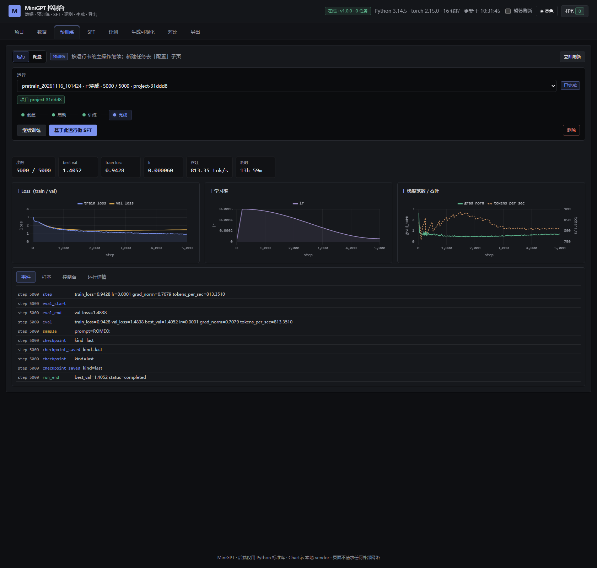
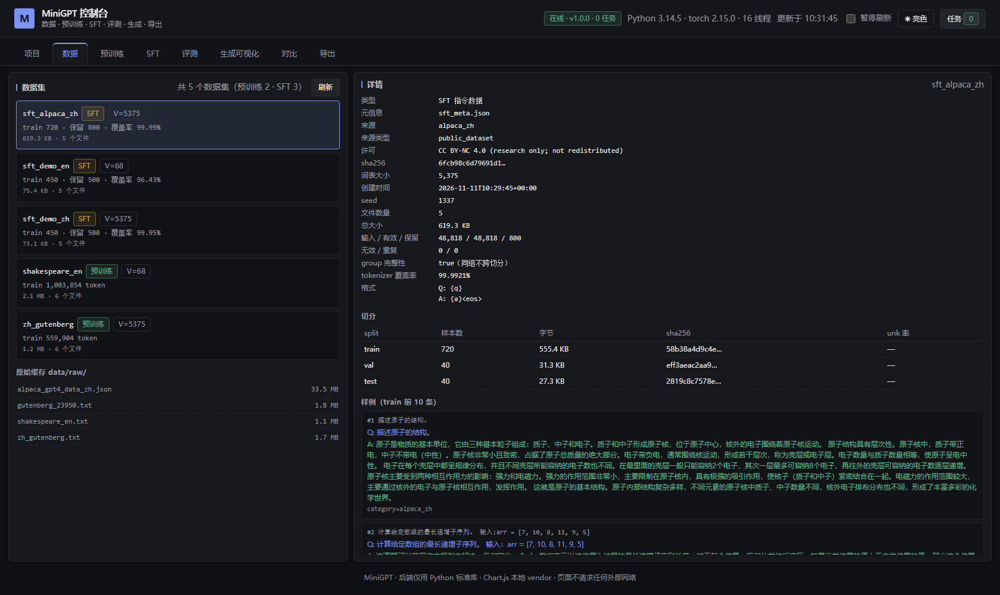
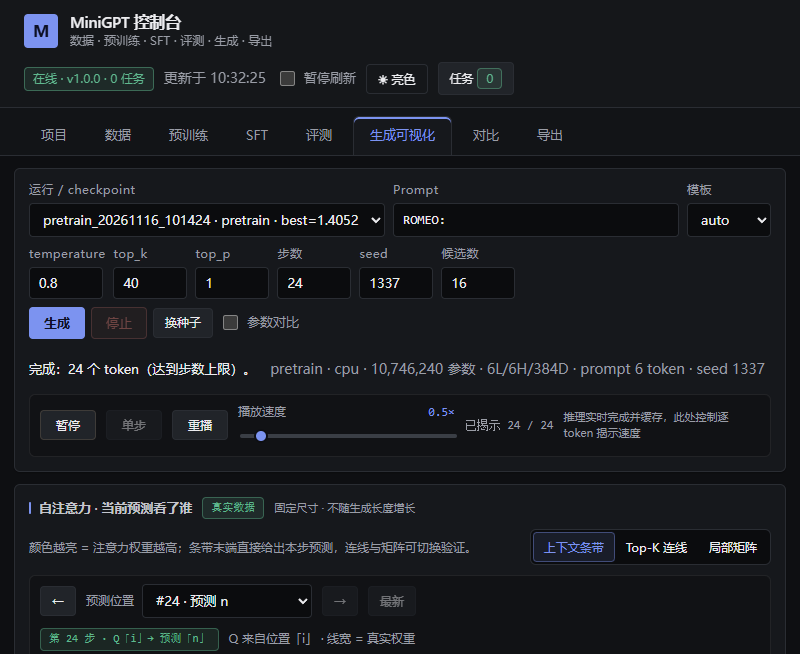

# MiniGPT

<p align="center"><a href="screenshots/dashboard.png"></a>　<a href="screenshots/stage-data.png"></a>　<a href="screenshots/spa-generate.png"></a><br><sub>点击放大：控制台总览 · 数据阶段 · 生成可视化</sub></p>

> 从零手写、可复现、可观察、可恢复、可扩展的**字符级小型 GPT 实验室**。
> 它**不是**训练好的聊天助手：仓库里的 demo 都是“方法演示”，默认只训练 **0.81M–1.5M** 参数的 debug 模型（英文 0.81M，中文 1.49M）。

- 唯一长手册（零基础、全部命令、原理、实验、排错）：**[MANUAL.md](MANUAL.md)**
- 施工合同（范围 / 验收 / 数据许可的唯一依据）：**[CONSTRUCTION.md](CONSTRUCTION.md)**
- 当前实现：PyTorch 全流程、中英文 demo、SFT 双数据、Web 面板、模型打包；Stage 2 纯 Python 后端已接入（tiny 训练 / `.mgckpt` / 无 torch 推理，见 MANUAL 第 31 章）。10M 参考配置已在本机 CPU 跑完一次 5000 步预训练（`runs/pretrain_20261116_101424`，约 14 小时，best val 1.4052），但未做 10M 的 SFT/评估；纯后端的大模型训练（0.81M/10M）不实用、不包含。

## 这是什么 / 不是什么

- 是：数据准备 → 字符级 tokenizer → 预训练 → SFT → 评估 → 对话的**完整可运行管线**；带 Web 控制面板、实验产物、断点恢复、扩展接口，适合学习“一次训练到底发生了什么”。
- 不是：通用助手、事实可靠的知识库、ChatGPT 替代品（字符级小模型常**语法像、语义错**），也不是 BPE/多模态/RLHF/分布式训练框架。

## 依赖政策（为什么装起来这么轻）

| 层 | 允许 | 说明 |
|---|---|---|
| AI / 训练 / 数据 | Python 标准库 + PyTorch | `requirements.txt` 钉住 `torch==2.15.0`（CPU 变体见 `requirements.lock.txt`） |
| Web 后端 / 测试 | 纯 Python 标准库 | 看板可运行在**没有 PyTorch** 的机器上 |
| 前端 | Chart.js 4.4.7 本地 vendor | 页面运行时不请求任何外部网络；无 CDN、无 Node 构建链 |

**不允许**引入 numpy、pytest、transformers、datasets 等依赖；测试用 `unittest`。运行环境建议 Python 3.11+（本机 3.14.5 实测通过）；未装 numpy 时 torch 启动的 `Failed to initialize NumPy` 警告属预期、无害。

## 五分钟快速开始（英文 debug 冒烟，CPU 可跑）

Windows PowerShell（本机已有 `.venv`，用其中的 Python；Linux/macOS 先按 MANUAL 第 4 章建 venv）。**一键上手**：`pwsh -NoProfile -File .\setup.ps1` —— 幂等：复用/创建 `.venv` → 安装依赖（CPU 源提示见脚本注释）→ 全量 unittest → 打印启动面板命令；失败即停。`-WhatIf` 干跑只打印步骤、不动环境。

```powershell
# 0. 确认 PyTorch 可用（应打印 2.x 版本）
.\.venv\Scripts\python.exe -c "import torch; print(torch.__version__)"

# 1. 下载并准备英文语料（约 1.1MB，自动校验 sha256；产物在 data/shakespeare_en/）
.\.venv\Scripts\python.exe prepare.py --dataset shakespeare_en

# 2. 迷你门禁：200 步缩小版训练，自动打印 [mini-run] PASS/FAIL（约 1 分钟）
.\.venv\Scripts\python.exe pretrain.py --preset debug_en --mini_run --run_name demo
#    产物：runs/demo-mini/{last.pt,metrics.csv,events.jsonl,minirun_report.json,...}

# 3. 看看模型此刻会续写什么（mini-run 权重；输出是随机/半成品文本，属正常）
.\.venv\Scripts\python.exe observe.py --checkpoint runs/demo-mini/last.pt --prompt "ROMEO:" --top_k 5

# 4. 启动 Web 控制面板（纯标准库；浏览器打开 http://127.0.0.1:8000/）
.\.venv\Scripts\python.exe dashboard.py
# 若看板解释器没装 PyTorch，指定训练解释器：--python .venv\Scripts\python.exe
```

`[mini-run] PASS` 的含义：初始 loss 接近 `ln(词表大小)`、梯度有限且非零、前 200 步 loss 下降 ≥0.2（详见 MANUAL 第 10 章）。

## 完整 demo（更久，细节与预期输出见 MANUAL 第 5–12 章）

```powershell
# 英文：3000 步预训练 → 300 步 SFT → 评估 → 对话
.\.venv\Scripts\python.exe pretrain.py --preset debug_en
.\.venv\Scripts\python.exe prepare_sft.py --source synthetic_en
.\.venv\Scripts\python.exe sft.py --preset sft_debug_en --init_from runs/<pretrain_run>/best.pt
.\.venv\Scripts\python.exe evaluate.py --checkpoint runs/<sft_run>/best.pt --split test
.\.venv\Scripts\python.exe chat.py --checkpoint runs/<sft_run>/best.pt --interactive

# 中文：单本 Gutenberg（书号 23950）+ 合成 SFT；用 SFT train 文本补词表，解决繁体语料/简体 SFT 的覆盖率
.\.venv\Scripts\python.exe prepare.py --dataset zh_gutenberg --books 23950
.\.venv\Scripts\python.exe prepare_sft.py --source synthetic_zh --tokenizer_dir data/zh_gutenberg
# 可选：再准备公开数据（CC BY-NC 仅缓存），把 data/sft_alpaca_zh/train.jsonl 一并加进 --vocab_extra
.\.venv\Scripts\python.exe prepare.py --dataset zh_gutenberg --books 23950 --vocab_extra data/sft_demo_zh/train.jsonl
.\.venv\Scripts\python.exe prepare_sft.py --source synthetic_zh --tokenizer_dir data/zh_gutenberg
.\.venv\Scripts\python.exe pretrain.py --preset debug_zh
.\.venv\Scripts\python.exe sft.py --preset sft_debug_zh --init_from runs/<zh_pretrain_run>/best.pt
```

`--vocab_extra` 用 SFT **train** 文本补词表（只补字、不进入预训练流；禁止传 SFT val/test），用来解决“繁体预训练语料 + 简体 SFT”的字符覆盖率问题（见 MANUAL 第 6.1 / 7.6 节）。当前参考运行把 `sft_demo_zh` 与 `sft_alpaca_zh` 的 train 文本都加入（V=5375、SFT 覆盖率 99.95%/99.99%）；只用 synthetic 也完整可跑，V 会小一些。

`runs/<run_id>/` 是每次训练的完整档案（配置、指标、事件、样本、checkpoint、报告），用看板的“运行”下拉框选择即可查看。

## 模型打包（给别人也能跑）
`best.pt` 是训练存档；`export.py` 会额外生成**可交换推理包**（训练报告的超参/数据指纹/指标/能力边界摘要自动写入模型卡）：

```powershell
.\.venv\Scripts\python.exe export.py --checkpoint runs/demo-en-sft/best.pt --output dist/minigpt-en-sft
# 产物：dist/minigpt-en-sft/（config/权重/weights.f32/tokenizer/模型卡/run.py/serve.py/MANIFEST）
#       dist/minigpt-en-sft.zip
.\.venv\Scripts\python.exe export.py --verify dist/minigpt-en-sft

# 对方机器：解压后只需要 Python；有 torch 用默认引擎，没有就用 --engine pure（纯标准库）
python dist/minigpt-en-sft/run.py --prompt "Hello" --max_new_tokens 40
python dist/minigpt-en-sft/run.py --engine pure --prompt "Hello" --max_new_tokens 20
python dist/minigpt-en-sft/serve.py --port 8000
```

包内用 `MANIFEST.json` 做 sha256 完整性校验；**不是** `transformers` 兼容格式，不能直接用 `AutoModel`/`AutoTokenizer` 加载（见 MANUAL 第 29 章）。源码更新后用 `python scripts/build_dist.py` 同步刷新 dist 副本的源码/模板/requirements 并重算 MANIFEST 哈希（权重与模型卡不动）；`--check` 只校验一致性，漂移退出码 1（守卫测试 `tests/test_dist_sync.py`）。训练报告 `training_report.json` 含超参/数据指纹/指标汇总/能力边界，导出时自动写入模型卡“训练摘要”。

## 数据与许可（重要）

- 合成 SFT 数据（`data/demo_sft_en.jsonl`、`data/demo_sft_zh.jsonl`）：仓库内确定性生成，**仅用于验证训练管道**，不代表真实能力。
- 英文 Tiny Shakespeare / 中文 Project Gutenberg：公版，自动下载/清洗并校验 sha256。
- 公开中文指令数据 `shibing624/alpaca-zh`：**CC BY-NC 4.0，仅研究用途；只缓存到本地，不随仓库分发**。

## 当前能力与边界

- 能跑：数据准备、字符级 tokenizer、预训练、SFT、val/test 评估、chat、Web 面板、checkpoint 恢复、模型包导出；前端是原生 ESM + SPA，按流水线阶段分页签（数据 / 预训练 / SFT / 评测 / 生成 / 导出；前三个之外均为只读扫描，生成页是逐 token 流式渲染 + 采样过程分解 + 分支），生成过程也可用 `chat.py --stream` / `visualize.py` 查看；Stage 2 纯后端已接入 CLI：`pretrain.py --preset pure_debug_en` 可训练 tiny 模型并写 `.mgckpt`，`chat.py`/`evaluate.py` 按后缀分派；bundle 也可用 `--engine pure` 无 torch 推理。
- 当前参考结果：英文 debug 预训练 best val **1.954**（test PPL 7.33）、中文 best val **5.078**（test PPL 175.16）、mini-run PASS；英文 10M 预训练 best val **1.4052**（未做 10M 的 SFT/评估）；SFT 英文 test exact_match=0、中文空回答率 0.64，只证明管道可用。
- 当前规模：0.81M debug 权重可训练/导出；10M（6 层/6 头/384 维/block 256）已在本机 CPU 完整预训练 5000 步（best val 1.4052，约 14 小时），但未做 10M 的 SFT/评估。
- 当前测试：`python -m unittest discover -s tests` 全过（501 项，以实际运行为准）；看板支持 新建任务 / 启动任务 / 停止任务 / 删除任务（原子操作）与表单/JSON 双模式配置。
- 当前不包含：纯后端的大模型训练（0.81M/10M 在纯 Python 下不可行）、严格 `transformers` 兼容、BPE/子词 tokenizer、HF Hub 上传。

## 工作区结构

```text
MiniGPT/
├─ README / MANUAL / CONSTRUCTION / LICENSE
├─ prepare... / pretrain... / chat... / visualize... / export... / dashboard...   CLI 入口
├─ minigpt/ 核心包（config/data/model/training/backends/web/pure）  web/ 前端
├─ bundle_templates/ 包内运行器模板   scripts/ demo 数据生成   tests/ 501 项
├─ data/ 语料与预处理产物   runs/ 实验档案   dist/ 模型包   screenshots/ 截图
```

- `data/`、`runs/`、`configs/`、`dist/` 是**运行产物**，不进 git；源码/文档/测试/demo JSONL 才进。`minigpt/cli/` + `pyproject.toml` 提供 `minigpt-pretrain` 等规范控制台入口（与根脚本同一实现，旧调用不变）。
- 重新生成数据 / 权重 / 包用 `prepare.py` / `pretrain.py` / `export.py`；无 `docs/` 长文目录，唯一长手册 `MANUAL.md`，计划 / 验收在 `CONSTRUCTION.md`。

